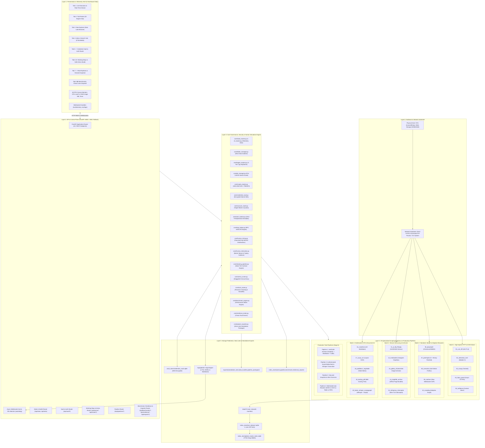
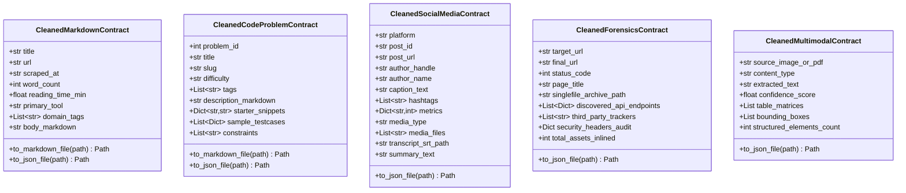

# 🕷️ Crawlers_testing: Enterprise Web Crawling, Anti-Bot Evasion & Multimodal Ingestion Platform

[](https://www.python.org/)
[](https://fastapi.tiangolo.com/)
[](https://playwright.dev/)
[-003B57?logo=sqlite&logoColor=white)](https://www.sqlite.org/fts5.html)
[](https://cryptography.io/)
[](#-zero-plaintext-security--cryptographic-vault)
[](#-master-system-regression--testing)
[](LICENSE)

An enterprise-grade, high-throughput web crawling, content harvesting, and multimodal extraction ecosystem engineered to defeat modern anti-bot protections (**Cloudflare Turnstile**, **Akamai Bot Manager**, **DataDome**, **PerimeterX**, and **AWS WAF**) while guaranteeing zero data loss, reproducible execution, and strict architectural governance.

Unifies **20 specialized crawling engines** across **7 technical scraping paradigms**, orchestrated by a **FastAPI control plane**, real-time **4-tier telemetry**, dual-tier **SQLite FTS5 search indexing**, and an **AES-256-GCM encrypted credential vault** with RFC 6238 2FA TOTP generation and zero-fill cookie shredding.

---

## 🏛️ Executive System Architecture

The platform operates across a fully coordinated 6-layer horizontal stack, maintaining strict data isolation, zero-leak credential protection, and reproducible pipeline execution:



---

## 🛠️ Master 20-Tool Capabilities Matrix

The platform integrates 20 specialized tools organized across four batch cohorts:

| ID | Tool Name | Batch | Scraping Mechanism | Primary Library / Binary | Default Action | Output Formats | Human Simulation Support |
|:--:|:---|:---:|:---|:---|:---|:---|:---:|
| **01** | `01_curl_cffi` | 1 | TLS / JA3 / JA4 Impersonation | `curl_cffi` (BoringSSL) | `scrape_for_leetcode` | JSON, HTML, Markdown | **Yes** (Pacing, Backoff Jitter) |
| **02** | `02_selectolax_lxml` | 1 | C-Engine DOM Slicers | `selectolax` (Modest) + `lxml` | `scrape_for_leetcode` | JSON, HTML | **No** (High-Speed Local Parser) |
| **03** | `03_scrapy` | 1 | Industrial Framework | `scrapy` (Twisted) | `catalog_crawl` | JSONLines, CSV | **Yes** (Autothrottle, Delays) |
| **04** | `04_httpx_parsel` | 1 | Async HTTP/2 + Selectors | `httpx` + `parsel` | `scrape_for_leetcode` | JSON, HTML, Markdown | **Yes** (Async Delays, Jitter) |
| **05** | `05_trafilatura` | 1 | Content & Boilerplate Slicer | `trafilatura` | `article_extract` | Markdown, TXT, JSON | **No** (Local Content Slicer) |
| **06** | `06_playwright` | 2 | Standard Browser Automation | `playwright` (Chromium) | `secured_page_origin` | HTML, HAR, PNG, JSON | **Yes** (Bezier Mouse, Typing) |
| **07** | `07_patchright` | 2 | C++ Patched Stealth Browser | `patchright` | `stealth_login_extract` | HTML, HAR, JSON | **Yes** (Native Pointer, Hesitation) |
| **08** | `08_camoufox` | 2 | Firefox Anti-Detect Engine | `camoufox` | `camoufox_crawl` | HTML, JSON | **Yes** (Canvas/Font Entropy) |
| **09** | `09_nodriver` | 2 | Raw CDP WebSocket Engine | `nodriver` | `nodriver_fetch` | HTML, JSON | **Yes** (Async CDP Cadence) |
| **10** | `10_scrapling` | 2 | Adaptive Heuristic Relocator | `scrapling` | `adaptive_scrape` | JSON, HTML | **Yes** (Smart Fallback Retries) |
| **11** | `11_yt_dlp_ffmpeg` | 3 | Stream Demuxer & Transcoder | `yt-dlp` + `ffmpeg` | `stream_capture` | MP4, WAV, JSON | **Yes** (Chunk Pacing) |
| **12** | `12_instaloader` | 3 | Social Graph Archiver | `instaloader` | `profile_archive` | JSON, JPG, MP4 | **Yes** (Session Burst Delay) |
| **13** | `13_gallery_dl` | 3 | Multi-Platform Image Archiver | `gallery-dl` | `gallery_scrape` | JPG, PNG, JSON | **Yes** (Rate-Limit Backoff) |
| **14** | `14_singlefile_archive` | 3 | Offline Page Bundler | `single-file-cli` | `offline_snapshot` | Inlined HTML, JSON | **Yes** (Page Dwell Time) |
| **15** | `15_mitmproxy_interceptor` | 3 | Deep Wire TLS Interceptor | `mitmproxy` | `traffic_intercept` | HAR, JSON, Raw Flows | **Yes** (Passive Interception) |
| **16** | `16_crawl4ai` | 4 | AI/LLM-Optimized Extractor | `crawl4ai` | `markdown_harvest` | Markdown, JSON | **Yes** (Prerender Wait, Pacing) |
| **17** | `17_surya_ocr` | 4 | Multilingual Document OCR | `surya-ocr` (PyTorch) | `ocr_extract` | JSON, Text, Layout BBoxes | **No** (Local GPU/CPU Inference) |
| **18** | `18_paddleocr_img2table` | 4 | Table Grid Extractor | `paddleocr` + `img2table` | `table_extract` | CSV, Excel, 3D Matrix JSON | **No** (Local Vision Pipeline) |
| **19** | `19_docling_pdf` | 4 | IBM Document Layout Parser | `docling` | `pdf_parse` | JSON, Docling Tree, Markdown | **No** (Local Document AI) |
| **20** | `20_faster_whisper_scrapegraph` | 4 | Audio Transcription & Graph | `faster-whisper` + graph | `audio_transcribe` | SRT, VTT, JSON Graph | **No** (Local Model Inference) |

---

## ⚙️ The 3 Working Ways Architecture

`Crawlers_testing` replaces ad-hoc scraping scripts with three standardized architectural execution paradigms:

### Working Way 1: Universal Human Mode (`core/human_timing.py` & `core/human_interaction.py`)
Eliminates fingerprinting through authentic human simulation rather than static delays:
- **Statistical Delay Models:** Delays drawn from Gaussian distributions ($\mu=1.5\text{s}, \sigma=0.3\text{s}$), Log-Normal response dwell times ($\text{median}=2.4\text{s}, \sigma=0.5$), and Exponential Backoff with decorrelated full jitter.
- **Biomechanical Kinematics:** Generates cubic Bezier mouse trajectories parameterized by Fitts' Law velocity easing ($t \mapsto t^2(3 - 2t)$), randomized perpendicular normal offsets, and biological micro-tremor jitter.
- **Realistic Keystroke Cadence:** Simulates variable WPM typing cadences (60–90 WPM) with QWERTY adjacent-key typos, cognitive hesitation pauses at word boundaries, and backspace correction sequences.

### Working Way 2: Safe Arena Mode (`core/arena_runner.py`)
Enables objective, multi-tool competitive benchmarking on a single target URL:
- **Staggered Concurrency:** Launches candidate tools sequentially with anti-ban staggered delay intervals (0.5s–3.0s) to prevent IP throttling or simultaneous rate-limit trips.
- **Deep Process & Telemetry Monitoring:** Captures per-tool latency percentiles, memory RSS footprint delta, ingested raw bytes, cleaned output bytes, and domain metrics.
- **Multi-Vector Scoring:** Ranks candidates on Speed (35%), Data Richness (30%), Stealth (25%), and Memory Efficiency (10%), electing an overall winner.
- **Automated Reporting:** Generates persistent comparative reports in both JSON and human-readable Markdown inside `index_store/arena_reports/`.

### Working Way 3: Precision Task Router (`core/task_router.py`)
Coordinates multi-stage tool pipelines with explicit artifact hand-offs and fallback execution:
- **Pipeline Stage Contracts:** Defines explicit predecessor-to-successor dependency trees (`input_from_stage`, `input_artifact_keys`).
- **Dynamic Contextual Handoffs:** Ingests raw payloads from fast network scrapers (e.g. `01_curl_cffi`), transforms artifacts through specialized cleaners (e.g. `16_crawl4ai`), and extracts downstream assets.
- **Canonical Recipes:** Out-of-the-box recipes for High-Speed Web Extraction to Markdown, Media Stream Capture to Whisper Transcripts, and Browser Page Snapshots to OCR Forensics.

---

## 🥈 Data Lake Silver-Tier Contract Enforcement (`core/cleaning_pipeline.py`)

All transformed assets saved to `data/<tool_id>/<action>/<date>/<run_id>/cleaned/` must conform strictly to standardized Pydantic schemas enforced by `core/cleaning_pipeline.py`. Arbitrary unvalidated dumps are strictly blocked by Rule 8.



- **Cryptographic Digest Integrity:** Every cleaned asset is hashed with SHA-256 and cataloged into `run_manifest.json`.
- **Dual Output Serialization:** Contracts support native serialization to both structured JSON and GitHub-flavored CommonMark with YAML frontmatter headers.

---

## 🧪 The 4 Real-World Production Pipelines (`pipelines/`)

Stage 5 introduces four end-to-end production pipelines demonstrating multi-engine collaboration under authentic network conditions:

### Pipeline 1: LeetCode Problem Archiver (`pipelines/01_leetcode_archiver.py`)
- **Objective:** Harvests problem catalog indexes, problem statements, starter codes, and test cases without triggering Cloudflare challenges.
- **Chained Engines:** `01_curl_cffi` (BoringSSL JA3/JA4 impersonation) $\to$ GraphQL query resolution $\to$ HTML-to-CommonMark normalization $\to$ `CleanedCodeProblemContract`.
- **Deliverables:** Problem catalog JSON, CommonMark problem statement cards with constraints, multi-language code templates (Python, JavaScript, C++, Java), and test cases.

### Pipeline 2: Authenticated Social Media Reel & Whisper Pipeline (`pipelines/02_social_media_pipeline.py`)
- **Objective:** Securely authenticates against walled-garden platforms, demuxes media streams, and synthesizes timestamped transcripts.
- **Chained Engines:** `core/auth_injector.py` (session leasing) $\to$ `11_yt_dlp_ffmpeg` (HLS/DASH chunk capture & 16kHz WAV extraction) $\to$ `20_faster_whisper` (INT8 transcription) $\to$ `CleanedSocialMediaContract`.
- **Deliverables:** High-definition video (`.mp4`), 16kHz mono audio (`.wav`), timestamped subtitle transcript (`.srt`), and engagement metadata JSON.

### Pipeline 3: Secured Page Snapshot & Wire Forensics (`pipelines/03_secured_snapshot_forensics.py`)
- **Objective:** Creates forensic-grade, immutable single-file offline snapshots and maps all network origin traffic and backend API endpoints.
- **Chained Engines:** `07_patchright` (stealth browser navigation) $\to$ `14_singlefile_archive` (Base64 resource inliner) $\to$ `15_mitmproxy_interceptor` (wire inspection) $\to$ `CleanedForensicsContract`.
- **Deliverables:** Fully self-contained offline HTML snapshot, HAR network transaction trace, discovered API endpoints list, third-party tracker audit, and security headers evaluation.

### Pipeline 4: Smart Multimodal Auto-Resolver (`pipelines/04_multimodal_auto_resolver.py`)
- **Objective:** Intelligently classifies multimodal targets and dispatches optimal visual extractors (DOM text vs OCR vs Table vs PDF).
- **Chained Engines:** Modality classifier $\to$ `17_surya_ocr` (visual text) / `18_paddleocr_img2table` (table matrices) / `19_docling_pdf` (document tree) $\to$ `CleanedMultimodalContract`.
- **Deliverables:** 3D table matrices (tables $\to$ rows $\to$ cells), OCR bounding boxes with confidence scores, structured document layout trees, and plain-text summaries.

---

## 🖥️ Antigravity Control Center Dashboard (8 Tabs)

The platform provides an integrated, dark-mode single-page application hosted at `http://127.0.0.1:8000`:

```
+===================================================================================================================+
|  HUD BAR: [Stage: Master Verification]  [Step: Final Audit]  [Elapsed: 14.2s]  [Prog: 100%]  [Workers: 4]         |
|  Canvas CPU Monitor: [||||||||||  12%]      Canvas RAM Monitor: [||||||||||||||||  196 MB]                        |
+===================================================================================================================+
| [Tab 1: Live Execution] [Tab 2: Tool Roster] [Tab 3: Data Explorer] [Tab 4: Index & Search]                       |
| [Tab 5: 🔐 Credential Vault] [Tab 6: ⚙ Working Ways & Arena] [Tab 7: 🧪 Real Pipelines] [Tab 8: 📊 Benchmarks]    |
+===================================================================================================================+
```

| Tab | Name | Keyboard Shortcut | Primary Features & Operational Subviews |
|:---:|:---|:---:|:---|
| **Tab 1** | **Live Execution** | `Alt + 1` | Real-time WebSocket log stream (`/ws/logs`), milestone timeline, process tree monitor (`psutil`), and active worker PIDs. |
| **Tab 2** | **Tool Roster** | `Alt + 2` | Execution cards for all 20 crawling engines with custom target URL inputs, action selectors, and live JSON response viewers. |
| **Tab 3** | **Data Explorer** | `Alt + 3` | Hierarchical filesystem explorer browsing Bronze (`raw/`), Silver (`cleaned/`), and provenance manifests (`run_manifest.json`). |
| **Tab 4** | **Index & Search Hub** | `Alt + 4` | Okapi BM25 ranked full-text queries over `global_master_index.sqlite` with keyword highlighting and 20 tool database inspection. |
| **Tab 5** | **🔐 Credential Vault** | `Alt + 5` | 6-card KPI ribbon, masked account inventory, target coverage matrix, on-demand RFC 6238 2FA TOTP generator, and session recorder. |
| **Tab 6** | **⚙ Working Ways & Arena** | `Alt + 6` | Human Simulation Studio (typing/mouse sliders), Safe Arena Tournament Studio (staggered concurrency), and Task Router Chaining Studio. |
| **Tab 7** | **🧪 Real Pipelines** | `Alt + 7` | Control planes for all 4 task pipelines, multi-format deliverable viewer (Markdown, Audio, HTML, Code, OCR), and Silver contract matrix. |
| **Tab 8** | **📊 Benchmarks & Lab** | `Alt + 8` | Master Benchmark Lab (radar spider chart), Chaos & Resilience Stress Lab (fault injection), and Standalone Project Exporter. |

---

## 📊 Master Benchmarks, Chaos Lab & Standalone Exporter (`core/`)

Stage 6 completes the benchmarking, chaos resilience, and standalone deployment infrastructure:

### 1. Performance Matrix Engine (`core/benchmark_engine.py`)
- **Multi-Iteration Statistical Latency:** NIST quantile interpolation for $p50$, $p90$, $p99$, mean, min, max, and standard deviation.
- **Process Footprint Telemetry:** RSS memory delta ($\Delta\text{RAM}$ in MB) and peak CPU utilization % captured via `psutil`.
- **Data Yield Efficiency:** Evaluates $\text{Yield} = \frac{\text{Cleaned Output Bytes}}{\text{Raw Ingested Bytes}}$ to measure boilerplate-stripping efficiency.
- **Composite Quality Scoring:**
  $$\text{Composite} = (0.35 \times \text{Speed}) + (0.30 \times \text{Richness}) + (0.25 \times \text{Stealth}) + (0.10 \times \text{Memory})$$

### 2. Chaos & Resilience Stress Lab (`core/resilience_tester.py`)
- **Ephemeral Chaos Server:** Localhost HTTP testbed injecting deterministic network and server faults:
  - `HTTP 429 Rate Limiting:` Verifies exponential backoff jitter and account quarantine.
  - `Cloudflare Turnstile Marker:` Validates stealth browser bypass fallbacks.
  - `Scrambled DOM Mutations:` Injects obfuscated CSS classes to test heuristic auto-healing selectors.
  - `Socket Disconnects & Latency Spikes:` Validates timeout guards and clean socket recovery.
  - `Contract Schema Fuzzing:` Verifies Pydantic validation errors are safely trapped without process crashes.

### 3. Standalone Project Exporter (`core/project_exporter.py`)
- **Standalone Zero-Monorepo Scrapers:** Packages individual tools (e.g. `01_curl_cffi`, `06_playwright`) into standalone folders with independent CLI runners, minimal `requirements.txt`, and compatibility shims (`compat.py`).
- **Encrypted Data Lake Bundling:** Packages cleaned Silver-Tier artifacts into cryptographically signed ZIP archives with SHA-256 manifests, strictly enforcing zero-leak filters (excluding `.env`, `*.sqlite`, `.key`, temporary cookies).
- **Dockerized Pipeline Microservices:** Generates containerized packages with `Dockerfile`, CLI runners, and pinned dependencies for single-command Docker deployment.

---

## 🚀 Quickstart & Developer Guide

### 1. Prerequisites
- **Operating System:** Windows 10/11, macOS, or Linux.
- **Python:** Version 3.11, 3.12, or 3.14.
- **Git:** Installed and on system PATH.

### 2. Clone & Virtual Environment Setup
```powershell
# Clone repository
git clone https://github.com/spdwivedi/Crawlers_testing.git
cd Crawlers_testing

# Create and activate Python virtual environment
python -m venv .venv
.\.venv\Scripts\Activate.ps1    # Windows PowerShell
# source .venv/bin/activate     # Linux / macOS

# Install core dependencies
pip install -r requirements.txt

# Install browser automation binaries
playwright install chromium
patchright install chromium
```

### 3. Automatic Master Key Initialization
The cryptographic engine auto-initializes upon first execution:
- Generates a cryptographically secure 256-bit `VAULT_MASTER_KEY` and 128-bit `VAULT_KDF_SALT`.
- Persists secrets to `.env` (strictly ignored by Git).
- Creates a safe `.env.example` template with placeholder keys for team collaboration.

### 4. Launching the Control Center Dashboard
```powershell
# Launch FastAPI Control Plane & Telemetry Server (:8000 or :8001 fallback)
.\.venv\Scripts\python.exe -m uvicorn backend.app:app --host 127.0.0.1 --port 8000

# Development Mode with Selective Reload (Prevents reload loops)
.\.venv\Scripts\python.exe -m uvicorn backend.app:app --host 127.0.0.1 --port 8000 --reload --reload-dir backend
```
Open your browser to: **[http://127.0.0.1:8000](http://127.0.0.1:8000)** (or `http://127.0.0.1:8001`).

### 5. Running Operations from the CLI

#### A. Execute Safe Arena Multi-Tool Tournament
```powershell
.\.venv\Scripts\python.exe core/arena_runner.py --tools 01_curl_cffi,04_httpx_parsel,06_playwright --url "https://quotes.toscrape.com"
```

#### B. Execute Production Task Pipeline 1 (LeetCode Archiver)
```powershell
.\.venv\Scripts\python.exe pipelines/01_leetcode_archiver.py --slug "two-sum" --human-mode
```

#### C. Run Master 20-Tool Performance Benchmark Battery
```powershell
.\.venv\Scripts\python.exe core/benchmark_engine.py --tools 01_curl_cffi,04_httpx_parsel --iterations 3 --url "https://quotes.toscrape.com"
```

#### D. Run Chaos & Anti-Bot Fault-Injection Drills
```powershell
.\.venv\Scripts\python.exe core/resilience_tester.py --full-battery
```

#### E. Export Standalone Scraper Package or Data Lake Bundle
```powershell
# Package 01_curl_cffi into a standalone zero-monorepo project
.\.venv\Scripts\python.exe -c "from core.project_exporter import get_project_exporter; get_project_exporter().export_standalone_tool('01_curl_cffi', output_format='both')"

# Bundle Silver-Tier Cleaned Data Lake into a signed ZIP
.\.venv\Scripts\python.exe -c "from core.project_exporter import get_project_exporter; get_project_exporter().bundle_data_lake(scope='cleaned')"
```

#### F. Run Master System Regression Verification Suite
```powershell
.\.venv\Scripts\python.exe core/verify_master_system.py
```

---

## 🔒 Zero-Plaintext Security & Cryptographic Vault

`Crawlers_testing` implements military-grade credential protection:

1. **AES-256-GCM + PBKDF2 (600,000 iterations):** All passwords, cookies, tokens, and 2FA seeds are encrypted with a 256-bit symmetric key derived via PBKDF2-HMAC-SHA256 (OWASP recommended baseline against GPU brute-force).
2. **Row-Binding Cryptographic Proof:** Every encryption call binds the ciphertext to its specific `account_id` via Associated Data (AD). If an attacker attempts to copy ciphertext between rows in the database, decryption immediately fails with `ValueError: GCM tag mismatch`, preventing row-swapping injection attacks.
3. **Blind Index Hashing:** Account deduplication is performed in $O(1)$ time via deterministic HMAC-SHA256 hashes ($\text{BlindHash} = \text{HMAC}(Key, \text{platform} \mathbin{\Vert} \text{":"} \mathbin{\Vert} \text{username})$) without storing plaintext usernames.
4. **Ephemeral Cookie Shredding:** Tools requiring physical Netscape `.cookies.txt` files receive dynamically generated temporary files. Upon context exit, `AuthInjector` overwrites the file bytes with `0x00`, flushes the disk cache via `os.fsync()`, and unlinks the file, leaving zero forensic trace on physical media.
5. **Git Pre-Commit Secret Guard:** Automated scanner in `core/git_manager.py` inspects staged files before every Git commit, intercepting `.env`, `*.sqlite`, raw cipher tokens (`v1:aes256gcm:`), and private keys.

---

## 📜 Mandatory Antigravity Governance Protocol

Development in this repository is strictly regulated by the **9 Antigravity Governance Rules** specified in [`GEMINI.md`](GEMINI.md):
- **Rule 1 (Live State Telemetry):** Every task must register start/update/complete state in `logs/global/live_state.json` via `core/cli_tracker.py`.
- **Rule 2 (4-Tier Logging):** Every diagnostic event is appended to all four log tiers simultaneously via `core/logger_engine.py` (Global JSONL, Global MD, Stage Log, Action Run Log).
- **Rule 3 (Strict Data Isolation):** All scrape output is strictly isolated into `data/<tool>/<action>/<date>/run_<id>/` containing `raw/`, `cleaned/`, `logs/`, and `run_manifest.json`.
- **Rule 4 (Atomic Git Commits):** Every development action concludes with a categorized Git commit (`[SCAFFOLD]`, `[TOOL-INSTALL]`, `[UPDATE]`, `[FIX]`, `[RUN-LOG]`, `[DOCS]`).
- **Rule 5 (Auto-Indexing):** Completing an action run automatically updates `<tool_id>.sqlite` and federates records into `global_master_index.sqlite` (FTS5).
- **Rule 6 (Zero-Plaintext Security):** Plaintext credentials, `.env`, and `vault_store/*.sqlite*` must never be logged or committed to Git.
- **Rule 7 (Human Simulation & Timing Discipline):** Pacing delays follow `core/human_timing.py` statistical distributions (Gaussian, Log-Normal, Exponential Backoff Jitter).
- **Rule 8 (Data Lake Silver Tier Contract Enforcement):** All transformed files saved into `cleaned/` must strictly validate against Pydantic schema contracts in `core/cleaning_pipeline.py`.
- **Rule 9 (Benchmark Traceability & Non-Destructive Testing):** All benchmark and chaos runs must record reproducible telemetry (p50/p90/p99, RAM delta, CPU %, yield, stealth) into structured reports.

---

## 📄 License
This project is licensed under the MIT License — see the [LICENSE](LICENSE) file for details.
