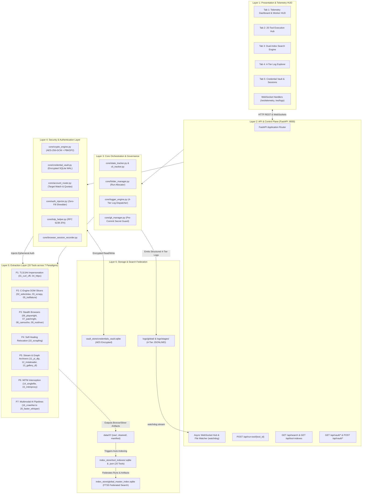

# 🕷️ Crawlers_testing: Enterprise Web Crawling, Anti-Bot Evasion & Multimodal Ingestion Platform

[](https://www.python.org/)
[](https://fastapi.tiangolo.com/)
[](https://playwright.dev/)
[-003B57?logo=sqlite&logoColor=white)](https://www.sqlite.org/fts5.html)
[](https://cryptography.io/)
[](#-zero-plaintext-security--cryptographic-vault)
[](LICENSE)

An enterprise-grade, high-throughput web crawling, content harvesting, and multimodal extraction ecosystem engineered to defeat modern anti-bot protections (**Cloudflare Turnstile**, **Akamai Bot Manager**, **DataDome**, **PerimeterX**, and **AWS WAF**) while guaranteeing zero data loss, reproducible execution, and strict governance.

Unifies **20 specialized crawling engines** across **7 technical scraping paradigms**, orchestrated by a **FastAPI control plane**, real-time **4-tier telemetry**, dual-tier **SQLite FTS5 search indexing**, and an **AES-256-GCM encrypted credential vault** with RFC 6238 2FA TOTP generation and zero-fill cookie shredding.

---

## 🏛️ System Architecture

The platform operates across six strictly bounded horizontal tiers:



---

## 🛠️ Master 20-Tool Capabilities Matrix

The platform integrates 20 specialized tools organized across four batch cohorts:

| ID | Tool Name | Batch | Paradigm / Mechanism | Primary Dependency | Key Capabilities & Primary Use Case |
|:--:|:---|:---:|:---|:---|:---|
| **01** | `01_curl_cffi` | 1 | HTTP / TLS Impersonation | `curl_cffi` (BoringSSL) | Bypasses Cloudflare JA3/JA4 TLS fingerprinting & HTTP/2 frame ordering |
| **02** | `02_selectolax_lxml` | 1 | C-Engine DOM Slicers | `selectolax` (Modest C) | Ultra-fast HTML parsing (10k+ pages/sec) avoiding Python object allocations |
| **03** | `03_scrapy` | 1 | Industrial Framework | `scrapy` (Twisted) | Concurrent sitemap and catalog crawls with built-in item pipelines |
| **04** | `04_httpx_parsel` | 1 | Async HTTP/2 + Selectors | `httpx` + `parsel` | High-concurrency async API harvesting with Scrapy-grade CSS/XPath |
| **05** | `05_trafilatura` | 1 | Content & Boilerplate Slicer | `trafilatura` | Density-based editorial text extraction, stripping ads and cookie notices |
| **06** | `06_playwright` | 2 | Standard Browser Automation | `playwright` (Chromium) | Full JavaScript SPA rendering, synthetic user input, and HAR network traces |
| **07** | `07_patchright` | 2 | C++ Patched Stealth Browser | `patchright` | Unhooks `window.cdc_*` and CDP leaks at binary compilation level |
| **08** | `08_camoufox` | 2 | Firefox Anti-Detect Engine | `camoufox` | Randomizes canvas noise, WebGL renderers, and OS fonts per execution run |
| **09** | `09_nodriver` | 2 | Raw CDP WebSocket Engine | `nodriver` | Eliminates webdriver binaries; communicates via raw WebSocket frames |
| **10** | `10_scrapling` | 2 | Adaptive Heuristic Relocator | `scrapling` | Auto-heals broken selectors via semantic graph distance when CSS classes churn |
| **11** | `11_yt_dlp_ffmpeg` | 3 | Stream Demuxer & Transcoder | `yt-dlp` + `ffmpeg` | Demuxes HLS (`.m3u8`) and DASH (`.mpd`) video streams from 1,000+ sites |
| **12** | `12_instaloader` | 3 | Social Graph Archiver | `instaloader` | Interfaces with Instagram GraphQL endpoints to harvest posts, reels, and stories |
| **13** | `13_gallery_dl` | 3 | Multi-Platform Image Archiver | `gallery-dl` | Bulk media downloader for 200+ visual communities (Reddit, Pinterest, Twitter) |
| **14** | `14_singlefile_archive` | 3 | Offline Page Bundler | `single-file-cli` | Inlines all fonts, CSS, and images into Base64 for immutable legal/forensic HTML |
| **15** | `15_mitmproxy_interceptor`| 3 | Deep Wire TLS Interceptor | `mitmproxy` | In-memory TLS proxy intercepting hidden XHR/GraphQL streams before DOM rendering |
| **16** | `16_crawl4ai` | 4 | AI/LLM-Optimized Extractor | `crawl4ai` | Converts web pages into token-efficient, LLM-ready clean Markdown chunks |
| **17** | `17_surya_ocr` | 4 | Multilingual Document OCR | `surya-ocr` (PyTorch) | 90+ language OCR with reading-order detection and document layout analysis |
| **18** | `18_paddleocr_img2table` | 4 | Table Grid Extractor | `paddleocr` + `img2table` | Detects cell boundaries in raster images and converts balance sheets into CSV/Excel |
| **19** | `19_docling_pdf` | 4 | IBM Document Layout Parser | `docling` | Parses complex multi-column PDFs, footnotes, and formulas into structured JSON |
| **20** | `20_faster_whisper_scrapegraph` | 4 | Audio Transcription & Graph | `faster-whisper` + graph | 4x faster local Whisper speech-to-text + ScrapeGraph knowledge graph synthesis |

---

## 🖥️ Antigravity Control Center Dashboard

The platform includes a responsive, dark-mode single-page application hosted directly on `http://127.0.0.1:8000`:

```
+==================================================================================================+
|  HUD BAR: [Stage 3: Credential Vault]  [Step 3.6]  [Tool: backend]  [Elapsed: 12.4s]  [Prog: 100%]|
|  Canvas CPU Monitor: [||||||||||  14%]   Canvas RAM Monitor: [||||||||||||||||  184 MB]           |
+==================================================================================================+
|  [Tab 1: Telemetry] [Tab 2: Tools] [Tab 3: Search] [Tab 4: Logs] [Tab 5: 🔐 Credential Vault]   |
+==================================================================================================+
```

- **Top Sticky HUD Bar:** Real-time 60 FPS Canvas displays showing active task, subtask, elapsed seconds, worker PIDs, and active CPU/RAM consumption.
- **Tab 1: Telemetry Dashboard & Worker Monitor:** Visual timeline of execution milestones, process tree inspection, and system health dials.
- **Tab 2: 20-Tool Execution Hub:** Parameter configuration panels for all 20 engines with live JSON response inspectors.
- **Tab 3: Dual-Index Search Engine:** Full-text keyword and phrase search across all scraped artifacts and logs powered by SQLite FTS5 with Okapi BM25 ranking and keyword highlighting.
- **Tab 4: Real-Time 4-Tier Log Streamer:** Virtual-scrolling live log grid powered by OS kernel filesystem notifications (`watchdog`) and WebSockets (`/ws/logs`).
- **Tab 5: 🔐 Credential Vault & Session Manager:** Encrypted account inventory, 6-card KPI ribbon, private-target follower coverage matrix, on-demand 2FA TOTP generator with countdown bars, 50-account bulk seed importer, and live 20-tool auth injection sandbox.

---

## 🚀 Quickstart Guide

### 1. Prerequisites
- **Operating System:** Windows 10/11, macOS, or Linux.
- **Python:** Version 3.11, 3.12, or 3.14.
- **Git:** Installed and on system PATH.

### 2. Clone & Environment Setup
```powershell
# Clone the repository
git clone https://github.com/<your-username>/Crawlers_testing.git
cd Crawlers_testing

# Create and activate Python virtual environment
python -m venv .venv
.\.venv\Scripts\Activate.ps1    # On Windows PowerShell
# source .venv/bin/activate     # On Linux / macOS

# Install core dependencies
pip install -r requirements.txt

# Install browser automation binaries
playwright install chromium
patchright install chromium
```

### 3. Automatic Master Key Initialization
The cryptographic engine auto-initializes upon first execution:
- Generates a cryptographically secure 256-bit `VAULT_MASTER_KEY` and 128-bit `VAULT_KDF_SALT`.
- Persists secrets to `.env` (which is strictly ignored by Git).
- Creates a safe `.env.example` template with placeholder keys for team collaboration.

### 4. Launching the Control Center
```powershell
# Start the FastAPI server (:8000)
.\.venv\Scripts\python.exe -m uvicorn backend.app:app --host 127.0.0.1 --port 8000
```
Open your browser to: **[http://127.0.0.1:8000](http://127.0.0.1:8000)**.

### 5. Running a Quick Smoke Test
```powershell
# Run 01_curl_cffi directly from the CLI
.\.venv\Scripts\python.exe tools/01_curl_cffi/adapter.py --url "https://leetcode.com/problems/two-sum/" --action "scrape_for_leetcode"

# Run the master Stage 3 verification test suite
.\.venv\Scripts\python.exe core/verify_step_3_6.py
```

---

## 🔒 Zero-Plaintext Security & Cryptographic Vault

`Crawlers_testing` implements military-grade credential protection:

1. **AES-256-GCM + PBKDF2 (600,000 iterations):** All passwords, cookies, tokens, and 2FA seeds are encrypted with a 256-bit symmetric key derived via PBKDF2-HMAC-SHA256 (OWASP recommended baseline against GPU brute-force).
2. **Row-Binding Cryptographic Proof:** Every encryption call binds the ciphertext to its specific `account_id` via Associated Data (AD). If an attacker attempts to copy ciphertext between rows in the database, decryption immediately fails with `ValueError: GCM tag mismatch`, preventing row-swapping injection attacks.
3. **Blind Index Hashing:** Account deduplication is performed in $O(1)$ time via deterministic HMAC-SHA256 hashes ($\text{BlindHash} = \text{HMAC}(Key, \text{platform} \mathbin{\Vert} \text{":"} \mathbin{\Vert} \text{username})$) without storing plaintext usernames.
4. **Ephemeral Cookie Shredding:** Tools requiring physical Netscape `.cookies.txt` files receive dynamically generated temporary files. Upon context exit, `AuthInjector` overwrites the file bytes with `0x00`, flushes the disk cache via `os.fsync()`, and unlinks the file, leaving zero forensic trace on physical media.
5. **Git Pre-Commit Secret Guard:** Automated scanner in `core/git_manager.py` inspects staged files before every Git commit, intercepting `.env`, `*.sqlite`, raw cipher tokens (`v1:aes256gcm:`), and private keys.

---

## 📖 Documentation Ecosystem

Comprehensive, textbook-grade documentation is maintained in [`docs/`](docs/):

```
docs/
├── 01_architecture_and_flows/
│   ├── 01_system_architecture_overview.md   # 6-Layer Architecture & 7 Scraping Paradigms
│   ├── 02_dfd_level_0_1_2.md                # Context, Subsystem & Granular Level 2 DFDs
│   ├── 03_state_diagrams.md                 # Telemetry, Account Quarantine & Run FSMs
│   └── 04_process_and_sequence_flows.md     # E2E Execution & Ephemeral Shredding Sequences
├── 02_database_and_security/
│   ├── 01_database_schemas_and_er_diagrams.md# Two-Tier Topology, PRAGMAs & 3x ER Diagrams
│   ├── 02_fts5_search_and_indexing_specification.md # Inverted Index, Unicode61 & BM25 Math
│   └── 03_cryptography_and_zero_leak_security_spec.md # AES-GCM Row-Binding Proofs & TOTP
├── 03_folder_and_file_reference/
│   ├── 01_folder_structure_and_data_taxonomy.md # Bronze/Silver/Gold & Manifest Contracts
│   ├── 02_core_and_api_file_reference.md    # Core OOP Classes, REST Endpoints & WebSockets
│   └── 03_20_tools_adapter_catalog.md       # 20-Row Matrix & 20 Deep-Dive Profiles
└── 04_operations_and_guides/
    ├── 01_developer_operations_and_runbook.md # Server Ops, CLI Commands & Regression Testing
    ├── 02_troubleshooting_and_resilience_guide.md # Windows File Locks & Anti-Bot Recovery
    └── 03_documentation_master_index.md     # Cross-Referenced Knowledge Index & Graph
```

---

## 📜 Mandatory Antigravity Governance Protocol

Development in this repository is strictly regulated by the **6 Antigravity Governance Rules** specified in [`GEMINI.md`](GEMINI.md):
- **Rule 1 (Live State Telemetry):** Every task must register start/update/complete state in `logs/global/live_state.json` via `core/cli_tracker.py`.
- **Rule 2 (4-Tier Logging):** Every diagnostic event is appended to all four log tiers simultaneously via `core/logger_engine.py`.
- **Rule 3 (Strict Data Isolation):** All scrape output is isolated into `data/<tool>/<action>/<date>/run_<id>/` (raw/, cleaned/, manifest).
- **Rule 4 (Atomic Git Commits):** Every development action concludes with a categorized Git commit (`[SCAFFOLD]`, `[TOOL-INSTALL]`, `[UPDATE]`, `[FIX]`, `[RUN-LOG]`).
- **Rule 5 (Auto-Indexing):** Completing an action run automatically updates `<tool_id>.sqlite` and federates records into `global_master_index.sqlite` (FTS5).
- **Rule 6 (Zero-Plaintext Security):** Plaintext credentials, `.env`, and `vault_store/*.sqlite*` must never be logged or committed to Git.

---

## 📄 License
This project is licensed under the MIT License — see the [LICENSE](LICENSE) file for details.
