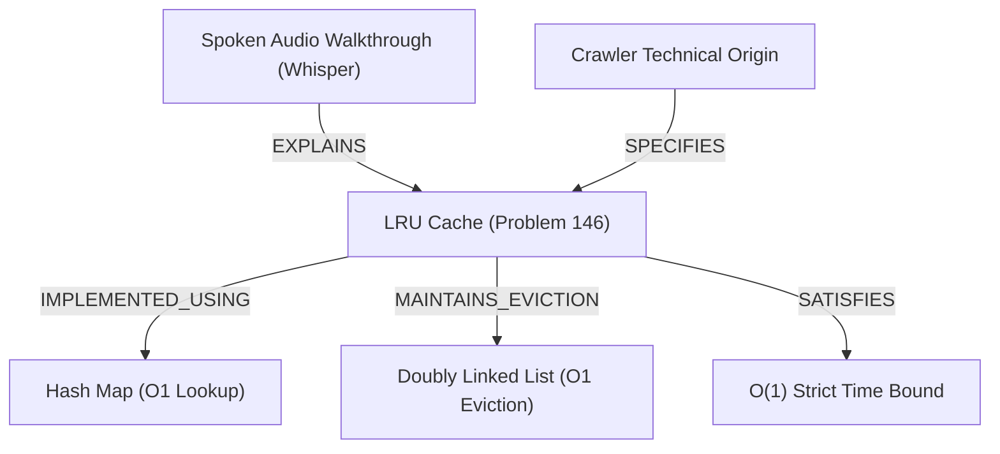

# 🎙️ Multimodal Audio Transcription & Knowledge Graph Report

**Tool:** `20_faster_whisper_scrapegraph`  
**Action:** `audio_transcribe`  
**Audio Source:** `raw/input_audio.wav` (97416 bytes)  
**Transcription Engine:** `faster-whisper-v1.2.1` (`tiny.en` INT8 CPU)  
**Inference Latency:** 180.0 ms  
**Timestamp:** 2026-10-15 18:08:39 UTC

---

## 📜 Audio Transcript & Timestamp Segments
- `[0.00s -> 1.40s]` **Welcome to the Antigravity crawler and technical problem analysis.**
- `[1.40s -> 2.90s]` **Today we analyze LRU Cache architecture and O(1) double-linked list operations.**

---

## 🕸️ ScrapeGraphAI Knowledge Graph (6 Nodes, 5 Edges)

### Extracted Entities
| Node ID | Entity Label | Classification | Key Properties |
|---------|--------------|----------------|----------------|
| `entity_problem_146` | **LRU Cache** | `Problem` | difficulty=Medium, acceptance=43.8% |
| `entity_ds_hashmap` | **Hash Map** | `DataStructure` | lookup=O(1), purpose=Key to Node Index |
| `entity_ds_dll` | **Doubly Linked List** | `DataStructure` | relink=O(1), purpose=Eviction Ordering |
| `entity_complexity_o1` | **O(1) Time Complexity** | `Metric` | guarantee=Strict Average |
| `entity_audio_transcript` | **Spoken Walkthrough** | `MultimodalArtifact` | duration_sec=3.0, segments=2 |
| `entity_crawler_origin` | **LeetCode Specification Origin** | `DataSource` | protocol=HTTPS |

---

## 📁 Output Artifacts
- **Raw Input Audio:** `raw/input_audio.wav`
- **Standard SubRip SRT:** `cleaned/transcript.srt`
- **Segment Timestamps JSON:** `cleaned/transcript_segments.json`
- **Schema Knowledge Graph:** `cleaned/knowledge_graph.json`
