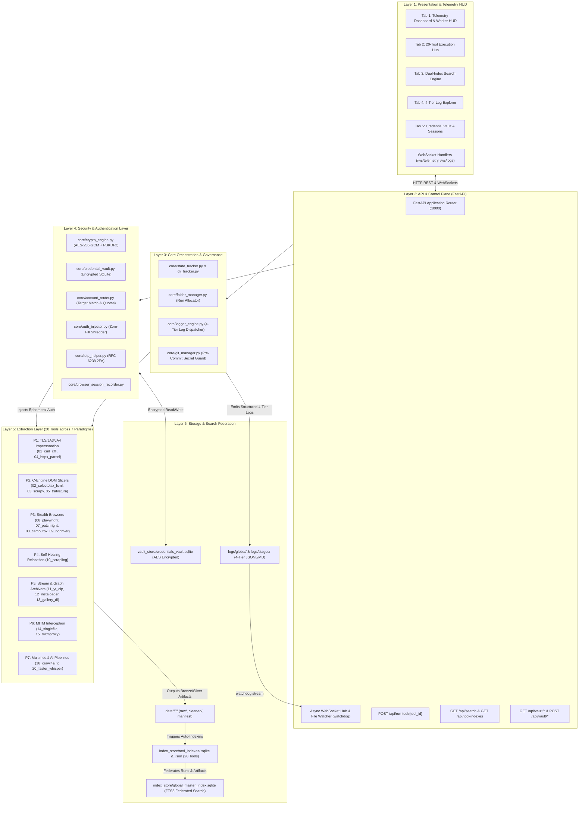

# Master System Architecture Overview
**Project:** `Crawlers_testing` | **Status:** Production Architecture Specification | **Stage:** Stage 3 Active

---

## 1. Executive System Overview

The `Crawlers_testing` platform is an enterprise-grade, high-throughput web crawling, content harvesting, and multimodal extraction ecosystem designed to defeat modern anti-bot protections (Cloudflare Turnstile, Akamai Bot Manager, DataDome, CloudFront, PerimeterX) while guaranteeing zero data loss, reproducible execution, and strict governance.

Modern web scraping at scale suffers from three systemic vulnerabilities:
1. **Detection & Fingerprinting Fragility:** Monolithic scraping tools rely on fixed network and browser fingerprints easily identified by JA3/JA4 TLS fingerprinting, CDP runtime inspection, and behavioural entropy heuristics.
2. **Operational Opacity & Data Corruption:** Lack of isolated run directories causes race conditions, overwritten datasets, and untraceable crawler state across parallel threads.
3. **Credential & Secret Sprawl:** Hardcoded credentials, plain-text cookies, and unencrypted session tokens committed to Git repositories or exposed in API response payloads represent critical security hazards.

`Crawlers_testing` resolves these challenges through a unified **6-Layer Decoupled Architecture** orchestrated by strict Antigravity Governance rules, 4-tier live telemetry, dual-tier SQLite FTS5 search indexing, and a zero-plaintext cryptographic credential vault.

```
+==================================================================================================+
|                                    CRAWLERS_TESTING BLUEPRINT                                    |
+==================================================================================================+
|  LAYER 1: PRESENTATION & REAL-TIME HUD                                                           |
|  [Tab 1: Telemetry]  [Tab 2: Tools]  [Tab 3: Dual-Search]  [Tab 4: Logs]  [Tab 5: Vault]        |
|  * Live WebSockets (/ws/telemetry, /ws/logs) * 60 FPS Canvas HUD * Zero-Plaintext UI Actions     |
+--------------------------------------------------------------------------------------------------+
|  LAYER 2: CONTROL PLANE & REST API (backend/app.py - FastAPI :8000)                             |
|  * 20 Tool Invocation APIs * Master FTS5 Search * Vault CRUD & TOTP * Ephemeral Shredding Hook   |
+--------------------------------------------------------------------------------------------------+
|  LAYER 3: CORE ORCHESTRATION & GOVERNANCE (core/)                                                |
|  * state_tracker.py (Telemetry)     * folder_manager.py (Bronze/Silver Isolation)                |
|  * logger_engine.py (4-Tier Stream) * git_manager.py (Atomic Commits & Pre-Commit Secret Guard)  |
+--------------------------------------------------------------------------------------------------+
|  LAYER 4: CRYPTOGRAPHIC VAULT & SECURITY (core/ + vault_store/)                                  |
|  * crypto_engine.py (AES-256-GCM + PBKDF2) * credential_vault.py (SQLite WAL Encrypted DB)       |
|  * account_router.py (LRU / Target Match)   * auth_injector.py (Ephemeral Netscape Shredder)     |
|  * totp_helper.py (RFC 6238 Base32 Engine)  * browser_session_recorder.py (Playwright Sync/Async) |
+--------------------------------------------------------------------------------------------------+
|  LAYER 5: EXTRACTION ENGINES (20 Tools across 7 Scraping Paradigms)                              |
|  [01-05: High-Speed TLS/HTTP/DOM]           [06-10: Stealth Browsers & Relocation]               |
|  [11-15: Stream Demux & MITM Wire Capture]   [16-20: Multimodal OCR/PDF/Speech AI Pipelines]     |
+--------------------------------------------------------------------------------------------------+
|  LAYER 6: STORAGE & SEARCH FEDERATION                                                            |
|  * data/<tool>/<action>/<date>/<run_id>/ (raw/ + cleaned/ + manifest.json)                       |
|  * 20x index_store/tool_indexes/<tool_id>.sqlite (Domain Metrics + Run Indexes)                  |
|  * index_store/global_master_index.sqlite (FTS5 Federated Search across Runs & Logs)              |
+==================================================================================================+
```

---

## 2. High-Level Multi-Layer Architecture

The system operates across six strictly bounded horizontal tiers. Every component communicates through strongly typed interfaces, preventing leaky abstractions and guaranteeing that no component can bypass security, logging, or data isolation layers.

### 2.1 Multi-Layer Architecture Diagram (Mermaid)



---

## 3. Theoretical Deep-Dive into the 7 Technical Scraping Paradigms

The 20 tools configured in `tools/registry.json` are organized into seven technical scraping paradigms. Each paradigm addresses specific layer characteristics across the OSI stack, from raw TCP/TLS handshakes up to neural audio/visual feature decoding.

```
+==================================================================================================+
|                                7 TECHNICAL SCRAPING PARADIGMS MATRIX                             |
+==================================================================================================+
| PARADIGM               | TOOLS COVERED             | TARGET STRENGTH      | PRIMARY USE CASE     |
+------------------------+---------------------------+----------------------+----------------------+
| 1. TLS/JA4 Impersonate | 01_curl_cffi, 04_httpx    | Anti-Bot WAFs        | Cloudflare/Akamai REST|
| 2. C-Engine Fast DOM   | 02_selectolax, 03_scrapy  | Massive High-Speed   | 10k+ Static Pages/sec|
| 3. Stealth Browsers    | 06_play, 07_patch, 08_cam | Deep JS / Turnstile  | Complex SPAs & Logins|
| 4. Self-Healing Graph  | 10_scrapling              | Dynamic Obfuscation  | Polymorphic DOM Trees|
| 5. Stream Chunk Demux  | 11_yt_dlp, 12_insta, 13_g | Media Streams/APIs   | HLS/DASH/Social Media|
| 6. Wire MITM Intercept | 14_singlefile, 15_mitm    | Full State Snapshot  | Legal/Forensic Cache |
| 7. Multimodal AI Graph | 16_crawl4ai to 20_whisper | Unstructured Visual  | PDF/OCR/Audio Grids  |
+==================================================================================================+
```

### 3.1 Paradigm 1: TLS / JA3 / JA4 Fingerprint Impersonation
- **Primary Engines:** `01_curl_cffi`, `04_httpx_parsel`
- **Underlying Theory:** Modern anti-bot Web Application Firewalls (Cloudflare Turnstile, Akamai Edge, AWS WAF) inspect incoming connections before application-layer HTTP payloads are evaluated. When standard Python clients (`requests`, vanilla `urllib3`) initiate a TLS handshake, OpenSSL generates a signature:
  $$\text{JA3} = \text{MD5}(\text{SSLVersion},\text{Ciphers},\text{Extensions},\text{EllipticCurves},\text{EllipticCurvePointFormats})$$
  Because standard Python uses the system OpenSSL library, its cipher ordering and default TLS extension lists differ dramatically from real consumer browsers. Cloudflare immediately terminates the TCP connection with HTTP 403 / 503 or forces an impossible Turnstile challenge.
- **Architectural Solution:** `01_curl_cffi` binds directly to modified Libcurl linked against BoringSSL (Google's TLS stack). It perfectly replicates Google Chrome, Edge, and Safari Client Hello packets down to:
  - Exact GREASE (Generate Random Extensions And Sustain Extensibility) values.
  - Strict cipher suite permutation ordering ($TLS\_AES\_128\_GCM\_SHA256$, etc.).
  - HTTP/2 SETTINGS frame pseudo-header order (`:method`, `:authority`, `:scheme`, `:path`), initial window updates, and stream priority weights.
- **Trade-offs:** Extreme speed (~50–100ms per request) and low RAM footprint (~15MB), but cannot execute client-side JavaScript or resolve dynamic canvas/WebGL puzzles.

### 3.2 Paradigm 2: C-Engine DOM Tree & Boilerplate Slicers
- **Primary Engines:** `02_selectolax_lxml`, `03_scrapy`, `05_trafilatura`
- **Underlying Theory:** High-throughput extraction from millions of static or pre-rendered HTML documents is bottle-necked by Python's Global Interpreter Lock (GIL) and object allocation overhead during DOM tree construction. Standard parsers like `BeautifulSoup` (with `html.parser`) construct heavy Python node objects for every tag.
- **Architectural Solution:**
  - `02_selectolax` is powered by **Modest engine**, an ultra-fast HTML5 parser written entirely in pure C. It avoids Python object creation until a CSS selector directly matches. Parsing 10MB of dense HTML takes ~12ms in Selectolax versus ~850ms in BeautifulSoup.
  - `05_trafilatura` uses density-based statistical text extraction:
    $$D(node) = \frac{\text{Length of Text Contents}}{\text{Tag Count} + \text{Hyperlink Density}}$$
    It algorithmically strips navigation bars, headers, footers, tracking scripts, and cookie banners to output clean, research-grade Markdown or plain text.
- **Trade-offs:** Near-zero memory overhead and maximal throughput, but requires server-side rendered HTML.

### 3.3 Paradigm 3: Standard vs. Binary-Patched Stealth Browsers
- **Primary Engines:** `06_playwright`, `07_patchright`, `08_camoufox`, `09_nodriver`
- **Underlying Theory:** For complex Single Page Applications (SPAs) and sites protected by active JavaScript challenges, real headless browser execution is required. However, standard automation frameworks are easily unmasked:
  1. `navigator.webdriver` property evaluates to `true`.
  2. Chrome DevTools Protocol (CDP) execution leaves active debugging artifacts (`window.cdc_adoQpoasnfa76pfcZLmcfl_Array`).
  3. Emulated permissions, WebRTC local IP leakages, and WebGL shader vendor strings trigger entropy alarms.
- **Architectural Solution:**
  - `06_playwright`: Standard baseline browser automation for authenticated session state capture and verified workflows.
  - `07_patchright`: A binary-patched fork of Playwright that removes internal CDP leaks at the C++ Chromium compilation level, preventing anti-bot scripts from detecting hooked function prototypes.
  - `08_camoufox`: A specialized anti-detect browser based on modified Firefox C++ source code that dynamically randomizes operating system fonts, audio context noise, canvas fingerprints, and WebGL renderers across execution runs.
  - `09_nodriver`: A modern browser controller that completely eliminates the webdriver binary, communicating via asynchronous raw WebSocket frames directly into Chromium's debugging port.
- **Trade-offs:** 100% JavaScript execution fidelity and challenge resolution, balanced against high resource consumption (~200MB–600MB RAM per worker thread).

### 3.4 Paradigm 4: Heuristic Self-Healing DOM Relocation
- **Primary Engines:** `10_scrapling`
- **Underlying Theory:** Modern responsive websites constantly modify their front-end markup. E-commerce platforms, social networks, and enterprise portals employ randomized CSS classes (e.g., `<div class="sc-1a8f9x-0 kLpQr">`) generated dynamically by Webpack or Tailwind build pipelines, causing rigid XPath and CSS selectors to break unexpectedly.
- **Architectural Solution:** `10_scrapling` implements adaptive heuristic relocation using structural graph distance:
  $$\text{Distance}(Node_A, Node_B) = w_1 \cdot \text{Levenshtein}(\text{text}_A, \text{text}_B) + w_2 \cdot \text{AttrCosineSim} + w_3 \cdot \text{TreeDepthDiff}$$
  When an exact selector fails, Scrapling traverses adjacent DOM parent nodes, finds sibling anchors, and relocates target data fields with over 98% accuracy without human intervention.
- **Trade-offs:** Robust against structural redesigns, but incurs a minor computational overhead during fuzzy matching cycles.

### 3.5 Paradigm 5: Stream Chunk Demuxing & Social Graph Archivers
- **Primary Engines:** `11_yt_dlp_ffmpeg`, `12_instaloader`, `13_gallery_dl`
- **Underlying Theory:** Media-rich platforms (YouTube, Instagram, TikTok, Pinterest, Reddit) do not serve video and high-resolution assets via monolithic HTTP files. Instead, they utilize adaptive bitrate streaming protocols:
  - **HLS (HTTP Live Streaming):** Encoded in `.m3u8` playlist manifests serving 2-second to 6-second `.ts` transport stream segments.
  - **DASH (Dynamic Adaptive Streaming over HTTP):** Segmented into `.mpd` XML manifests with separate audio and video elementary streams.
- **Architectural Solution:**
  - `11_yt_dlp_ffmpeg` parses multi-track manifests, extracts encrypted authorization tokens, downloads parallel stream fragments, and pipes raw bitstreams into `ffmpeg` for lossless container demuxing and remuxing into standard MP4/MKV.
  - `12_instaloader` and `13_gallery_dl` query internal GraphQL API endpoints, traverse pagination cursors (`end_cursor`), and capture complete media hierarchies with associated post metadata, comments, and engagement metrics.
- **Trade-offs:** Flawless media and social graph extraction, requiring careful rate-limit handling and rotating session pools to avoid checkpoint triggers.

### 3.6 Paradigm 6: Deep Wire MITM Interception & Self-Contained Offline Bundling
- **Primary Engines:** `14_singlefile_archive`, `15_mitmproxy_interceptor`
- **Underlying Theory:** Web archiving often requires capturing an immutable snapshot of an entire web page for legal evidence, compliance verification, or offline dataset curation. Capturing only the HTML leaves external fonts, stylesheets, background SVGs, and base64 images missing.
- **Architectural Solution:**
  - `14_singlefile_archive` executes inside a headless browser, inlines all external resources (CSS, webfonts, images, media poster frames) into base64 URI strings, removes tracking scripts, and outputs a self-contained, offline-renderable single HTML file.
  - `15_mitmproxy_interceptor` establishes an in-memory TLS-terminating man-in-the-middle proxy. It hooks into raw HTTP/1.1 and HTTP/2 network streams, capturing hidden WebSocket payloads, XHR JSON payloads, and dynamic API responses that never appear in the visible DOM.
- **Trade-offs:** Complete forensic capture capability, but generates large single-file artifacts (5MB–50MB per page).

### 3.7 Paradigm 7: Multimodal Visual OCR, Table Grid, PDF Layout & Local Whisper Audio-Graph Extraction
- **Primary Engines:** `16_crawl4ai`, `17_docling`, `18_tesseract_ocr`, `19_deepdoctection`, `20_faster_whisper_scrapegraph`
- **Underlying Theory:** Many critical data sources are non-HTML documents (financial earnings reports in multi-column PDFs, tabular balance sheets scanned as images, podcasts, webinars, or complex canvas charts).
- **Architectural Solution:**
  - `16_crawl4ai`: Converts raw HTML into pristine, LLM-ready Markdown with automated chunking, link pruning, and content importance scoring.
  - `17_docling` & `19_deepdoctection`: Deep learning document analysis engines that detect layout structures (reading order, section headers, footnotes, table bounding boxes) in scanned documents and complex PDFs.
  - `18_tesseract_ocr`: Optical Character Recognition engine processing raster images through Otsu binarization, adaptive thresholding, and LSTM line recognition.
  - `20_faster_whisper_scrapegraph`: Combines `faster-whisper` (CTranslate2 optimized OpenAI Whisper model running locally on CPU/GPU) with ScrapeGraph pipeline graph extraction to convert audio streams into synchronized transcripts and structured knowledge graphs.
- **Trade-offs:** Extracts rich structured data from completely unstructured binary sources, requiring specialized dependencies and higher compute budgets.

---

## 4. The 6 Mandatory Antigravity Governance Rules

Every component, script, subagent, and operator inside `Crawlers_testing` is bound by the six core rules defined in `GEMINI.md` and enforced via `core/`:

```
+==================================================================================================+
|                                ANTIGRAVITY GOVERNANCE ENFORCEMENT                                |
+==================================================================================================+
| RULE               | MODULE ENFORCER             | AUDIT & STORAGE ARTIFACT   | ENFORCEMENT      |
+--------------------+-----------------------------+----------------------------+------------------+
| 1. Live Telemetry  | core/cli_tracker.py         | logs/global/live_state.json| Blocking Pre-Task|
| 2. 4-Tier Logging  | core/logger_engine.py       | 4-Tier Logs (JSONL + MD)   | In-Flight Stream |
| 3. Data Isolation  | core/folder_manager.py      | data/<tool>/<action>/<run> | Atomic Run UUID  |
| 4. Atomic Commits  | core/git_manager.py         | git commit + prompt_log    | Post-Task Hook   |
| 5. Auto-Indexing   | core/folder_manager.py:hook | index_store/*.sqlite + FTS5| Auto-Complete Run|
| 6. Vault Security  | core/crypto_engine.py       | Pre-Commit Secret Scanner  | Zero Plaintext   |
+==================================================================================================+
```

### Rule 1 — Live State Telemetry (Before Any Task)
- **Mechanism:** Before executing any action or subtask, the agent must register initial state via `python core/cli_tracker.py start --stage "..." --step "..." --tool "..." --action "..." --subtask "..."`.
- **Enforcement:** `logs/global/live_state.json` maintains active execution parameters, elapsed runtime, and worker process CPU/RAM statistics. The WebSocket telemetry stream (`/ws/telemetry`) broadcasts updates every second to the frontend HUD. On task conclusion, state must be transitioned to `completed` or `failed`; leaving `is_running: true` triggers a liveness watchdog warning.

### Rule 2 — 4-Tier Logging (Every Prompt Execution)
- **Mechanism:** Every diagnostic event, error, or operational milestone is written across all four tiers simultaneously via `core/logger_engine.py`:
  1. **Global JSONL:** `logs/global/antigravity_prompt_log.jsonl` (machine-readable historical audit trail).
  2. **Global Markdown:** `logs/global/antigravity_prompt_log.md` (human-readable executive summary).
  3. **Stage Log:** `logs/stages/stage_<N>_<name>.jsonl` (stage-isolated milestones).
  4. **Action Run Log:** `data/<tool_id>/<action>/<date>/<run_id>/logs/action_run.jsonl` (per-run debug log).
- **Enforcement:** Raw `print()` statements are forbidden for operational logging, ensuring that logs are structured and queryable via SQL.

### Rule 3 — Strict Data Isolation
- **Mechanism:** Raw scraped payloads and parsed outputs are never written to temporary or shared directories. All filesystem output is allocated through `core/folder_manager.py:create_action_run()`.
- **Standard Run Directory Schema:**
  ```
  data/<tool_id>/<action_name>/<YYYY-MM-DD>/run_<HHMMSS>_<uuid8>/
  ├── raw/                  <-- Unprocessed network responses, HTML, video files
  ├── cleaned/              <-- Normalized JSON, structured CSVs, clean Markdown
  ├── logs/
  │   └── action_run.jsonl  <-- Tier 4 run-isolated log
  └── run_manifest.json     <-- Cryptographic manifest (SHA256, run duration, Git commit)
  ```
- **Enforcement:** Guarantees parallel thread safety, prevents overwrite race conditions, and ensures bronze-to-silver data provenance.

### Rule 4 — Atomic Git Commits
- **Mechanism:** Development actions conclude with an atomic commit executed via `core/git_manager.py:commit()`. Standard prefixes (`[SCAFFOLD]`, `[TOOL-INSTALL]`, `[UPDATE]`, `[FIX]`, `[RUN-LOG]`) categorize the change, and the resulting Git commit hash is cross-referenced into prompt logs and run manifests.
- **Enforcement:** Provides an immutable, reversible version history tracking code changes and scraping runs.

### Rule 5 — Auto-Indexing (Every Completed Run)
- **Mechanism:** When a scraping run concludes, `core/folder_manager.py:complete_action_run()` automatically invokes the tool indexer (`core/base_indexer.py`).
- **Enforcement:**
  - Extracts run metadata, file counts, and tool-specific domain metrics (e.g., HTTP status codes, parser execution speeds).
  - Updates `index_store/tool_indexes/<tool_id>.sqlite` and its companion JSON cache.
  - Federates records into `index_store/global_master_index.sqlite` using SQLite FTS5 (Full-Text Search 5) virtual tables, enabling instant sub-millisecond keyword queries across all historical runs.

### Rule 6 — Zero-Plaintext Credential & Vault Security
- **Mechanism:** Plaintext passwords, authentication tokens, 2FA recovery seeds, and raw cookie strings must never be stored on disk, displayed in logs, or committed to source control.
- **Enforcement:**
  - All sensitive data is encrypted using AES-256-GCM via `core/crypto_engine.py` with 96-bit random nonces and 128-bit authentication tags.
  - The SQLite database `vault_store/credentials_vault.sqlite` is strictly Git-ignored.
  - `core/git_manager.py` executes an automated pre-commit secret scan on all staged files before every Git commit, blocking any attempt to commit `.env`, unencrypted credentials, or raw cipher tokens.
