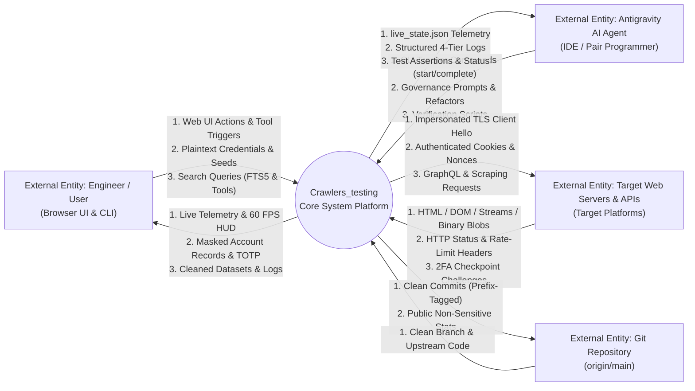
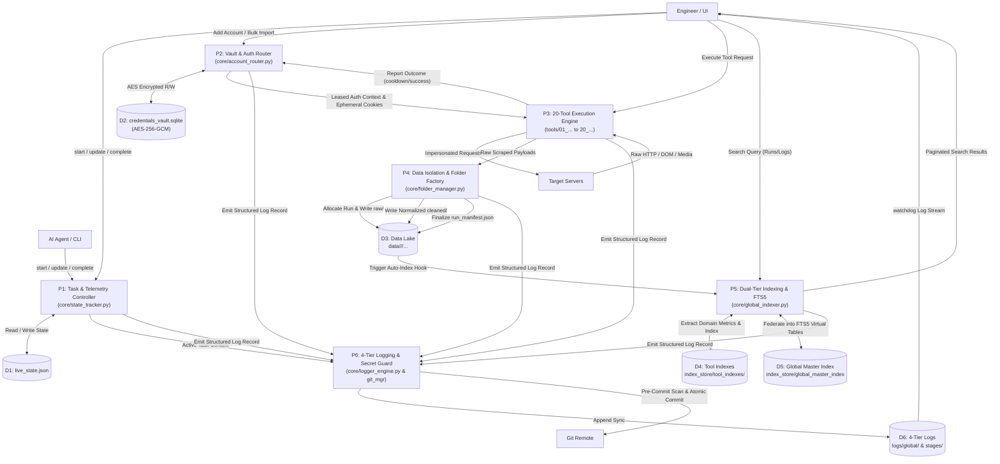
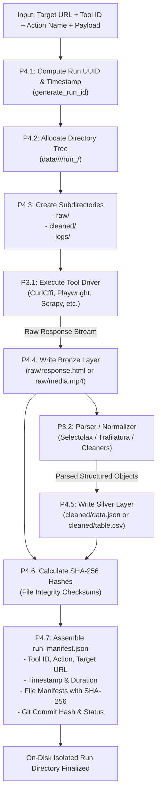
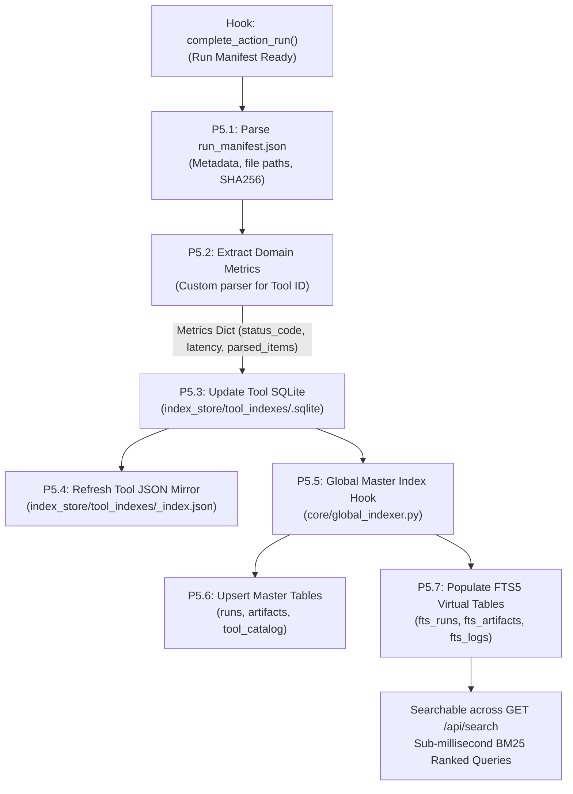
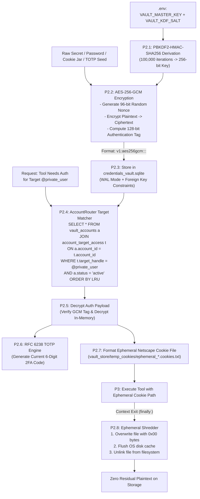
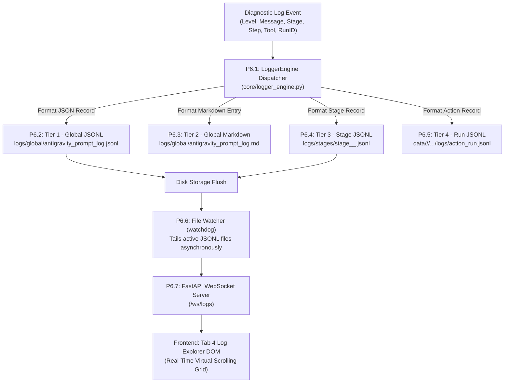
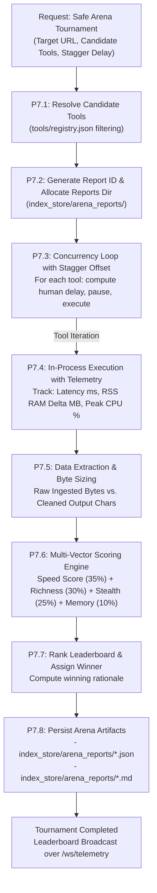
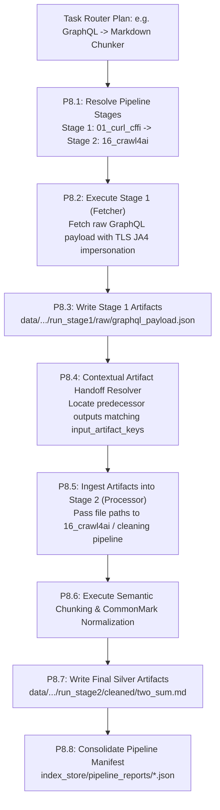
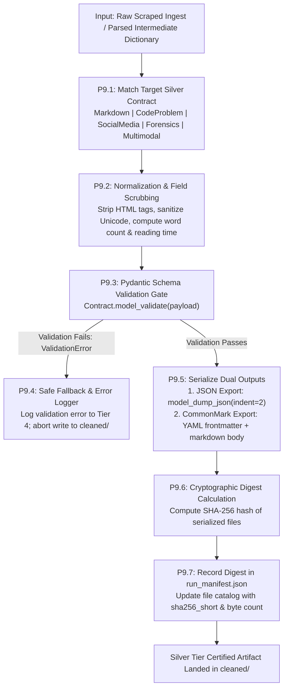

# Data Flow Diagrams (DFD) Specification: Level 0, Level 1 & Level 2
**Project:** `Crawlers_testing` | **Status:** Formal Data Flow Specification | **Stage:** Stage 3 Active

---

## 1. DFD Theoretical Framework & Data Dictionary

Data Flow Diagrams (DFDs) trace the algorithmic path that raw inputs, credentials, and telemetry travel through the `Crawlers_testing` system. Unlike physical network or process diagrams, DFDs formalize how data changes state, where data is buffered, and what transforms are applied at each boundary.

### 1.1 Data Dictionary Notation & Standards

The diagrams follow standard Gane-Sarson / Yourdon structured analysis notation:
- **External Entities (Square / Subgraph):** External human operators, AI agent runtimes, remote HTTP endpoints, or remote source control.
- **Processes (Circles / Rounded Rectangles $P_x$):** Discrete computational units transforming input data streams into output data streams.
- **Data Stores (Open Cylinders / Brackets $D_x$):** Persistent on-disk databases, state files, or memory buffers.
- **Data Flows (Directed Arrows):** Named, typed data payloads with defined access constraints.

```
+==================================================================================================+
|                                    MASTER DFD DATA DICTIONARY                                    |
+==================================================================================================+
| SYMBOL | NAME                         | TYPE / MEDIUM           | INTEGRITY & SECURITY POLICY    |
+--------+------------------------------+-------------------------+--------------------------------+
| E1     | Engineer / Operator          | Human Actor             | Browser UI Session (Tab 1–5)   |
| E2     | Antigravity AI Agent         | AI Developer Runtime    | CLI & JSON Governance Protocol |
| E3     | Target Web Servers / APIs    | Remote HTTP/HTTPS/WSS   | TLS/JA4 Impersonation / WAF    |
| E4     | Git Remote Repository        | Remote VCS              | Pre-Commit Secret Guard Scan   |
| D1     | live_state.json              | Memory-Mapped JSON      | Atomic Single-Writer Locks     |
| D2     | credentials_vault.sqlite     | SQLite (WAL Mode)       | AES-256-GCM Row Encryption     |
| D3     | Data Lake (Bronze/Silver)    | Hierarchical Filesystem | Run-UUID Atomic Isolation      |
| D4     | Per-Tool Indexes (*.sqlite)  | 20x SQLite Databases    | Dedicated Tool Schemas         |
| D5     | global_master_index.sqlite   | SQLite (FTS5 Enabled)   | Federated Token Search Engine  |
| D6     | 4-Tier Logs (JSONL/MD)       | Append-Only Text Files  | Multi-Tier Concurrent Flush    |
+==================================================================================================+
```

---

## 2. DFD Level 0 — Context Diagram

The Context Diagram defines the absolute system boundary of `Crawlers_testing`. It illustrates how the core platform mediates between human developers, the Antigravity AI pair programmer, remote web endpoints, and source control.



---

## 3. DFD Level 1 — Major System Subsystems

Level 1 decomposes the system into six core processes and six primary data stores.



---

## 4. DFD Level 2 — Granular Subsystem Decomposition

### 4.1 DFD Level 2.1 — Tool Scrape & Folder Creation Flow
This diagram details the atomic lifecycle of a scrape execution from URL ingestion to bronze/silver filesystem serialization.



### 4.2 DFD Level 2.2 — Auto-Indexing & Master FTS5 Federation Flow
This diagram details how on-disk run artifacts are indexed into isolated per-tool SQLite databases and then federated into the global master FTS5 search index.



### 4.3 DFD Level 2.3 — Credential Vault Encryption, Private-Target Routing & Auth Injection Flow
This diagram traces credentials from `.env` key derivation through AES-256-GCM encryption, private follower matching, ephemeral cookie deployment, and zero-fill shredding.



### 4.4 DFD Level 2.4 — 4-Tier Logging & Live Telemetry Streaming Flow
This diagram shows how execution diagnostics are written to four distinct log tiers and streamed to connected WebSockets in real time.



### 4.5 DFD Level 2.5 — Safe Arena Multi-Crawler Execution with Anti-Ban Staggered Concurrency
This diagram traces how multiple candidate crawler tools are executed sequentially with statistical safety offsets on a single target URL to determine an objective winner.



### 4.6 DFD Level 2.6 — Precision Task Router Predecessor-to-Successor Artifact Handoffs
This diagram traces how multi-stage pipelines pass intermediate artifacts dynamically from fetchers to content processors.



### 4.7 DFD Level 2.7 — Pydantic Silver-Tier Normalization & SHA-256 Integrity Verification
This diagram details the Silver-Tier contract enforcement gateway validating transformed assets before filesystem persistence.


