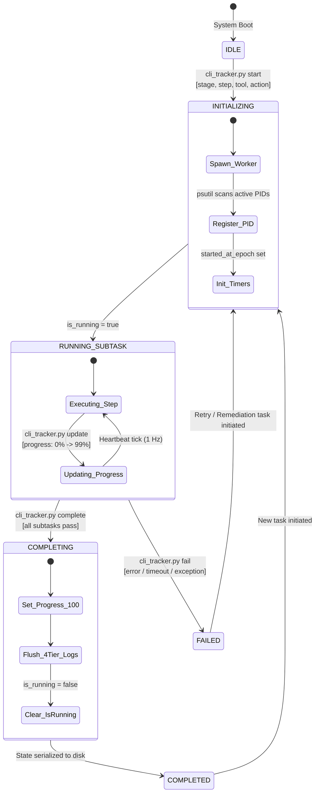
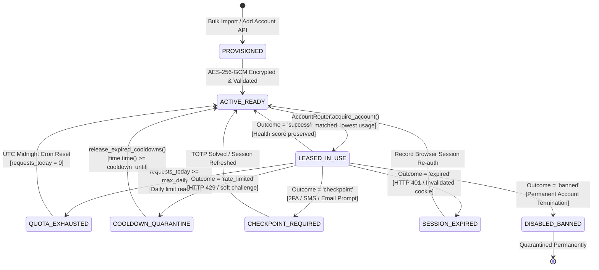
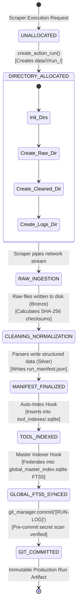
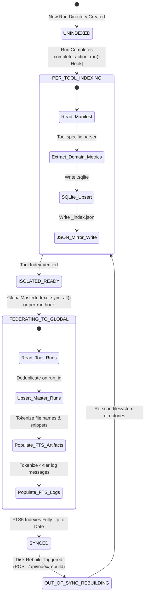

# Formal State Machine Reference: Telemetry, Accounts, Runs & Index Synchronization
**Project:** `Crawlers_testing` | **Status:** Formal State Machine Specification | **Stage:** Stage 3 Active

---

## 1. State Machine Theoretical Model

In distributed crawling and automated security systems, race conditions and inconsistent states lead to account bans, corrupted datasets, and ghost processes. `Crawlers_testing` implements a deterministic Finite State Machine (FSM) model across its four primary operational vectors:

$$M = (S, \Sigma, \delta, s_0, F)$$

Where:
- $S$ is the set of valid states.
- $\Sigma$ is the alphabet of trigger events (HTTP responses, CLI tracker calls, cron ticks).
- $\delta: S \times \Sigma \rightarrow S$ is the state transition function governed by explicit guard predicates.
- $s_0 \in S$ is the initial state.
- $F \subseteq S$ is the set of terminal (accepting) states.

---

## 2. Global Telemetry & HUD Task State Machine (`live_state.json`)

The Global Telemetry state machine governs the live execution status recorded in `logs/global/live_state.json` and mirrored in the real-time HUD on frontend Tab 1.

### 2.1 State Transition Table

```
+========================================================================================================================+
| CURRENT STATE       | EVENT / TRIGGER              | GUARD CONDITION              | ACTION                | NEXT STATE  |
+---------------------+------------------------------+------------------------------+-----------------------+-------------+
| IDLE                | cli_tracker.py start         | CLI arguments validated      | Write live_state.json | INITIALIZING|
| INITIALIZING        | Worker process spawned       | PID registered with psutil   | Start elapsed timer   | RUNNING     |
| RUNNING             | cli_tracker.py update        | 0 <= progress < 100          | Update progress %     | RUNNING     |
| RUNNING             | Tool scraper sub-step done   | Subtask string provided      | Append recent_events  | RUNNING     |
| RUNNING             | Unhandled Exception / crash  | Exception caught or SIGINT   | Record fail reason    | FAILED      |
| RUNNING             | cli_tracker.py complete      | Subtasks complete            | progress = 100%       | COMPLETING  |
| COMPLETING          | Flush logs & close sockets   | Filesystem sync complete     | is_running = false    | COMPLETED   |
| COMPLETED           | Next task start              | Previous task was completed  | Reset timers & arrays | INITIALIZING|
| FAILED              | Next task start              | User acknowledgment / retry  | Clean error flags     | INITIALIZING|
+========================================================================================================================+
```

### 2.2 Telemetry State Diagram (Mermaid)



---

## 3. Credential Vault Account Lifecycle & Quarantine State Machine

The account lifecycle state machine manages credential health, authentication states, rate-limit cooldowns, and anti-bot quarantine in `vault_store/credentials_vault.sqlite`.

### 3.1 State Transition Table

```
+=============================================================================================================================+
| CURRENT STATE       | EVENT / TRIGGER              | GUARD CONDITION              | ACTION                     | NEXT STATE  |
+---------------------+------------------------------+------------------------------+----------------------------+-------------+
| PROVISIONED         | Initial Import (Netscape/CSV)| Credentials encrypted        | Calculate initial health   | ACTIVE_READY|
| ACTIVE_READY        | Lease Requested              | Status == 'active' & Not Exh | Increment lease count      | LEASED      |
| LEASED              | Scrape Success Reported      | HTTP 200 & parsed cleanly    | Increment success counter  | ACTIVE_READY|
| LEASED              | Daily Quota Exceeded         | requests_today >= max_daily  | Set exhausted flag         | QUOTA_EXH   |
| LEASED              | HTTP 429 / Rate Limit        | Status code == 429           | cooldown_until = time()+sec| COOLDOWN    |
| LEASED              | Checkpoint / Captcha Trigger | Captcha or 2FA challenge     | Notify operator / Tab 5 UI | CHECKPOINT  |
| LEASED              | HTTP 401 / 403 Session Death | Invalidated auth cookie      | Mark requires session rec  | EXPIRED     |
| LEASED              | Hard Ban / Profile Deleted   | Account suspension message   | Revoke credentials permanently| BANNED  |
| COOLDOWN            | release_expired_cooldowns()  | time.time() > cooldown_until | status = 'active', timer=0 | ACTIVE_READY|
| QUOTA_EXH           | Midnight UTC Chron Reset     | UTC Day Rollover             | requests_today = 0         | ACTIVE_READY|
| CHECKPOINT          | Operator Solves Captcha      | TOTP or manual login passes  | New cookies re-encrypted   | ACTIVE_READY|
| EXPIRED             | Browser Session Recorder Run | Fresh login cookies stored   | Re-verify target access    | ACTIVE_READY|
+=============================================================================================================================+
```

### 3.2 Account Lifecycle State Diagram (Mermaid)



---

## 4. Action Run & Data Lifecycle State Machine (`run_manifest.json`)

The Data Lifecycle state machine enforces the bronze-to-silver data pipeline in accordance with Governance Rule 3.

### 4.1 State Transition Table

```
+=============================================================================================================================+
| CURRENT STATE       | EVENT / TRIGGER              | GUARD CONDITION              | ACTION                     | NEXT STATE  |
+---------------------+------------------------------+------------------------------+----------------------------+-------------+
| UNALLOCATED         | create_action_run()          | Valid tool_id & action_name  | Create directory tree      | ALLOCATED   |
| ALLOCATED           | Network request initiated    | Socket open                  | Stream network payload     | RAW_INGEST  |
| RAW_INGEST          | Raw payload saved to raw/    | Bytes written & flush        | Compute raw SHA-256        | CLEANING    |
| CLEANING            | Normalizer / Parser finished | Structured JSON/CSV ready    | Write cleaned/ & Silver SHA| FINALIZING  |
| FINALIZING          | complete_action_run()        | Manifest schema satisfied    | Write run_manifest.json    | MANIFEST_OK |
| MANIFEST_OK         | Auto-Index Hook Triggered    | BaseToolIndexer available    | Insert into <tool>.sqlite  | TOOL_INDEXED|
| TOOL_INDEXED        | Global Master Hook Triggered | GlobalMasterIndexer running  | Insert into FTS5 tables    | FTS5_SYNCED |
| FTS5_SYNCED         | git_manager commit()         | Zero-Secret pre-commit pass  | Record Git commit in log   | COMMITTED   |
+=============================================================================================================================+
```

### 4.2 Run Lifecycle State Diagram (Mermaid)



---

## 5. 20-Pipeline Index Synchronization State Machine

The Index Synchronization state machine governs how independent per-tool indexes are synchronized with the federated Global Master Search Index.

### 5.1 State Diagram (Mermaid)


