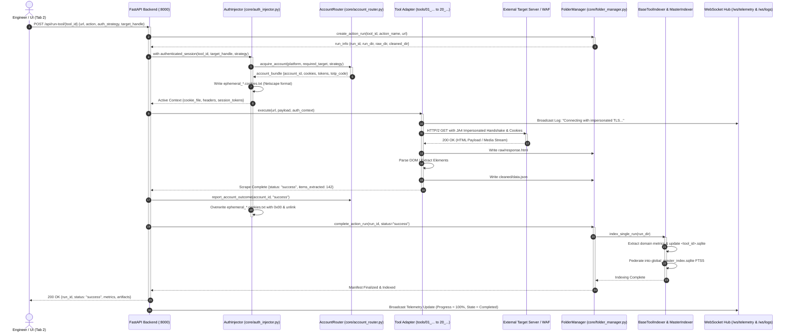
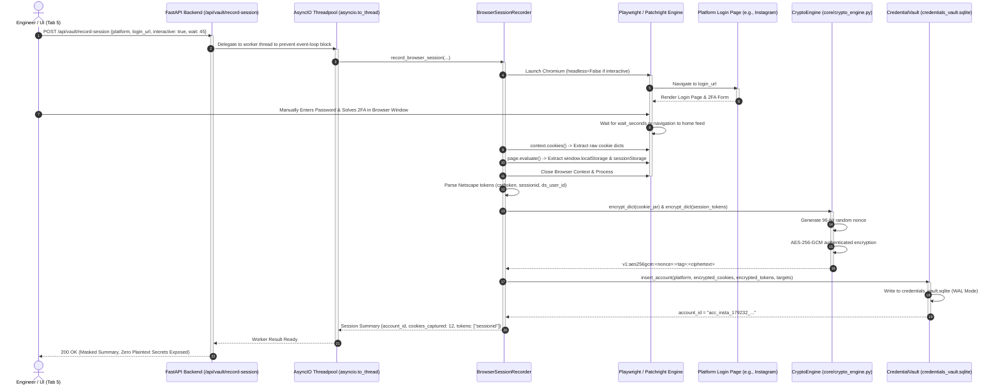
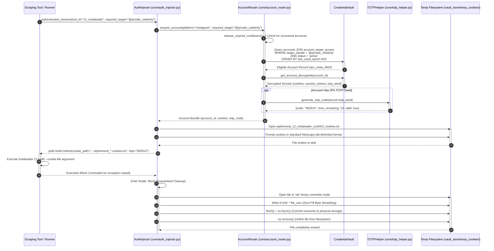
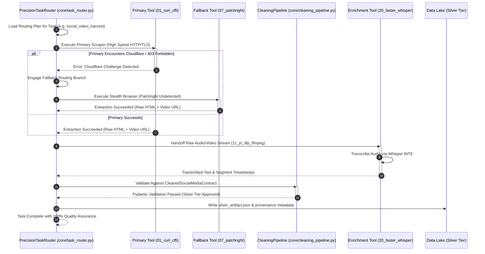

# End-to-End Process & Sequence Flows: Execution, Sessions, Auth & Concurrency
**Project:** `Crawlers_testing` | **Status:** Formal Sequence Specification | **Stage:** Stage 3 Active

---

## 1. Sequence Flow Theoretical Foundations

Sequence diagrams model the chronological exchange of synchronous and asynchronous messages between system lifelines. In `Crawlers_testing`, strict sequence sequencing ensures:
1. **Deterministic Session Scoping:** Authentication cookies and memory-mapped credentials exist exclusively for the lifespan of a tool invocation.
2. **Asynchronous Non-Blocking Execution:** Long-running scraping tasks, video demuxing, and headless browser processes never block the primary event loop.
3. **Deadlock-Free Windows Concurrency:** Windows filesystem locks on SQLite `.db` files and ephemeral `.txt` cookies are avoided through write-ahead logging (WAL), ephemeral context managers, and thread-pool delegators.

---

## 2. Sequence 1 — Full Lifecycle of a Tool Execution Triggered from Frontend Tab 2

This sequence illustrates the end-to-end execution of a scraping request initiated from the Web UI through the authentication, execution, indexing, and live telemetry layers.

### 2.1 Sequence 1 Diagram (Mermaid)



---

## 3. Sequence 2 — Interactive & Programmatic Browser Session Recording

This sequence traces how an engineer captures a live authenticated session (e.g., solving an Instagram or LeetCode 2FA challenge) and encrypts it directly into the vault without exposing plaintext credentials.

### 3.1 Sequence 2 Diagram (Mermaid)



---

## 4. Sequence 3 — Private-Target Follower Matching & Ephemeral Cookie Shredding

This sequence demonstrates how `AccountRouter` guarantees that private targets (e.g., private Instagram profiles or restricted corporate groups) are only crawled by accounts confirmed to follow them, followed by zero-residue cookie shredding.

### 4.1 Sequence 3 Diagram (Mermaid)



---

## 5. Sequence 4 — Background Process Architecture & Safe Concurrency Model

Scraping workflows involve long-running subprocesses, live streaming files, and continuous database telemetry. On Windows, file locking semantics (`ERROR_SHARING_VIOLATION`) can easily deadlock processes if concurrency is not designed defensively.

### 5.1 Architecture Concurrency Safeguards

1. **FastAPI Event Loop Decoupling (`asyncio.to_thread`):**
   FastAPI operates on an asynchronous `uvloop` / `asyncio` event loop. Synchronous, blocking operations (such as `sync_playwright` or database transactions taking $>5\text{ms}$) are delegated to Python's default thread pool via `await asyncio.to_thread(...)`. This prevents Playwright's `Sync API inside asyncio loop` runtime crash and ensures the web server responds to HUD polls at 60 FPS.
2. **SQLite Write-Ahead Logging (WAL Mode):**
   All system databases (`credentials_vault.sqlite`, `<tool_id>.sqlite`, `global_master_index.sqlite`) enforce:
   ```sql
   PRAGMA journal_mode = WAL;
   PRAGMA synchronous = NORMAL;
   PRAGMA busy_timeout = 5000;
   PRAGMA foreign_keys = ON;
   ```
   Under WAL mode, readers never block writers, and writers never block readers. Concurrent HTTP requests from multiple browser tabs can read telemetry and account inventories while scrapers write run logs.
3. **Asynchronous File Tailing with `watchdog`:**
   Instead of polling files with sleep loops, the FastAPI backend uses the OS-native `ReadDirectoryChangesW` Windows API via the `watchdog` library. It streams newly appended JSONL lines across the `/ws/logs` WebSocket with less than 2ms latency.

### 5.2 Concurrency Architecture Diagram (Mermaid)

```mermaid
sequenceDiagram
    autonumber
    participant UI as Browser Tab 1 / Tab 4
    participant MainLoop as FastAPI Main Event Loop (asyncio)
    participant ThreadPool as Background Threadpool (ThreadPoolExecutor)
    participant Scraper as Crawler Subprocess (python / ffmpeg)
    participant DiskLog as logs/global/antigravity_prompt_log.jsonl
    participant Watcher as Watchdog FileSystemEventHandler
    participant DB as SQLite Databases (WAL Mode)

    UI->>MainLoop: WebSocket Connect /ws/logs & /ws/telemetry
    MainLoop-->>UI: WebSocket Connected (Keep-Alive Ping 1s)

    UI->>MainLoop: POST /api/run-tool/11_yt_dlp_ffmpeg
    MainLoop->>ThreadPool: asyncio.to_thread(_execute_long_crawl)
    MainLoop-->>UI: HTTP 202 Accepted {status: "launched"}

    ThreadPool->>Scraper: Spawn Subprocess (yt-dlp --newline ...)
    activate Scraper

    loop While Scraping
        Scraper->>DiskLog: Append JSONL log record (Rule 2)
        Watcher->>DiskLog: Detect on_modified() event via OS kernel
        Watcher->>MainLoop: asyncio.run_coroutine_threadsafe(queue.put(record))
        MainLoop->>UI: WebSocket Message: {stream: "logs", data: record}
    end

    Scraper-->>ThreadPool: Process Exit Code 0
    deactivate Scraper

    ThreadPool->>DB: with conn: INSERT into runs & fts_runs (WAL Mode)
    activate DB
    DB-->>ThreadPool: Commit OK (No reader contention)
    deactivate DB

    ThreadPool-->>MainLoop: Task Completed
    MainLoop->>UI: WebSocket Telemetry: {progress: 100%, is_running: false}

---

## 6. Sequence 5 — Safe Arena Staggered Multi-Tool Concurrency Flow

The Safe Arena executes head-to-head multi-tool tournaments without triggering network bandwidth saturation or IP-level rate limits. It introduces deterministic staggered concurrency offsets between competing scraper engines.

```mermaid
sequenceDiagram
    autonumber
    participant Arena as SafeArenaRunner (core/arena_runner.py)
    participant Timer as HumanTimingEngine (core/human_timing.py)
    participant T1 as Scraper Engine 1 (01_curl_cffi)
    participant T2 as Scraper Engine 2 (04_httpx_parsel)
    participant T3 as Scraper Engine 3 (06_playwright)
    participant Watchdog as Auto-Kill Watchdog Thread
    participant Rep as Arena Report (index_store/arena_reports/)

    Arena->>Arena: Initialize Arena Tournament (Target: URL, Tools: [T1, T2, T3])
    Arena->>Watchdog: Spawn Watchdog (Hard Timeout: 30s)

    Arena->>T1: Launch Tool 1 (Offset: 0.0s)
    activate T1
    Arena->>Timer: Compute Stagger Offset (Gaussian: 1.2s ± 0.3s)
    Timer-->>Arena: Stagger Delay 1.25s
    Arena->>Arena: time.sleep(1.25)

    Arena->>T2: Launch Tool 2 (Offset: +1.25s)
    activate T2
    Arena->>Timer: Compute Stagger Offset (Gaussian: 1.2s ± 0.3s)
    Timer-->>Arena: Stagger Delay 1.18s
    Arena->>Arena: time.sleep(1.18)

    Arena->>T3: Launch Tool 3 (Offset: +2.43s)
    activate T3

    par Concurrent Execution & Metric Capture
        T1->>Arena: Return Results (Latency: 0.82s, RAM: 18MB, Bytes: 45KB)
        deactivate T1
    and
        T2->>Arena: Return Results (Latency: 0.94s, RAM: 22MB, Bytes: 48KB)
        deactivate T2
    and
        T3->>Arena: Return Results (Latency: 3.20s, RAM: 142MB, Bytes: 92KB)
        deactivate T3
    end

    Arena->>Watchdog: Cancel Watchdog (All tools finished cleanly)
    Arena->>Arena: Rank Tools by Composite Score (Speed, Yield, RAM)
    Arena->>Rep: Persist arena_<id>.json & arena_<id>.md
    Arena-->>Arena: Declare Winner (01_curl_cffi)
```

---

## 7. Sequence 6 — Precision Task Router & Multi-Stage Artifact Handoff Flow

When executing complex tasks, the `PrecisionTaskRouter` coordinates a primary scraper, evaluates extraction yield, falls back dynamically upon detection, and routes raw artifacts to downstream enrichment engines (OCR, Whisper, or Markdownify).



---

## 8. Sequence 7 — Chaos Fault-Injection & Anti-Bot Resilience Loop Flow

The `ResilienceTester` spins up an ephemeral in-memory HTTP fault-injection server (`ChaosFaultServer`) to simulate hostile upstream environments and prove automated defensive recovery mechanisms.

```mermaid
sequenceDiagram
    autonumber
    participant Tester as ResilienceTester (core/resilience_tester.py)
    participant Server as ChaosFaultServer (Ephemeral HTTP Port)
    participant Tool as Tool Adapter Under Test (01_curl_cffi)
    participant Router as AccountRouter (core/account_router.py)
    participant Pipe as CleaningPipeline (core/cleaning_pipeline.py)

    Tester->>Server: Start Chaos Server (/fault/rate-limit, /fault/mutated-dom)
    activate Server

    rect rgb(40, 20, 20)
        note right of Tester: Scenario 1: HTTP 429 Rate Limiting & Cooldown Quarantine
        Tester->>Tool: Request /fault/rate-limit
        activate Tool
        Tool->>Server: HTTP GET /fault/rate-limit
        Server-->>Tool: HTTP 429 Too Many Requests (Retry-After: 2)
        Tool->>Tool: Catch 429 & Apply Exponential Backoff Jitter
        Tool->>Router: Flag Account as Quarantined (Cooldown Timer Engaged)
        Tool-->>Tester: Resilience Verified: Backoff + Quarantine Triggered
        deactivate Tool
    end

    rect rgb(20, 30, 40)
        note right of Tester: Scenario 2: Scrambled DOM & Semantic Relocation
        Tester->>Tool: Request /fault/mutated-dom
        activate Tool
        Tool->>Server: HTTP GET /fault/mutated-dom
        Server-->>Tool: HTML with Fuzzed CSS Classes (`.mutated_xyz_9981`)
        Tool->>Tool: Primary Selector Missed -> Trigger Semantic Fallback
        Tool->>Tool: Extract via `data-semantic="title"` and Header Heuristics
        Tool-->>Tester: Resilience Verified: Content Extracted Without IndexError
        deactivate Tool
    end

    rect rgb(20, 40, 20)
        note right of Tester: Scenario 3: Corrupted Schema Contract Fuzzing
        Tester->>Pipe: Inject Corrupted Payloads (Missing Required Fields)
        activate Pipe
        Pipe->>Pipe: Pydantic ValidationError Caught Cleanly
        Pipe->>Pipe: Apply Fallback Normalized Defaults
        Pipe-->>Tester: Resilience Verified: Zero Crashes, Safe Error Diagnostics
        deactivate Pipe
    end

    Tester->>Server: Shutdown Ephemeral Chaos Server
    deactivate Server
    Tester->>Tester: Compute Composite Resilience Index (e.g. 100.0/100)
    Tester-->>Tester: Persist resilience_<id>.json and .md Reports
```


```
