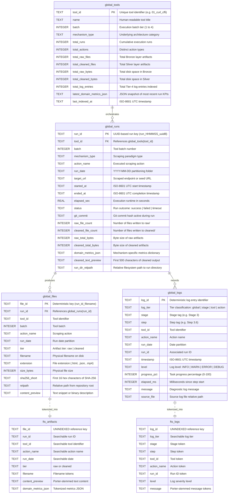
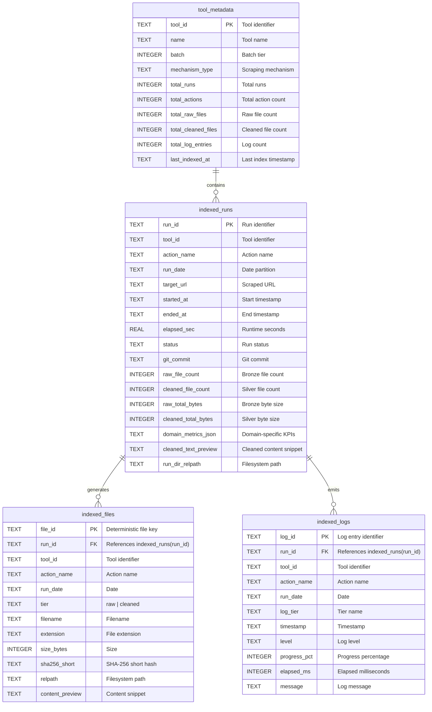
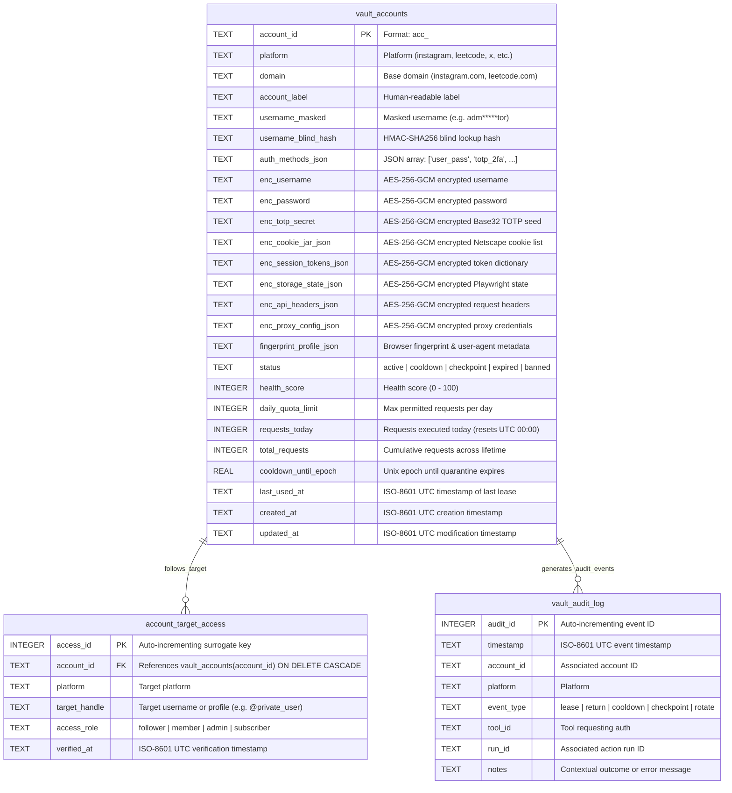

# Master Database Architecture, Relational Schemas & Entity-Relationship Diagrams
**Project:** `Crawlers_testing` | **Status:** Formal Database Specification | **Stage:** Stage 3 Active

---

## 1. Storage Strategy & Topology

The `Crawlers_testing` platform implements a **Decoupled Two-Tier Database Architecture** optimized for high-concurrency scraping, multi-tool domain isolation, and cryptographic zero-leak credential storage.

Rather than funneling 20 disparate scraping engines into a monolithic database, the storage topology separates workloads into distinct functional tiers:

```
+==================================================================================================+
|                                    DATABASE TOPOLOGY MATRIX                                      |
+==================================================================================================+
| DATABASE                   | LOCATION                               | ENGINE & PRAGMAS           | ROLE / LIFECYCLE             |
+----------------------------+----------------------------------------+----------------------------+------------------------------+
| 20x Tool Local Indexes     | index_store/tool_indexes/<tool>.sqlite | SQLite 3 (WAL, NORMAL sync)| Isolated per-tool run index  |
| Global Master Index        | index_store/global_master_index.sqlite | SQLite 3 + FTS5 (WAL mode) | Federated search & catalogs  |
| Encrypted Credential Vault | vault_store/credentials_vault.sqlite   | SQLite 3 (WAL, AES-256-GCM)| Zero-plaintext auth storage  |
| 20x Companion JSONs        | index_store/tool_indexes/<tool>.json   | Standard JSON 2-space      | Git-tracked index snapshot   |
| Global Companion JSON      | index_store/global_master_index.json   | Standard JSON 2-space      | Git-tracked master catalog   |
| Public Non-Sensitive Stats | vault_store/vault_stats_public.json    | Standard JSON 2-space      | Git-tracked vault telemetry  |
+==================================================================================================+
```

### 1.1 Architectural Rationale

1. **Failure Domain Isolation:** If an intensive crawler process crashes or encounters database corruption during an aggressive scraping run, only that individual tool's local index (`<tool_id>.sqlite`) is impacted. The remaining 19 tool databases, the global search catalog, and the credential vault remain untouched.
2. **Schema Polymorphism without Migrations:** Scraping tools exhibit radically different domain outputs (e.g., `11_yt_dlp_ffmpeg` outputs audio bitrates and video codec profiles; `01_curl_cffi` outputs TLS handshake cipher suites and HTTP/2 pseudo-headers; `18_tesseract_ocr` outputs OCR bounding boxes and confidence intervals). By storing mechanism-specific KPIs in a strongly typed `domain_metrics_json` column within uniform relational envelopes, new scraping tools can be registered without altering database DDL schemas.
3. **Physical File Exclusion for Secrets:** `vault_store/credentials_vault.sqlite` is completely excluded from source control via `.gitignore`, while non-sensitive aggregate counts are safely committed via `vault_store/vault_stats_public.json`.

---

## 2. High-Concurrency SQLite PRAGMA Configuration

Every connection established across `core/base_indexer.py`, `core/global_indexer.py`, and `core/credential_vault.py` executes a mandatory suite of concurrency pragmas:

```sql
PRAGMA journal_mode = WAL;
PRAGMA synchronous = NORMAL;
PRAGMA busy_timeout = 5000;
PRAGMA foreign_keys = ON;
```

### 2.1 Concurrency Mechanics & Guarantees

```
+==================================================================================================+
| PRAGMA                      | TECHNICAL GUARANTEE                                                | PREVENTED FAILURE MODE       |
+-----------------------------+--------------------------------------------------------------------+------------------------------+
| journal_mode = WAL          | Write-Ahead Logging writes changes to a -wal file. Readers never  | Database lock contention     |
|                             | block writers, and writers never block concurrent readers.        | between HUD & crawler tasks. |
+-----------------------------+--------------------------------------------------------------------+------------------------------+
| synchronous = NORMAL        | Syncs the WAL file at checkpoint boundaries rather than every single| Write latency drops from     |
|                             | transaction commit. Fully crash-safe on modern filesystems.        | 15ms to < 0.2ms per insert.  |
+-----------------------------+--------------------------------------------------------------------+------------------------------+
| busy_timeout = 5000         | When a lock is held, SQLite pauses execution and retries for up to | Eliminates 'sqlite3.Operational|
|                             | 5,000 milliseconds before raising an operational error.            | Error: database is locked'.  |
+-----------------------------+--------------------------------------------------------------------+------------------------------+
| foreign_keys = ON           | Enforces referential integrity on child records (e.g., cascading  | Orphaned files/runs on       |
|                             | deletion of target access rules when an account is deleted).      | manual deletion or rollback. |
+==================================================================================================+
```

---

## 3. Database 1: Global Master Index (`global_master_index.sqlite`)

The Global Master Index federates metadata, file artifacts, and logs across all 20 crawling engines into a unified search and discovery engine.

### 3.1 Entity-Relationship Diagram (Mermaid)



### 3.2 Data Dictionary: `global_master_index.sqlite`

```
+===================================================================================================================================+
| TABLE: global_tools                                                                                                               |
+----------------------------+-----------+----------------------+----------+---------+----------------------------------------------+
| COLUMN                     | TYPE      | CONSTRAINTS          | NULLABLE | DEFAULT | DESCRIPTION & INDEXES                        |
+----------------------------+-----------+----------------------+----------+---------+----------------------------------------------+
| tool_id                    | TEXT      | PRIMARY KEY          | NO       | None    | Unique tool folder identifier (e.g. 01_...)  |
| name                       | TEXT      | None                 | YES      | None    | Formal tool name from tools/registry.json    |
| batch                      | INTEGER   | None                 | YES      | None    | Batch cohort (1, 2, 3, or 4)                 |
| mechanism_type             | TEXT      | None                 | YES      | None    | Architecture paradigm description            |
| total_runs                 | INTEGER   | None                 | NO       | 0       | Total runs logged for this tool              |
| total_actions              | INTEGER   | None                 | NO       | 0       | Total distinct action names executed         |
| total_raw_files            | INTEGER   | None                 | NO       | 0       | File count in raw/ Bronze storage            |
| total_cleaned_files        | INTEGER   | None                 | NO       | 0       | File count in cleaned/ Silver storage        |
| total_raw_bytes            | INTEGER   | None                 | NO       | 0       | Aggregated bytes in raw/ storage             |
| total_cleaned_bytes        | INTEGER   | None                 | NO       | 0       | Aggregated bytes in cleaned/ storage         |
| total_log_entries          | INTEGER   | None                 | NO       | 0       | Total log entries associated with tool       |
| latest_domain_metrics_json | TEXT      | Valid JSON           | YES      | None    | Snapshot of latest domain metrics            |
| last_indexed_at            | TEXT      | ISO-8601 UTC         | YES      | None    | Last synchronization timestamp               |
+===================================================================================================================================+

+===================================================================================================================================+
| TABLE: global_runs                                                                                                                |
+----------------------------+-----------+----------------------+----------+---------+----------------------------------------------+
| COLUMN                     | TYPE      | CONSTRAINTS          | NULLABLE | DEFAULT | DESCRIPTION & INDEXES                        |
+----------------------------+-----------+----------------------+----------+---------+----------------------------------------------+
| run_id                     | TEXT      | PRIMARY KEY          | NO       | None    | Unique run directory name                    |
| tool_id                    | TEXT      | REFERENCES global_t  | YES      | None    | Indexed via idx_gruns_tool_action            |
| batch                      | INTEGER   | None                 | YES      | None    | Batch cohort                                 |
| mechanism_type             | TEXT      | None                 | YES      | None    | Scraping paradigm                            |
| action_name                | TEXT      | None                 | YES      | None    | Indexed via idx_gruns_tool_action            |
| run_date                   | TEXT      | YYYY-MM-DD           | YES      | None    | Indexed via idx_gruns_date                   |
| target_url                 | TEXT      | Valid URI            | YES      | None    | Target website or API endpoint               |
| started_at                 | TEXT      | ISO-8601 UTC         | YES      | None    | Execution start timestamp                    |
| ended_at                   | TEXT      | ISO-8601 UTC         | YES      | None    | Execution completion timestamp               |
| elapsed_sec                | REAL      | Positive Float       | YES      | None    | Total wall-clock runtime in seconds          |
| status                     | TEXT      | success|failed|...   | YES      | None    | Run outcome flag                             |
| git_commit                 | TEXT      | Hex SHA string       | YES      | None    | Active Git commit hash at run conclusion     |
| raw_file_count             | INTEGER   | >= 0                 | YES      | 0       | Files written to Bronze tier                 |
| cleaned_file_count         | INTEGER   | >= 0                 | YES      | 0       | Files written to Silver tier                 |
| raw_total_bytes            | INTEGER   | >= 0                 | YES      | 0       | Size of Bronze artifacts                     |
| cleaned_total_bytes        | INTEGER   | >= 0                 | YES      | 0       | Size of Silver artifacts                     |
| domain_metrics_json        | TEXT      | Valid JSON           | YES      | None    | Tool-specific KPIs (status_code, items, etc) |
| cleaned_text_preview       | TEXT      | Max 500 chars        | YES      | None    | Content preview of primary cleaned output    |
| run_dir_relpath            | TEXT      | Path string          | YES      | None    | Path from repository root                    |
+===================================================================================================================================+
```

---

## 4. Database 2: The 20 Isolated Tool Databases (`index_store/tool_indexes/<tool_id>.sqlite`)

Every scraping tool maintains an isolated SQLite database reflecting its private execution history and local file index.

### 4.1 Entity-Relationship Diagram (Mermaid)



---

## 5. Database 3: Encrypted Credential Vault (`vault_store/credentials_vault.sqlite`)

The Credential Vault is a zero-plaintext encrypted database storing authentication profiles, session cookies, 2FA seeds, and private-follower routing relationships.

### 5.1 Entity-Relationship Diagram (Mermaid)



### 5.2 Data Dictionary: `vault_store/credentials_vault.sqlite`

```
+===================================================================================================================================+
| TABLE: vault_accounts                                                                                                             |
+----------------------------+-----------+----------------------+----------+---------+----------------------------------------------+
| COLUMN                     | TYPE      | CONSTRAINTS          | NULLABLE | DEFAULT | DESCRIPTION & INDEXES                        |
+----------------------------+-----------+----------------------+----------+---------+----------------------------------------------+
| account_id                 | TEXT      | PRIMARY KEY          | NO       | None    | Deterministic unique identifier              |
| platform                   | TEXT      | Indexed              | NO       | None    | Indexed via idx_accounts_platform_status     |
| domain                     | TEXT      | None                 | NO       | None    | Normalized domain (e.g. leetcode.com)        |
| account_label              | TEXT      | None                 | YES      | None    | Descriptive account nickname                 |
| username_masked            | TEXT      | None                 | YES      | None    | Plaintext safe masked handle (adm***01)      |
| username_blind_hash        | TEXT      | Indexed              | YES      | None    | Indexed via idx_accounts_blind_hash          |
| auth_methods_json          | TEXT      | Valid JSON Array     | NO       | None    | Declared auth methods (cookie_jar, totp_2fa) |
| enc_username               | TEXT      | v1:aes256gcm token   | YES      | None    | AES-256-GCM row-bound encrypted username     |
| enc_password               | TEXT      | v1:aes256gcm token   | YES      | None    | AES-256-GCM row-bound encrypted password     |
| enc_totp_secret            | TEXT      | v1:aes256gcm token   | YES      | None    | AES-256-GCM row-bound Base32 TOTP secret     |
| enc_cookie_jar_json        | TEXT      | v1:aes256gcm token   | YES      | None    | AES-256-GCM row-bound Netscape cookies list  |
| enc_session_tokens_json    | TEXT      | v1:aes256gcm token   | YES      | None    | AES-256-GCM row-bound session tokens (CSRF)  |
| enc_storage_state_json     | TEXT      | v1:aes256gcm token   | YES      | None    | AES-256-GCM Playwright storage_state payload |
| enc_api_headers_json       | TEXT      | v1:aes256gcm token   | YES      | None    | AES-256-GCM custom headers (Authorization)   |
| enc_proxy_config_json      | TEXT      | v1:aes256gcm token   | YES      | None    | AES-256-GCM authenticated proxy credentials  |
| fingerprint_profile_json   | TEXT      | Valid JSON           | YES      | None    | Browser headers, OS, and User-Agent profile  |
| status                     | TEXT      | Indexed              | NO       | active  | Indexed via idx_accounts_platform_status     |
| health_score               | INTEGER   | 0 <= val <= 100      | NO       | 100     | Dynamic reliability score                    |
| daily_quota_limit          | INTEGER   | > 0                  | NO       | 50      | Max daily allowed requests before rest       |
| requests_today             | INTEGER   | >= 0                 | NO       | 0       | Request counter for current UTC calendar day |
| total_requests             | INTEGER   | >= 0                 | NO       | 0       | Cumulative request count                     |
| cooldown_until_epoch       | REAL      | Unix timestamp       | NO       | 0.0     | Expiration epoch for rate-limit quarantine   |
| last_used_at               | TEXT      | ISO-8601 UTC         | YES      | None    | Timestamp of most recent lease               |
| created_at                 | TEXT      | ISO-8601 UTC         | NO       | None    | Record insertion timestamp                   |
| updated_at                 | TEXT      | ISO-8601 UTC         | NO       | None    | Record modification timestamp                |
+===================================================================================================================================+

+===================================================================================================================================+
| TABLE: account_target_access                                                                                                      |
+----------------------------+-----------+----------------------+----------+---------+----------------------------------------------+
| COLUMN                     | TYPE      | CONSTRAINTS          | NULLABLE | DEFAULT | DESCRIPTION & INDEXES                        |
+----------------------------+-----------+----------------------+----------+---------+----------------------------------------------+
| access_id                  | INTEGER   | PRIMARY KEY AUTOINCR | NO       | None    | Surrogate primary key                        |
| account_id                 | TEXT      | FK -> vault_accounts | NO       | None    | ON DELETE CASCADE foreign key                |
| platform                   | TEXT      | None                 | NO       | None    | Platform identifier                          |
| target_handle              | TEXT      | None                 | NO       | None    | Target username or profile (@celebrity)      |
| access_role                | TEXT      | follower|member|...  | NO       | follower| Verified relationship role                   |
| verified_at                | TEXT      | ISO-8601 UTC         | NO       | None    | Verification timestamp                       |
| INDEX COVERAGE             |           |                      |          |         | idx_target_lookup (platform, target, role)   |
+===================================================================================================================================+
```

---

## 6. Git-Tracked Companion JSON Snapshots

To enable Git-based review, CI/CD observability, and cross-platform inspection without requiring SQLite CLI binaries, companion JSON files are updated on every database transaction:

```
+==================================================================================================+
| COMPANION FILE                        | GENERATING HOOK          | COMMITTED TO GIT? | CONTENTS  |
+---------------------------------------+--------------------------+-------------------+-----------+
| index_store/global_master_index.json  | GlobalMasterIndexer.sync | YES (Rule 5)      | Tools list|
| index_store/tool_indexes/<tool>.json  | BaseToolIndexer.sync     | YES (Rule 5)      | Tool runs |
| vault_store/vault_stats_public.json   | CredentialVault.export   | YES (Rule 6)      | Aggregates|
+==================================================================================================+
```

### 6.1 `vault_store/vault_stats_public.json` Schema

This snapshot exposes high-level pool capacity and health without leaking usernames, domains, or secrets:

```json
{
  "total_accounts": 14,
  "active_ready": 12,
  "cooldown_quarantine": 1,
  "checkpoint_required": 0,
  "expired": 1,
  "banned": 0,
  "platform_distribution": {
    "instagram": 5,
    "leetcode": 4,
    "twitter": 3,
    "github": 2
  },
  "unique_private_targets_covered": 8,
  "exported_at": "2026-10-18T18:04:36.192847+00:00"
}
```
