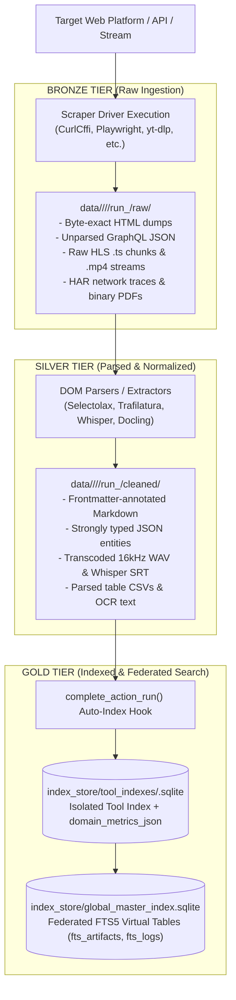
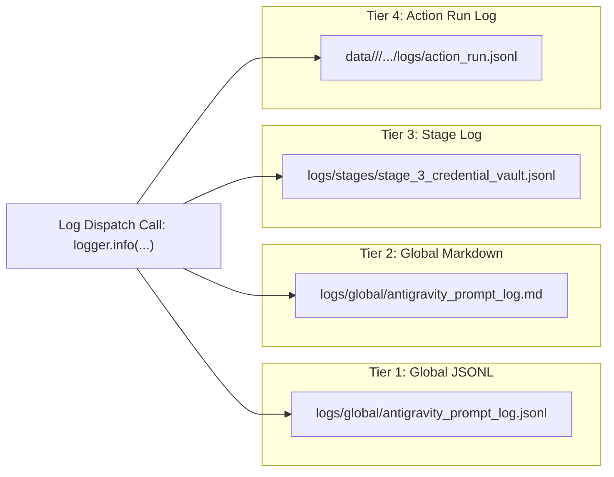

# Master Folder Taxonomy & Data Lake Multi-Tier Specification
**Project:** `Crawlers_testing` | **Status:** Formal Storage & Taxonomy Specification | **Stage:** Stage 3 Active

---

## 1. Root Directory Taxonomy & Architectural Boundaries

`Crawlers_testing` maintains strict physical directory isolation to prevent race conditions, avoid file-lock deadlocks on Windows, eliminate secret sprawl, and ensure deterministic reproducibility.

### 1.1 Complete Repository Filesystem Blueprint

```
D:\Project_Files\Crawlers_testing\
├── .agents/                               # Antigravity Governance & Rule Configurations
│   └── rules/
│       └── antigravity_governance.md      # Rules 1-6 Governance Specification
├── .venv/                                 # Isolated Python 3.14 Virtual Environment
├── backend/                               # Control Plane API & WebSocket Streaming Server
│   └── app.py                             # FastAPI Application (:8000), WS Hub & Telemetry
├── core/                                  # Core Operational Framework (Governance, Vault, Indexing)
│   ├── account_router.py                  # Account Pool Router, Quotas & Cooldown Quarantine
│   ├── auth_injector.py                   # 20-Tool Auth Bundle Injector & Ephemeral Shredder
│   ├── base_indexer.py                    # Base SQLite/JSON Indexing Class for 20 Tools
│   ├── browser_session_recorder.py        # Playwright Session & Cookie Jar Recorder
│   ├── cli_tracker.py                     # CLI Wrapper for live_state.json Telemetry
│   ├── credential_vault.py                # Encrypted SQLite Credential Vault (WAL Mode)
│   ├── crypto_engine.py                   # AES-256-GCM + PBKDF2 (600k iters) Cryptographic Engine
│   ├── folder_manager.py                  # Bronze/Silver Run Directory Allocator & Auto-Index Hook
│   ├── git_manager.py                     # Atomic Git Commits & Pre-Commit Secret Guard
│   ├── global_indexer.py                  # Global Master Indexer & SQLite FTS5 Federation
│   ├── logger_engine.py                   # Simultaneous 4-Tier Structured Logger
│   ├── state_tracker.py                   # Atomic live_state.json Read/Write & psutil Monitor
│   ├── totp_helper.py                     # RFC 6238 2FA TOTP Engine with Clock-Skew Windowing
│   ├── vault_importer.py                  # Netscape, CSV, JSON & 1000-Account Bulk Importer
│   └── verify_step_*.py                   # Master Automated Verification Test Suites
├── data/                                  # Data Lake: Bronze & Silver Storage (Rule 3)
│   ├── 01_curl_cffi/                      # Tool 01 Scraped Output Hierarchy
│   │   └── <action_name>/                 # e.g., scrape_for_leetcode, scrape_for_insta
│   │       └── <YYYY-MM-DD>/              # Date Partition (e.g., 2026-10-18)
│   │           └── run_<HHMMSS>_<uuid8>/  # Atomic Isolated Run Directory
│   │               ├── raw/               # BRONZE TIER: Immutable raw bytes/HTML/streams
│   │               ├── cleaned/           # SILVER TIER: Normalized structured JSON/Markdown
│   │               ├── logs/              # TIER 4 LOG: Run-isolated action_run.jsonl
│   │               └── run_manifest.json  # Cryptographic run provenance & SHA-256 hashes
│   └── ... [02 through 20]                # Isolated directories for each of the 20 engines
├── docs/                                  # Master Engineering Documentation Spine
│   ├── 01_architecture_and_flows/         # System Architecture, DFDs, State Machines & Sequences
│   ├── 02_database_and_security/          # Relational Schemas, ERDs, FTS5 & Cryptography
│   ├── 03_folder_and_file_reference/      # Directory Taxonomy, Code Reference & Tool Catalog
│   └── 04_operations_and_guides/          # Deployment, CLI Guides & Disaster Recovery
├── frontend/                              # Responsive Antigravity Control Center (Dark-Mode UI)
│   ├── app.js                             # Control Center Client Logic (Tabs 1-5 Controllers)
│   ├── index.html                         # Multi-Tab Layout, 60 FPS Canvas HUD & Modals
│   └── styles.css                         # Custom Dark-Mode Typography & Component Styles
├── index_store/                           # GOLD TIER: Search Indexes & Metadata Catalogs
│   ├── global_master_index.sqlite         # Federated SQLite FTS5 Search Index (WAL Mode)
│   ├── global_master_index.json           # Git-Tracked Master Catalog Snapshot
│   └── tool_indexes/                      # 20 Dedicated Tool SQLite Databases & JSON Snapshots
│       ├── <tool_id>.sqlite               # Isolated per-tool SQLite run database
│       └── <tool_id>_index.json           # Git-tracked per-tool JSON companion mirror
├── logs/                                  # Multi-Tier System Diagnostic Logs
│   ├── global/                            # TIER 1 & 2 LOGS
│   │   ├── antigravity_prompt_log.jsonl   # Machine-readable historical prompt audit log
│   │   ├── antigravity_prompt_log.md      # Human-readable prompt milestone log
│   │   └── live_state.json                # Live Telemetry State File (1 Hz HUD Updates)
│   └── stages/                            # TIER 3 LOGS
│       ├── stage_1_scaffolding.jsonl      # Stage 1 Milestone Logs
│       ├── stage_2_indexing.jsonl         # Stage 2 Milestone Logs
│       └── stage_3_credential_vault.jsonl # Stage 3 Milestone Logs
├── tools/                                 # 20 Scraping Engine Adapters & Registries
│   ├── registry.json                      # Master 20-tool manifest, batches & supported actions
│   └── <tool_id>/                         # Dedicated Tool Package (e.g., tools/01_curl_cffi/)
│       ├── adapter.py                     # Standardized crawler execution wrapper
│       ├── indexer.py                     # Tool-specific domain metric extractor
│       ├── config.json                    # Tool metadata, runtime flags & timeout limits
│       └── logs/                          # TIER 2 LOG: tools/<tool_id>/logs/tool_ops.jsonl
├── vault_store/                           # Encrypted Security Vault (Rule 6 - Git Ignored)
│   ├── credentials_vault.sqlite           # AES-256-GCM Encrypted Account Database (WAL Mode)
│   ├── credentials_vault.sqlite-wal       # SQLite Write-Ahead Log buffer
│   ├── README_VAULT.md                    # Vault architecture & key management instructions
│   ├── vault_stats_public.json            # Non-sensitive aggregate metrics (Git Tracked)
│   └── temp_cookies/                      # Ephemeral Netscape cookies directory (Zero-Fill Shredded)
├── .env                                   # Local Secret Keys (VAULT_MASTER_KEY, VAULT_KDF_SALT)
├── .env.example                           # Safe Template with placeholder keys (Git Tracked)
├── .gitignore                             # Git exclusion rules (Blocking .env, *.sqlite, raw cookies)
└── GEMINI.md                              # Mandatory Antigravity Workspace Governance Protocol
```

---

## 2. Data Lake Multi-Tier Hierarchy: Bronze, Silver & Gold

Data flowing through `Crawlers_testing` advances through three distinct stages of refinement, adhering to the Databricks Medallion Architecture adapted for distributed web scraping:



### 2.1 Bronze Tier (`raw/`): Immutable Source Captures
- **Path:** `data/<tool_id>/<action_name>/<YYYY-MM-DD>/run_<HHMMSS>_<uuid8>/raw/`
- **Integrity Rule:** Once written, files in `raw/` are **strictly append-only and immutable**. Parsers must never alter or overwrite raw files in-place.
- **Payload Types:**
  - Raw HTML responses directly from the network socket (e.g., `leetcode_problem.html`).
  - Unmodified API JSON responses containing full nested response graphs.
  - Video stream fragments (`chunk_001.ts`, `manifest.m3u8`).
  - Raster screenshots and camera frames (`fullpage.png`).
  - Network archive HAR dumps (`network_traffic.har`).

### 2.2 Silver Tier (`cleaned/`): Structured Entities & Media
- **Path:** `data/<tool_id>/<action_name>/<YYYY-MM-DD>/run_<HHMMSS>_<uuid8>/cleaned/`
- **Transformation Standards:**
  - Boilerplate-stripped article text in clean CommonMark format with YAML frontmatter.
  - Entity-extracted JSON records (e.g., question title, difficulty, acceptance rate, tags).
  - Stitch-muxed MP4 video with synchronized audio tracks.
  - Normalized audio extracted as 16kHz single-channel mono PCM `.wav` files.
  - Time-aligned subtitles and speech segments formatted in `.srt` or `.vtt`.
  - Tabular data extracted as clean CSV tables with header rows.

### 2.3 Gold Tier (`index_store/`): Search & Discovery Aggregates
- **Path:** `index_store/global_master_index.sqlite` and `index_store/tool_indexes/<tool_id>.sqlite`
- **Capabilities:**
  - Instant full-text keyword and phrase search via SQLite FTS5.
  - Pre-computed domain metrics (e.g., HTTP response codes, latency percentiles, word counts).
  - Cross-tool federated discovery across millions of historical runs without walking the disk filesystem.

---

## 3. Run Directory Anatomy & Cryptographic Run Manifest Contract

Every invocation of `core/folder_manager.py:create_action_run()` provisions an isolated run directory containing:

```
run_<HHMMSS>_<uuid8>/
├── raw/
│   └── [raw network response files]
├── cleaned/
│   └── [parsed structured deliverables]
├── logs/
│   └── action_run.jsonl        <-- Tier 4 execution log
└── run_manifest.json           <-- Cryptographic run contract
```

### 3.1 `run_manifest.json` Concrete Schema Specification

The manifest acts as the legal contract certifying data provenance, execution duration, and cryptographic file hashes:

```json
{
  "run_id": "run_150044_a01c09ef",
  "tool_id": "01_curl_cffi",
  "action_name": "scrape_for_leetcode",
  "run_date": "2026-10-18",
  "target_url": "https://leetcode.com/problems/two-sum/",
  "started_at": "2026-10-18T15:00:44.128490+00:00",
  "ended_at": "2026-10-18T15:00:45.389124+00:00",
  "elapsed_sec": 1.26,
  "status": "success",
  "git_commit": "d054dc1e82a93b4f91c78216",
  "raw_file_count": 1,
  "cleaned_file_count": 1,
  "raw_total_bytes": 148292,
  "cleaned_total_bytes": 4821,
  "files": [
    {
      "tier": "raw",
      "filename": "two_sum_raw.html",
      "extension": ".html",
      "size_bytes": 148292,
      "sha256": "e3b0c44298fc1c149afbf4c8996fb92427ae41e4649b934ca495991b7852b855",
      "sha256_short": "e3b0c44298fc1c14",
      "relpath": "data/01_curl_cffi/scrape_for_leetcode/2026-10-18/run_150044_a01c09ef/raw/two_sum_raw.html"
    },
    {
      "tier": "cleaned",
      "filename": "two_sum_problem.json",
      "extension": ".json",
      "size_bytes": 4821,
      "sha256": "8f434346648f6b96df89dda901c5176b10a6d83961dd3c1ac88b59b2dc327aa4",
      "sha256_short": "8f434346648f6b96",
      "relpath": "data/01_curl_cffi/scrape_for_leetcode/2026-10-18/run_150044_a01c09ef/cleaned/two_sum_problem.json"
    }
  ],
  "domain_metrics": {
    "http_status": 200,
    "ja4_signature": "t13d1516h2_8daaf6152771_b186095e22b6",
    "tls_version": "TLSv1.3",
    "parser_speed_ms": 14.2
  }
}
```

---

## 4. Log Store Taxonomy (Rule 2 Compliance)

`Crawlers_testing` enforces a **4-Tier Simultaneous Logging Model** governed by `core/logger_engine.py`:

```
+==================================================================================================+
| LOG TIER             | FILE LOCATION                          | FORMAT | FLUSH FREQUENCY / PURPOSE|
+----------------------+----------------------------------------+--------+--------------------------+
| Tier 1: Global JSONL | logs/global/antigravity_prompt_log.jsonl| JSONL  | Real-time prompt events  |
| Tier 2: Global MD    | logs/global/antigravity_prompt_log.md  | Table  | Executive human summary  |
| Tier 3: Stage Log    | logs/stages/stage_<N>_<name>.jsonl     | JSONL  | Stage-isolated audit log |
| Tier 4: Action Run   | data/.../logs/action_run.jsonl         | JSONL  | Run-specific debug log   |
+==================================================================================================+
```



---

## 5. Vault & Security Directory Taxonomy (Rule 6 Compliance)

The `vault_store/` hierarchy is partitioned to isolate long-term encrypted secrets from short-lived execution artifacts:

```
vault_store/
├── credentials_vault.sqlite           # Encrypted SQLite database (Strictly Git-Ignored)
├── credentials_vault.sqlite-wal       # SQLite Write-Ahead Log journal (Git-Ignored)
├── credentials_vault.sqlite-shm       # SQLite Shared Memory index (Git-Ignored)
├── README_VAULT.md                    # Architecture and developer instructions (Git-Tracked)
├── vault_stats_public.json            # Non-sensitive aggregate metrics (Git-Tracked)
└── temp_cookies/                      # Ephemeral Netscape cookies directory (Git-Ignored)
    └── ephemeral_<tool>_<run>.cookies.txt  # Lifespan: with authenticated_session(): block only
```

### 5.1 Ephemeral Cookie Life Cycle & Zero-Fill Guarantee
- Files inside `vault_store/temp_cookies/` are created on-the-fly when a tool requests an authenticated session.
- The path is passed into the crawler process via command-line flags or environment variables.
- Upon context exit (normal completion or error), `AuthInjector.shred_ephemeral_artifacts()` overwrites the file bytes with `0x00`, flushes the OS cache via `os.fsync()`, and unlinks the inode from disk, leaving zero residual plaintext on physical storage.
