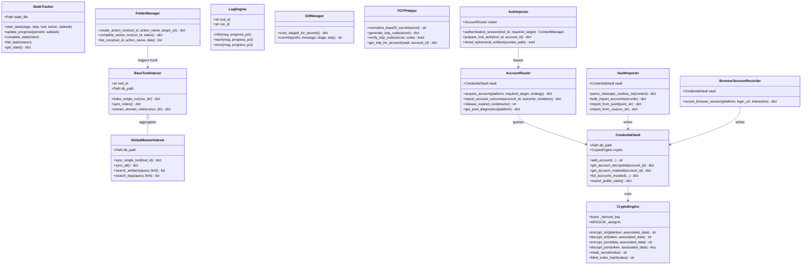

# Core Framework & API Technical Reference Manual
**Project:** `Crawlers_testing` | **Status:** Formal Code & Interface Specification | **Stage:** Completed (Full 6-Stage Web Scraping Testbed & Benchmarking Engine)

---

## 1. Architectural Class & Module Hierarchy

The core system components in `core/`, `backend/`, and `frontend/` form a strongly typed, object-oriented framework enforcing governance, data isolation, search indexing, and cryptographic security.

### 1.1 Core Class Hierarchy Diagram (Mermaid)

---

## 2. Core Governance & Telemetry Modules

### 2.1 `core/folder_manager.py` — Bronze/Silver Run Allocator & Auto-Index Hook
- **Purpose:** Enforces Antigravity Governance Rule 3 (Data Isolation) and Rule 5 (Auto-Indexing).
- **Core Functions:**
  - `create_action_run(tool_id: str, action_name: str, target_url: str = "") -> dict`:
    - Generates a deterministic run identifier: `run_<HHMMSS>_<uuid8>`.
    - Computes directory path: `data/<tool_id>/<action_name>/<YYYY-MM-DD>/<run_id>/`.
    - Creates child folders: `raw/`, `cleaned/`, `logs/`.
    - Initializes preliminary `run_manifest.json` recording `started_at` in ISO-8601 UTC.
  - `complete_action_run(run_id: str, status: str = "success", error_message: str = "") -> dict`:
    - Scans `raw/` and `cleaned/` directories, computing exact byte counts and SHA-256 hashes for every file.
    - Finalizes `run_manifest.json` recording `ended_at`, `elapsed_sec`, and file manifests.
    - **Rule 5 Auto-Index Hook:** Instantiates the tool indexer (`core/base_indexer.py:BaseToolIndexer`) to update `<tool_id>.sqlite` and federates changes into `index_store/global_master_index.sqlite`.

### 2.2 `core/state_tracker.py` & `core/cli_tracker.py` — Live Telemetry & HUD State Machine
- **Purpose:** Enforces Antigravity Governance Rule 1 (Live State Telemetry).
- **Architecture:** Provides atomic read/write synchronization over `logs/global/live_state.json` via file-locking wrappers.
- **Core Functions:**
  - `start_task(stage: str, step: str, tool_id: str, action: str, subtask: str)`:
    - Sets `is_running = true`, resets `progress_percent = 0`, records `started_at_epoch`.
    - Spawns background process monitoring via `psutil` to track active Python/Chromium worker PIDs, CPU usage %, and RAM consumption in MB.
  - `update_progress(progress_percent: int, subtask: str)`:
    - Updates progress percentage ($0 \le \text{pct} \le 100$) and appends an event to the circular `recent_events` buffer.
  - `complete_task(notes: str = "")`:
    - Sets `progress_percent = 100`, `is_running = false`, and records elapsed execution seconds.
  - `fail_task(reason: str)`:
    - Sets `is_running = false`, flags failure reason, and persists error state for HUD alerts.
- **CLI Wrapper (`core/cli_tracker.py`):**
  - Exposes subcommands `start`, `update`, `complete`, and `fail` for terminal scripts and agent automation.

### 2.3 `core/logger_engine.py` — Simultaneous 4-Tier Structured Logger
- **Purpose:** Enforces Antigravity Governance Rule 2 (4-Tier Structured Logging).
- **Architecture:** Every log dispatch formats and appends structured records to all 4 tiers concurrently:
  1. `logs/global/antigravity_prompt_log.jsonl` (Global JSONL audit trail)
  2. `logs/global/antigravity_prompt_log.md` (Markdown table with UTC timestamp, stage, tool, action, and message)
  3. `logs/stages/stage_<N>_<name>.jsonl` (Stage-isolated log)
  4. `data/<tool>/<action>/<date>/<run>/logs/action_run.jsonl` (Run-specific log)
- **Core Classes & Functions:**
  - `LogEngine(tool_id, action_name, run_id, stage, step)`: Main per-run logger instance providing `.info()`, `.warn()`, `.error()`.
  - `ToolLogger(tool_id, stage, step)`: Simplified logger for adapter stubs without an active run context.
  - `log_global(message, level, stage, step, tool_id, action_name, run_id, progress_pct)`: Standalone convenience function used by CLI tools and verification suites.

### 2.4 `core/git_manager.py` — Atomic Commits & Pre-Commit Secret Guard
- **Purpose:** Enforces Antigravity Governance Rule 4 (Atomic Commits) and Rule 6 (Zero-Plaintext Security).
- **Core Functions:**
  - `scan_staged_for_secrets() -> dict`:
    - Inspects `git diff --cached` for staged secret patterns:
      - Forbidden files: `.env`, `*.sqlite`, `*.sqlite-wal`, `*.cookies.txt`.
      - High-entropy tokens: `v1:aes256gcm:`, `ghp_`, `xoxb-`, `AIzaSy`.
      - Private keys: `-----BEGIN RSA/EC PRIVATE KEY-----`.
    - If a violation is discovered, automatically unstages the file (`git reset HEAD <file>`), blocks the commit, and logs an alert.
  - `commit(prefix: str, message: str, stage: str = "", step: str = "") -> str`:
    - Validates commit prefix: `[SCAFFOLD]`, `[TOOL-INSTALL]`, `[UPDATE]`, `[FIX]`, `[RUN-LOG]`.
    - Executes `scan_staged_for_secrets()`.
    - Executes `git commit -m "[PREFIX] Message — Stage X Step Y.Z"`.
    - Cross-references the resulting Git commit hash into `logs/global/antigravity_prompt_log.jsonl`.

---

## 3. Core Indexing & Search Modules

### 3.1 `core/base_indexer.py` — BaseToolIndexer Engine
- **Purpose:** Enforces Antigravity Governance Rule 5 (Auto-Indexing) on a per-tool level.
- **Key Methods:**
  - `_init_db()`: Initializes tables `tool_metadata`, `indexed_runs`, `indexed_files`, and `indexed_logs` under WAL mode.
  - `index_single_run(run_dir: Path) -> dict`: Reads `run_manifest.json`, extracts domain KPIs, computes SHA-256 digests, and upserts rows into `<tool_id>.sqlite`.
  - `extract_domain_metrics(run_dir: Path) -> dict`: Abstract method overridden by each tool's `tools/<tool_id>/indexer.py` to extract mechanism-specific metrics.
  - `sync_index() -> dict`: Synchronizes the SQLite database state to its companion JSON snapshot `index_store/tool_indexes/<tool_id>_index.json`.

### 3.2 `core/global_indexer.py` — GlobalMasterIndexer & FTS5 Federation
- **Purpose:** Provides unified cross-tool search and master discovery.
- **Key Methods:**
  - `_init_db()`: Initializes relational tables (`global_tools`, `global_runs`, `global_files`, `global_logs`) and FTS5 virtual tables (`fts_artifacts`, `fts_logs`) with `tokenize='porter unicode61'`.
  - `sync_single_tool(tool_id: str) -> dict`: Reads records from `<tool_id>.sqlite` and upserts them into `global_master_index.sqlite`.
  - `sync_all() -> dict`: Iterates across all 20 tool databases, re-indexes 4-tier logs, populates FTS5 posting lists, and writes `index_store/global_master_index.json`.
  - `search_artifacts(query: str, limit: int = 50, offset: int = 0) -> list[dict]`: Executes an Okapi BM25 ranked full-text query over `fts_artifacts` with highlight annotations.
  - `search_logs(query: str, limit: int = 100) -> list[dict]`: Executes full-text search over `fts_logs`.

---

## 4. Core Security & Credential Vault Modules

### 4.1 `core/crypto_engine.py` — AES-256-GCM & PBKDF2 Cryptographic Engine
- **Purpose:** Enforces Antigravity Governance Rule 6 (Zero-Plaintext Security).
- **Core Methods:**
  - `_derive_key(master_bytes, salt_bytes) -> bytes`: Derives 256-bit key via PBKDF2-HMAC-SHA256 (600,000 iterations). Caches the key in memory.
  - `encrypt_str(plaintext: str, associated_data: str = "") -> str`: Generates a fresh 12-byte nonce, encrypts via AES-256-GCM, and returns `v1:aes256gcm:<base64url>`.
  - `decrypt_str(token: str, associated_data: str = "") -> str`: Verifies 128-bit GHASH tag and row-bound associated data; decrypts and returns plaintext string.
  - `encrypt_json(data: Any, associated_data: str = "") -> str`: Serializes dictionary/list to compact JSON and encrypts.
  - `decrypt_json(token: str, associated_data: str = "") -> Any`: Decrypts token and deserializes to Python object.
  - `mask_secret(value: str) -> str`: Formats string into `adm*******01` preview for safe UI display.
  - `blind_index_hash(value: str) -> str`: Computes deterministic HMAC-SHA256 hash for $O(1)$ duplicate lookups without plaintext exposure.

### 4.2 `core/credential_vault.py` — Encrypted Credential Vault
- **Purpose:** Production-grade SQLite repository for authenticated scraping identities.
- **Core Methods:**
  - `add_account(...) -> str`: Encrypts passwords, cookies, tokens, and TOTP seeds using row-bound `account_id` as Associated Data. Stores record in `vault_accounts`.
  - `get_account_decrypted(account_id: str) -> dict`: Retrieves account and decrypts all confidential fields in-memory for immediate tool consumption.
  - `get_account_masked(account_id: str) -> dict`: Returns account profile with all secrets masked (suitable for API and frontend display).
  - `list_accounts_masked(platform, status, target_handle, limit, offset) -> dict`: Paginated account list with zero secret exposure.
  - `export_public_stats() -> dict`: Generates non-sensitive aggregate metrics and syncs to `vault_store/vault_stats_public.json`.

### 4.3 `core/totp_helper.py` — RFC 6238 2FA Engine
- **Core Methods:**
  - `normalize_base32_secret(secret: str) -> str`: Sanitizes user input (strips spaces/dashes, pads Base32 `=`).
  - `generate_totp_code(secret: str, timestamp: float = None) -> dict`: Computes current 6-digit code, remaining validity seconds ($30 - (t \pmod{30})$), and validity boolean.
  - `verify_totp_code(secret: str, code: str, valid_window: int = 1) -> bool`: Verifies code with $\pm 1$ time-step window to accommodate network and clock skew.
  - `get_totp_for_account(vault, account_id) -> dict`: Decrypts TOTP seed from vault and computes code without exposing raw Base32 secret.

### 4.4 `core/vault_importer.py` — Multi-Format Bulk Importer
- **Core Methods:**
  - `parse_netscape_cookies_txt(content: str) -> dict`: Parses standard Netscape 7-column tab-delimited cookie files into structured JSON dictionaries and extracts session tokens (`sessionid`, `csrftoken`).
  - `bulk_import_accounts(records: list[dict], on_conflict: str = "update") -> dict`: Batch imports up to 1,000 accounts within a single atomic SQLite transaction.
  - `import_from_jsonl(jsonl_str: str, ...)` & `import_from_csv(csv_str: str, ...)`: Parses bulk account files into normalized vault schemas.

### 4.5 `core/account_router.py` — Smart Account Pool Router & Quotas
- **Core Methods:**
  - `release_expired_cooldowns() -> int`: Auto-recovers accounts whose `cooldown_until_epoch` has expired back to `active`.
  - `acquire_account(platform: str, required_target: str = "", strategy: str = "least_recently_used") -> dict`:
    - If `required_target` is provided, executes SQL JOIN against `account_target_access` to select only accounts confirmed to follow that private target.
    - Applies routing strategy (`least_recently_used`, `lowest_quota_usage`, `health_weighted_random`).
    - Verifies daily quota limits (`requests_today < daily_quota_limit`).
  - `report_account_outcome(account_id: str, outcome: str, cooldown_seconds: float = 1800)`: Adjusts health scores ($0 \dots 100$) and places rate-limited accounts into quarantine cooldown.

### 4.6 `core/browser_session_recorder.py` — Browser Session Capture
- **Core Methods:**
  - `record_browser_session(platform, login_url, interactive=True, engine="playwright", wait_seconds=30, ...)`:
    - Launches browser (headed if interactive, headless otherwise).
    - Captures storage state: `context.cookies()`, `window.localStorage`, `window.sessionStorage`.
    - Detects authentication tokens and encrypts credentials directly into `CredentialVault`.

### 4.7 `core/auth_injector.py` — Universal 20-Tool Auth Bundle Injector
- **Core Methods:**
  - `prepare_tool_auth(tool_id: str, account_id: str) -> dict`: Synthesizes tool-specific auth bundles:
    - `http_bundle`: Headers + cookie jar for `01_curl_cffi`, `04_httpx_parsel`.
    - `scrapy_bundle`: Cookie dictionary for `03_scrapy`.
    - `playwright_bundle`: `storage_state.json` structure for `06_playwright`, `07_patchright`.
    - `cdp_bundle`: Network domain cookie list for `09_nodriver`.
    - `cli_media_bundle`: Ephemeral Netscape cookie file for `11_yt_dlp_ffmpeg`, `12_instaloader`, `13_gallery_dl`.
  - `authenticated_session(tool_id, required_target, strategy) -> ContextManager`:
    - Context manager provisioning active credentials, writing ephemeral files, and executing **zero-fill byte shredding** upon exit.

---

## 5. Control Plane API & Frontend Architecture

### 5.1 `backend/app.py` — FastAPI REST & WebSocket Server (:8000)
- **REST Endpoints:**
  - `GET /api/state`: Returns current `live_state.json` telemetry.
  - `GET /api/tools`: Returns 20-tool catalog from `tools/registry.json`.
  - `GET /api/git-log`: Returns recent Git commits with stage/step tags.
  - `GET /api/data-tree`: Returns hierarchical tree of data lake directories.
  - `POST /api/run-tool/{tool_id}`: Launches scraping run with optional `auth_strategy` and `target_handle`.
  - `GET /api/tool-indexes` & `GET /api/tool-indexes/{tool_id}`: Queries isolated tool SQLite indexes.
  - `GET /api/search`: Executes Okapi BM25 ranked full-text queries over `global_master_index.sqlite`.
  - `GET /api/vault/diagnostics`: Returns pool health metrics and non-sensitive public stats.
  - `GET /api/vault/accounts` & `POST /api/vault/accounts`: Masked account inventory CRUD.
  - `POST /api/vault/bulk-import`: High-speed batch credential ingestion.
  - `POST /api/vault/accounts/{id}/totp`: Ephemeral 6-digit 2FA code generation.
  - `POST /api/vault/record-session`: Programmatic/interactive browser session capture (executed via `asyncio.to_thread`).
  - `POST /api/vault/test-injection`: 20-tool auth router sandbox test with ephemeral cookie shredding verification.
- **WebSocket Endpoints:**
  - `/ws/telemetry`: Broadcasts `live_state.json` updates and worker CPU/RAM telemetry at 1 Hz.
  - `/ws/logs`: Tails `logs/global/*.jsonl` using kernel filesystem notifications (`watchdog`) and streams new log records in real time.

### 5.2 Frontend Dashboard Architecture (`frontend/`)
- **`frontend/index.html`:** Semantic HTML5 multi-tab layout featuring:
  - Top Live Telemetry HUD Bar (Stage, Step, Tool, Elapsed Time, Worker CPU/RAM canvas monitors).
  - Tab 1: Live Telemetry Dashboard & Worker Process Monitor.
  - Tab 2: 20-Tool Execution Hub & Parameter Configuration Forms.
  - Tab 3: Data Lake Inspector (Bronze & Silver hierarchy).
  - Tab 4: Dual-Index Search Engine (BM25 Artifact & Log Explorer).
  - Tab 5: Credential Vault & Session Manager (Masked accounts table, 6-card KPI ribbon, target coverage matrix, and Add/Import/Record modals).
  - Tab 6: ⚙ Working Ways & Safe Arena Studio (Human simulation, multi-tool arena, task router).
  - Tab 7: 🧪 Real Task Pipelines & Cleaned Inspector (4 production pipelines, artifact streamer, contract matrix).
  - Tab 8: 📊 Master Benchmarks, Chaos Lab & Exporter (Tournament leaderboards, fault injection, standalone packaging).
- **`frontend/app.js`:** Pure vanilla JavaScript controller establishing WebSocket reconnect loops, handling tab switches (`Alt + 1` to `Alt + 8`), rendering dynamic charts, and managing modal workflows.
- **`frontend/styles.css`:** Custom dark-mode theme utilizing CSS Grid, Flexbox, high-contrast monospace status badges, and yellow highlight pills (`mark.fts-hl`).

---

## 6. Working Ways & Concurrency Modules (Stage 4)

### 6.1 `core/human_timing.py` — Statistical Human Pacing & Delay Distributions
- **Core Classes:** `HumanTimingEngine`, `TimingProfile` (`FAST_AUTOMATED`, `BALANCED_HUMAN`, `STEALTH_PARANOID`, `STREAM_PACED`).
- **Core Methods:**
  - `gaussian_delay(mean, std_dev) -> float`: Bell-curve randomized delay bounded by minimum threshold.
  - `log_normal_delay(mean, sigma) -> float`: Skewed long-tail reaction delay modeling human thought pauses.
  - `exponential_backoff_jitter(attempt, base_delay, max_delay) -> float`: Backoff delay with uniform jitter for HTTP 429 recovery.
  - `keystroke_delay(wpm) -> float`: Inter-character typing cadence.
  - `reading_pause(word_count) -> float`: Contextual reading delays calculated from page density.

### 6.2 `core/human_interaction.py` — Neuromotor Kinematics & Mouse Trajectories
- **Core Classes:** `HumanInteractionEngine`.
- **Core Methods:**
  - `generate_bezier_path(start, end, control_points=2) -> list[tuple]`: Computes cubic Bezier trajectory simulating human arm kinematics.
  - `apply_micro_hesitations(path) -> list[tuple]`: Injects overshoot, corrective tremors, and variable velocity.

### 6.3 `core/arena_runner.py` — Safe Multi-Tool Head-to-Head Arena
- **Core Classes:** `SafeArenaRunner`.
- **Core Methods:**
  - `run_arena_tournament(tools, target_url, stagger_delay, timeout) -> dict`: Executes multiple tools in parallel with staggered offsets, monitors RAM/CPU consumption, and ranks tools by speed, yield ratio, and memory footprint.
  - Persists reports to `index_store/arena_reports/arena_<id>.json` and `.md`.

### 6.4 `core/task_router.py` — Precision Task Router & Artifact Handoffs
- **Core Classes:** `PrecisionTaskRouter`.
- **Core Methods:**
  - `execute_routed_task(task_type, target, config) -> dict`: Dynamically routes task to primary engine, monitors extraction success, pivots to fallback engines upon detection, and chains downstream enrichment processors.
  - `build_graphql_markdown_pipeline(target_url)`: Two-stage LeetCode GraphQL fetch to LLM-ready markdown chunker recipe.
  - `build_stream_whisper_pipeline(target_url)`: Two-stage stream capture & demux to faster-whisper speech & knowledge graph.
  - `build_browser_ocr_pipeline(target_url)`: Two-stage browser snapshot to OCR table grid resolver recipe.

### 6.5 `core/human_adapter_helper.py` — Browser Kinematics & Human Navigation Bridge
- **Core Classes:** `HumanAdapterHelper`.
- **Core Methods:**
  - `warmup_page_human(page, scroll_passes, dwell_time)`: Simulates initial human landing pauses, viewport dwells, and subtle scroll micro-adjustments.
  - `browse_feed_human(page, target_item_selector, max_scrolls)`: Simulates authentic social feed browsing with eye-scan dwells, hesitation backtrack scrolling, and reading pauses.
  - `click_element_human(page, selector)`: Moves mouse along a cubic Bezier trajectory with biological micro-tremors before executing a 2D Gaussian randomized click.
  - `type_text_human(page, selector, text)`: Inputs text at realistic WPM cadences with QWERTY adjacent-key typo generation and backspace correction.

---

## 7. Silver-Tier Contract Engine & Task Pipelines (Stage 5)

### 7.1 `core/cleaning_pipeline.py` — Data Lake Silver Tier Contracts
- **Core Classes:** `CleaningPipeline`.
- **Pydantic Contract Models:**
  - `CleanedMarkdownContract`: Normalized editorial Markdown with title, word count, headers hierarchy, and reading time.
  - `CleanedCodeProblemContract`: LeetCode specification, constraints, starter code templates, and test vectors.
  - `CleanedSocialMediaContract`: Media metadata, demuxed stream paths, Whisper transcript, and entity graph.
  - `CleanedForensicsContract`: SingleFile snapshot digest, network origins, API endpoints, and cookies.
  - `CleanedMultimodalContract`: Multi-modal unified layout tree, OCR blocks, and table 2D grids.

### 7.2 Production Task Pipelines (`pipelines/`)
- `01_leetcode_archiver.py`: Chains `01_curl_cffi` TLS/JA3 GraphQL fetcher to extract LeetCode specifications, markdownify descriptions, and starter code templates.
- `02_social_media_pipeline.py`: Chains `11_yt_dlp_ffmpeg` with `20_faster_whisper` to harvest authenticated reels and generate speech transcripts.
- `03_secured_snapshot_forensics.py`: Chains `14_singlefile_archive` and `07_patchright` to generate immutable forensic HTML snapshots and network origin audits.
- `04_multimodal_auto_resolver.py`: Chains `06_playwright`, `17_surya_ocr`, and `18_paddleocr_img2table` for multimodal DOM/OCR/Table/PDF ingestion.

---

## 8. Master Benchmarks, Chaos Resilience & Exporter Modules (Stage 6)

### 8.1 `core/benchmark_engine.py` — Master 20-Tool Performance Matrix
- **Core Classes:** `BenchmarkEngine`.
- **Core Methods:**
  - `run_tool_benchmark(tool_id, target_url, iterations) -> dict`: Measures p50, p90, p99 latency, RAM delta, and byte yield.
  - `run_battery_benchmark(tool_ids, target_url, iterations) -> dict`: Evaluates candidate tools and generates Multi-Vector Radar Matrix (Speed, Richness, Stealth, Memory, Reliability).
  - Persists reports to `index_store/benchmark_reports/`.

### 8.2 `core/resilience_tester.py` — Chaos Fault Server & Anti-Bot Resilience
- **Core Classes:** `ResilienceTester`, `ChaosFaultServer`.
- **Evaluated Scenarios:**
  - HTTP 429 Rate Limiting with `Retry-After` backoff & account quarantine.
  - Mutated DOM with CSS class scrambling & semantic fallback relocation.
  - Network Chaos with socket resets, connection drops & latency spikes.
  - Schema Contract Fuzzing with malformed payloads & Pydantic error validation.

### 8.3 `core/project_exporter.py` — Zero-Leak Standalone Project Exporter
- **Core Classes:** `ProjectExporter`.
- **Core Methods:**
  - `export_standalone_tool(tool_id, output_format) -> dict`: Packages tool into standalone directory with `run.py`, `adapter.py`, `compat.py`, `requirements.txt`, and `README.md`.
  - `bundle_data_lake(scope, pipeline_id, archive_format) -> dict`: Creates signed ZIP archive of Silver-Tier deliverables with SHA-256 manifest catalog and Zero-Leak security filtering.
  - `export_standalone_pipeline(pipeline_id) -> dict`: Packages pipeline with `pipeline_runner.py` and `Dockerfile`.
