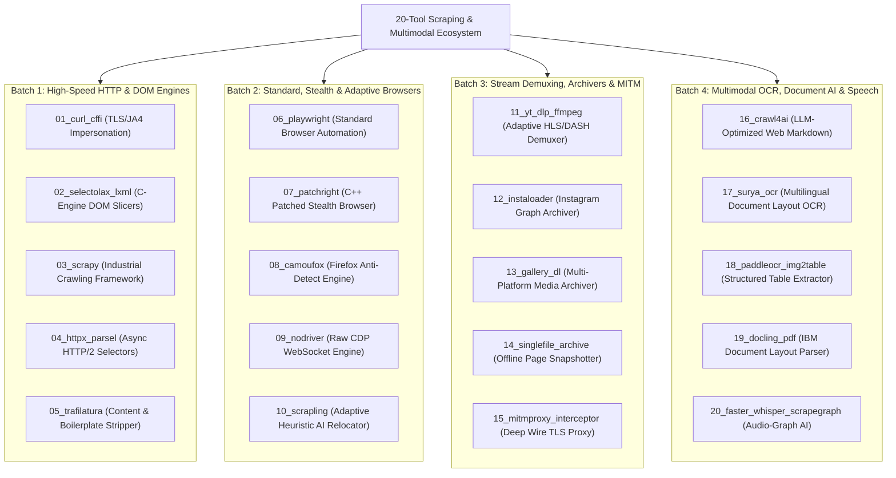

# 20-Tool Scraping Adapter & Architecture Catalog
**Project:** `Crawlers_testing` | **Status:** Formal Tool Catalog Specification | **Stage:** Completed (Full 6-Stage Web Scraping Testbed & Benchmarking Engine)

---

## 1. Master 20-Tool Overview Matrix

The platform orchestrates 20 specialized scraping, archiving, and multimodal extraction engines grouped into four batch cohorts:

```
+======================================================================================================================================+
| ID | TOOL NAME             | BATCH | MECHANISM TYPE       | PRIMARY DEPENDENCY      | DEFAULT ACTION       | OUTPUT FORMATS          |
+----+-----------------------+-------+----------------------+-------------------------+----------------------+-------------------------+
| 01 | 01_curl_cffi          | 1     | HTTP/TLS Impersonate | curl_cffi (BoringSSL)   | scrape_for_leetcode  | HTML, JSON              |
| 02 | 02_selectolax_lxml    | 1     | HTTP/Catalog Parser  | selectolax (Modest C)   | catalog_parse        | HTML, JSON, CSV         |
| 03 | 03_scrapy             | 1     | HTTP/Framework       | Scrapy (Twisted)        | catalog_crawl        | JSONL, CSV              |
| 04 | 04_httpx_parsel       | 1     | HTTP/Async           | httpx + Parsel (libxml2)| api_intercept        | JSON, HTML              |
| 05 | 05_trafilatura        | 1     | HTTP/Content-Extract | Trafilatura             | article_extract      | Clean Markdown, JSON    |
| 06 | 06_playwright         | 2     | Browser/Standard     | Playwright (Chromium)   | scrape_for_leetcode  | HTML, Screenshots, JSON |
| 07 | 07_patchright         | 2     | Browser/Stealth      | Patchright (C++ Patched)| scrape_for_insta     | HTML, JSON, Cookies     |
| 08 | 08_camoufox           | 2     | Browser/Stealth-Fox  | Camoufox (Firefox C++)  | fingerprint_evasion  | HTML, Screenshots       |
| 09 | 09_nodriver           | 2     | Browser/CDP-Stealth  | nodriver (Raw WSS CDP)  | cdp_intercept        | JSON, HTML              |
| 10 | 10_scrapling          | 2     | Browser/Adaptive-AI  | Scrapling               | adaptive_extract     | JSON, Markdown          |
| 11 | 11_yt_dlp_ffmpeg      | 3     | Social/Streams       | yt-dlp + ffmpeg         | video_download       | MP4, MKV, MP3, VTT      |
| 12 | 12_instaloader        | 3     | Social/Instagram     | Instaloader (GraphQL)   | profile_archive      | JPG, MP4, JSON          |
| 13 | 13_gallery_dl         | 3     | Social/Gallery       | gallery-dl (OAuth APIs) | gallery_archive      | PNG, JPG, JSON          |
| 14 | 14_singlefile_archive | 3     | Archiver/Snapshot    | single-file-cli (Node)  | page_archive         | Self-Contained HTML     |
| 15 | 15_mitmproxy_intercept| 3     | MITM/Interceptor     | mitmproxy (TLS Proxy)   | traffic_harvest      | HAR, Flows, JSON        |
| 16 | 16_crawl4ai           | 4     | AI/LLM-Extract       | crawl4ai (Async Web)    | llm_ready_scrape     | Clean Markdown, JSON    |
| 17 | 17_surya_ocr          | 4     | AI/OCR               | surya-ocr (PyTorch)     | document_ocr         | Bounding Boxes, JSON    |
| 18 | 18_paddleocr_img2table| 4     | AI/OCR-Table         | paddleocr + img2table   | table_extract        | Table CSV, Excel, JSON  |
| 19 | 19_docling_pdf        | 4     | AI/PDF               | docling (IBM Layout)    | pdf_parse            | Structured Markdown, JSON|
| 20 | 20_faster_whisper_ai  | 4     | AI/Audio-Graph       | faster-whisper + graph  | audio_transcribe     | WAV, SRT, JSON Graph    |
+======================================================================================================================================+
```

### 1.2 Tool Cohorts & Architecture Taxonomy (Mermaid)



---

## 2. Batch 1: High-Performance HTTP & DOM Engines (Tools 01–05)

### Tool 01: `01_curl_cffi` (TLS/JA3/JA4 Impersonation)
- **Canonical Identity:** `tools/01_curl_cffi` | Mechanism: `HTTP/TLS` | Batch: 1
- **Mechanism:** Implements Python CFFI bindings to a patched Libcurl linked against Google BoringSSL. Replicates exact Chrome, Firefox, and Safari TLS Client Hello fingerprints (cipher permutations, extensions, GREASE, ALPN) and HTTP/2 frame settings, bypassing Cloudflare Turnstile and Akamai Bot Manager without headless browser overhead.
- **Filesystem Structure:**
  ```
  tools/01_curl_cffi/
  ├── adapter.py              # Requests-compatible Session with impersonate="chrome124"
  ├── indexer.py              # Domain metric parser for HTTP/2 & TLS handshake
  ├── config.json             # Timeout, proxy, and retry configurations
  └── logs/tool_ops.jsonl     # Tier 2 tool operations log
  ```
- **Adapter Implementation:** Exposes `run(action_name, target_url, auth_context=None)`. Accepts `auth_context.http_bundle` containing cookie jars and custom headers.
- **Raw Artifacts (`raw/`):** `response_body.html`, `headers_dump.json`.
- **Cleaned Deliverables (`cleaned/`):** `parsed_payload.json` containing status code, title, and extracted page entities.
- **Domain KPIs:** `ja4_signature`, `http_version`, `handshake_time_ms`, `http_status_code`.
- **Auth Compatibility:** `http_bundle` (CookieJar + Session Headers).

---

### Tool 02: `02_selectolax_lxml` (C-Engine DOM Slicers)
- **Canonical Identity:** `tools/02_selectolax_lxml` | Mechanism: `HTTP/Catalog Parser` | Batch: 1
- **Mechanism:** Leverages the Modest engine (Selectolax) written in pure C for ultra-fast CSS node traversal, paired with `lxml` for complex XPath predicates. Bypasses Python object allocation during tree creation, parsing 10MB of dense HTML in under 15ms.
- **Filesystem Structure:** `tools/02_selectolax_lxml/{adapter.py, indexer.py, config.json, logs/tool_ops.jsonl}`.
- **Adapter Implementation:** Downloads via fast HTTP client, converts buffer to C `HTMLParser(html)`, executes bulk CSS selectors, and outputs clean dictionary rows.
- **Raw Artifacts (`raw/`):** `catalog_page.html`.
- **Cleaned Deliverables (`cleaned/`):** `extracted_catalog.json`, `catalog_items.csv`.
- **Domain KPIs:** `modest_parse_time_us`, `nodes_traversed_count`, `selectors_matched_count`.
- **Auth Compatibility:** `http_bundle`.

---

### Tool 03: `03_scrapy` (Industrial Crawling Framework)
- **Canonical Identity:** `tools/03_scrapy` | Mechanism: `HTTP/Framework` | Batch: 1
- **Mechanism:** Asynchronous event-driven crawling architecture powered by Twisted. Supports built-in spider middleware pipelines, item pipelines, automatic robots.txt compliance, domain concurrency throttles, and sitemap crawling.
- **Filesystem Structure:** `tools/03_scrapy/{adapter.py, indexer.py, config.json, logs/tool_ops.jsonl}`.
- **Adapter Implementation:** Wraps Scrapy `CrawlerRunner` into an isolated programmatic execution context with custom Item Pipelines routing outputs to the assigned run directory.
- **Raw Artifacts (`raw/`):** `spider_raw_stream.jsonl`.
- **Cleaned Deliverables (`cleaned/`):** `structured_items.json`, `spider_summary.json`.
- **Domain KPIs:** `pages_crawled_count`, `items_scraped_count`, `crawler_elapsed_sec`, `item_pipeline_latency_ms`.
- **Auth Compatibility:** `scrapy_bundle` (Cookie list dicts passed into `Request(cookies=...)`).

---

### Tool 04: `04_httpx_parsel` (Async HTTP/2 + Parsel Selectors)
- **Canonical Identity:** `tools/04_httpx_parsel` | Mechanism: `HTTP/Async` | Batch: 1
- **Mechanism:** Integrates `httpx` (async HTTP/2 client with connection pooling and SSL context customization) with `parsel` (Scrapy's standalone selector engine). Provides robust CSS and XPath extraction over async coroutines.
- **Filesystem Structure:** `tools/04_httpx_parsel/{adapter.py, indexer.py, config.json, logs/tool_ops.jsonl}`.
- **Adapter Implementation:** Manages `httpx.AsyncClient` session with custom User-Agent rotations and parses responses via `parsel.Selector(text)`.
- **Raw Artifacts (`raw/`):** `api_response.json`, `page_origin.html`.
- **Cleaned Deliverables (`cleaned/`):** `normalized_data.json`.
- **Domain KPIs:** `async_pool_connections_active`, `http2_frame_count`, `parsel_query_latency_ms`.
- **Auth Compatibility:** `http_bundle`.

---

### Tool 05: `05_trafilatura` (Boilerplate Stripper & Text Extractor)
- **Canonical Identity:** `tools/05_trafilatura` | Mechanism: `HTTP/Content-Extract` | Batch: 1
- **Mechanism:** Implements structural density algorithms ($D(node) = \frac{\text{Text Length}}{\text{Tag Count} + \text{Link Density}}$) to isolate main editorial content while algorithmically removing navigation bars, advertisements, cookie notices, and legal disclaimers.
- **Filesystem Structure:** `tools/05_trafilatura/{adapter.py, indexer.py, config.json, logs/tool_ops.jsonl}`.
- **Adapter Implementation:** Fetches web document, calls `trafilatura.extract(html, output_format="markdown", include_formatting=True)`.
- **Raw Artifacts (`raw/`):** `original_source.html`.
- **Cleaned Deliverables (`cleaned/`):** `extracted_content.md` (CommonMark with YAML frontmatter), `content_metadata.json`.
- **Domain KPIs:** `extracted_word_count`, `text_to_boilerplate_ratio`, `reading_time_minutes`.
- **Auth Compatibility:** `http_bundle`.

---

## 3. Batch 2: Standard, Stealth & Adaptive Browsers (Tools 06–10)

### Tool 06: `06_playwright` (Standard Browser Automation)
- **Canonical Identity:** `tools/06_playwright` | Mechanism: `Browser/Standard` | Batch: 2
- **Mechanism:** Cross-browser automation engine for Chromium, Firefox, and WebKit. Provides complete JavaScript execution, full DOM rendering, synthetic mouse/keyboard events, and network request/response routing.
- **Filesystem Structure:** `tools/06_playwright/{adapter.py, indexer.py, config.json, logs/tool_ops.jsonl}`.
- **Adapter Implementation:** Launches Chromium context with `viewport={"width": 1920, "height": 1080}`. Injects `auth_context.playwright_bundle` storage state.
- **Raw Artifacts (`raw/`):** `rendered_page.html`, `page_screenshot.png`, `network_trace.har`.
- **Cleaned Deliverables (`cleaned/`):** `dom_elements.json`, `performance_metrics.json`.
- **Domain KPIs:** `dom_content_loaded_ms`, `js_heap_size_mb`, `screenshot_file_bytes`.
- **Auth Compatibility:** `playwright_bundle` (`storage_state.json` containing cookies & localStorage).

---

### Tool 07: `07_patchright` (C++ Patched Stealth Browser)
- **Canonical Identity:** `tools/07_patchright` | Mechanism: `Browser/Stealth` | Batch: 2
- **Mechanism:** Binary-patched fork of Playwright that removes internal CDP artifacts, unhooks `window.cdc_*` variables, and masks `navigator.webdriver` at the Chromium source code level. Bypasses Cloudflare Turnstile, DataDome, and PerimeterX JavaScript challenges.
- **Filesystem Structure:** `tools/07_patchright/{adapter.py, indexer.py, config.json, logs/tool_ops.jsonl}`.
- **Adapter Implementation:** Drops in as replacement for Playwright, instantiating `sync_playwright` or `async_playwright` against the stealth binary.
- **Raw Artifacts (`raw/`):** `turnstile_passed.html`, `stealth_state.json`.
- **Cleaned Deliverables (`cleaned/`):** `session_cookies.json`, `extracted_spa_data.json`.
- **Domain KPIs:** `turnstile_solve_time_sec`, `stealth_evasion_score`, `cdp_leak_detected_boolean`.
- **Auth Compatibility:** `playwright_bundle`.

---

### Tool 08: `08_camoufox` (Stealth Firefox Anti-Detect)
- **Canonical Identity:** `tools/08_camoufox` | Mechanism: `Browser/Stealth-Firefox` | Batch: 2
- **Mechanism:** Specialized anti-detect browser based on modified Firefox source code. Randomizes canvas fingerprints, WebGL vendor strings, audio context noise, and OS font lists across execution runs, defeating advanced multi-signal bot classifiers.
- **Filesystem Structure:** `tools/08_camoufox/{adapter.py, indexer.py, config.json, logs/tool_ops.jsonl}`.
- **Adapter Implementation:** Launches Camoufox with custom spoofing profiles matching the operating system target.
- **Raw Artifacts (`raw/`):** `camoufox_page.html`, `canvas_probe.png`.
- **Cleaned Deliverables (`cleaned/`):** `profile_data.json`.
- **Domain KPIs:** `canvas_entropy_bits`, `audio_noise_variance`, `webrtc_leak_prevented`.
- **Auth Compatibility:** `playwright_bundle`.

---

### Tool 09: `09_nodriver` (Direct CDP WebSocket Engine)
- **Canonical Identity:** `tools/09_nodriver` | Mechanism: `Browser/CDP-Stealth` | Batch: 2
- **Mechanism:** Completely eliminates the webdriver binary, communicating via asynchronous raw WebSocket frames directly into Chromium's debugging port. Leaves zero webdriver footprint in memory or the DOM.
- **Filesystem Structure:** `tools/09_nodriver/{adapter.py, indexer.py, config.json, logs/tool_ops.jsonl}`.
- **Adapter Implementation:** Launches Chromium in debugging mode, connects via `nodriver.start()`, and invokes CDP methods directly (`Page.navigate`, `Runtime.evaluate`).
- **Raw Artifacts (`raw/`):** `cdp_dump.json`, `raw_dom.html`.
- **Cleaned Deliverables (`cleaned/`):** `extracted_records.json`.
- **Domain KPIs:** `cdp_frames_exchanged`, `memory_footprint_mb`, `dom_tree_depth`.
- **Auth Compatibility:** `cdp_bundle` (CDP `Network.setCookies` parameter list).

---

### Tool 10: `10_scrapling` (Adaptive Heuristic AI Relocator)
- **Canonical Identity:** `tools/10_scrapling` | Mechanism: `Browser/Adaptive-AI` | Batch: 2
- **Mechanism:** Implements adaptive heuristic relocation using structural graph distance (Levenshtein text distance + attribute cosine similarity + tree depth differences). Auto-heals broken selectors when target platforms randomize CSS classes.
- **Filesystem Structure:** `tools/10_scrapling/{adapter.py, indexer.py, config.json, logs/tool_ops.jsonl}`.
- **Adapter Implementation:** Executes dynamic page load, applies primary selector; upon failure, initiates heuristic graph traversal to find the nearest matching semantic anchor.
- **Raw Artifacts (`raw/`):** `dom_snapshot.html`.
- **Cleaned Deliverables (`cleaned/`):** `relocated_entities.json`.
- **Domain KPIs:** `selector_relocation_accuracy_pct`, `heuristic_search_time_ms`, `css_churn_detected`.
- **Auth Compatibility:** `playwright_bundle` and `http_bundle`.

---

## 4. Batch 3: Stream Demuxing, Archivers & MITM Interceptors (Tools 11–15)

### Tool 11: `11_yt_dlp_ffmpeg` (Adaptive Stream Demuxer)
- **Canonical Identity:** `tools/11_yt_dlp_ffmpeg` | Mechanism: `Social/Streams` | Batch: 3
- **Mechanism:** Parses HLS (`.m3u8`) and DASH (`.mpd`) video manifests across 1,000+ platforms. Downloads parallel audio and video chunks, pipelines raw bitstreams into `ffmpeg`, and losslessly remuxes into standardized `.mp4` or `.mkv` files.
- **Filesystem Structure:** `tools/11_yt_dlp_ffmpeg/{adapter.py, indexer.py, config.json, logs/tool_ops.jsonl}`.
- **Adapter Implementation:** Subprocesses `yt-dlp` with `--cookies <ephemeral_cookie_file>` and `--ffmpeg-location`, capturing stdout progress tokens.
- **Raw Artifacts (`raw/`):** `video_stream.mp4`, `manifest_info.json`.
- **Cleaned Deliverables (`cleaned/`):** `audio_track.wav` (16kHz mono), `video_metadata.json`, `subtitles.vtt`.
- **Domain KPIs:** `video_resolution_width`, `video_resolution_height`, `video_bitrate_kbps`, `audio_codec`, `duration_seconds`.
- **Auth Compatibility:** `cli_media_bundle` (Ephemeral Netscape `.cookies.txt`).

---

### Tool 12: `12_instaloader` (Instagram Graph Archiver)
- **Canonical Identity:** `tools/12_instaloader` | Mechanism: `Social/Instagram` | Batch: 3
- **Mechanism:** Dedicated Instagram archiver interfacing with internal GraphQL endpoints. Collects posts, carousels, reels, stories, highlights, and profile metadata.
- **Filesystem Structure:** `tools/12_instaloader/{adapter.py, indexer.py, config.json, logs/tool_ops.jsonl}`.
- **Adapter Implementation:** Instantiates `instaloader.Instaloader()`, loads session cookies from ephemeral Netscape file, and queries target profile nodes.
- **Raw Artifacts (`raw/`):** `post_images/*.jpg`, `post_videos/*.mp4`, `profile_metadata.json`.
- **Cleaned Deliverables (`cleaned/`):** `consolidated_feed.json`, `engagement_metrics.csv`.
- **Domain KPIs:** `posts_downloaded_count`, `follower_count_captured`, `private_account_unlocked_boolean`.
- **Auth Compatibility:** `cli_media_bundle` (Ephemeral Netscape `.cookies.txt`).

---

### Tool 13: `13_gallery_dl` (Multi-Platform Media Archiver)
- **Canonical Identity:** `tools/13_gallery_dl` | Mechanism: `Social/Gallery` | Batch: 3
- **Mechanism:** Command-line media downloader supporting image galleries, manga, and artwork from 200+ platforms (Reddit, Twitter/X, Pinterest, Pixiv).
- **Filesystem Structure:** `tools/13_gallery_dl/{adapter.py, indexer.py, config.json, logs/tool_ops.jsonl}`.
- **Adapter Implementation:** Spawns `gallery-dl` subprocess with custom destination directory and OAuth cookie arguments.
- **Raw Artifacts (`raw/`):** `gallery_images/*.png`, `gallery_metadata.json`.
- **Cleaned Deliverables (`cleaned/`):** `manifest_index.json`.
- **Domain KPIs:** `total_images_saved`, `average_file_size_kb`, `rate_limit_hits`.
- **Auth Compatibility:** `cli_media_bundle`.

---

### Tool 14: `14_singlefile_archive` (Self-Contained Offline Bundler)
- **Canonical Identity:** `tools/14_singlefile_archive` | Mechanism: `Archiver/Snapshot` | Batch: 3
- **Mechanism:** Headless browser archiver that inlines all external resources (CSS rules, webfonts, raster images, SVG icons) into Base64 URI strings, producing an immutable, single-file HTML document for legal and compliance archiving.
- **Filesystem Structure:** `tools/14_singlefile_archive/{adapter.py, indexer.py, config.json, logs/tool_ops.jsonl}`.
- **Adapter Implementation:** Executes Node.js `single-file-cli` with `--browser-headless` and `--output-directory`.
- **Raw Artifacts (`raw/`):** `archived_page.html` (Complete offline snapshot).
- **Cleaned Deliverables (`cleaned/`):** `archive_manifest.json`, `extracted_metadata.json`.
- **Domain KPIs:** `archive_file_size_bytes`, `inlined_resources_count`, `snapshot_duration_sec`.
- **Auth Compatibility:** `cli_media_bundle` and `playwright_bundle`.

---

### Tool 15: `15_mitmproxy_interceptor` (Deep Wire Traffic Interceptor)
- **Canonical Identity:** `tools/15_mitmproxy_interceptor` | Mechanism: `MITM/Interceptor` | Batch: 3
- **Mechanism:** In-memory TLS-terminating man-in-the-middle proxy hooking into raw HTTP/1.1, HTTP/2, and WebSocket streams. Intercepts hidden XHR JSON payloads and private API responses that never render into the visible DOM.
- **Filesystem Structure:** `tools/15_mitmproxy_interceptor/{adapter.py, indexer.py, config.json, logs/tool_ops.jsonl}`.
- **Adapter Implementation:** Boots `mitmproxy.dump.DumpMaster` in a background thread, routes crawler traffic through proxy port, and captures flow records.
- **Raw Artifacts (`raw/`):** `traffic_flows.har`, `intercepted_requests.json`.
- **Cleaned Deliverables (`cleaned/`):** `extracted_api_payloads.json`.
- **Domain KPIs:** `total_http_flows_captured`, `websocket_messages_intercepted`, `tls_decrypted_bytes`.
- **Auth Compatibility:** `http_bundle`.

---

## 5. Batch 4: Multimodal Visual OCR, Document AI & Speech Graphs (Tools 16–20)

### Tool 16: `16_crawl4ai` (LLM-Ready Web Markdown Extractor)
- **Canonical Identity:** `tools/16_crawl4ai` | Mechanism: `AI/LLM-Extract` | Batch: 4
- **Mechanism:** Asynchronous crawler engineered specifically for Large Language Model ingestion. Executes client-side JavaScript, prunes noisy DOM branches, and outputs pristine, token-efficient Markdown with semantic hierarchy tags.
- **Filesystem Structure:** `tools/16_crawl4ai/{adapter.py, indexer.py, config.json, logs/tool_ops.jsonl}`.
- **Adapter Implementation:** Uses `AsyncWebCrawler(verbose=True)` with custom CSS extraction filters and LLM chunking strategies.
- **Raw Artifacts (`raw/`):** `raw_markdown.md`, `page_snapshot.html`.
- **Cleaned Deliverables (`cleaned/`):** `llm_chunks.json`, `clean_article.md`.
- **Domain KPIs:** `llm_token_count_estimate`, `markdown_compression_ratio`, `chunk_count`.
- **Auth Compatibility:** `playwright_bundle`.

---

### Tool 17: `17_surya_ocr` (Multilingual Document & Layout OCR)
- **Canonical Identity:** `tools/17_surya_ocr` | Mechanism: `AI/OCR` | Batch: 4
- **Mechanism:** Deep learning OCR model capable of 90+ languages with reading-order detection and document layout analysis. Processes complex scanned pages and camera captures.
- **Filesystem Structure:** `tools/17_surya_ocr/{adapter.py, indexer.py, config.json, logs/tool_ops.jsonl}`.
- **Adapter Implementation:** Feeds PIL image tensors into Surya detection and recognition PyTorch pipelines.
- **Raw Artifacts (`raw/`):** `scanned_image.png`, `detection_heatmap.png`.
- **Cleaned Deliverables (`cleaned/`):** `ocr_transcription.json`, `reading_order_blocks.json`.
- **Domain KPIs:** `confidence_mean_score`, `detected_lines_count`, `gpu_inference_latency_ms`.
- **Auth Compatibility:** Not applicable (Input is local image/PDF artifact).

---

### Tool 18: `18_paddleocr_img2table` (Structured Table Grid Extractor)
- **Canonical Identity:** `tools/18_paddleocr_img2table` | Mechanism: `AI/OCR-Table` | Batch: 4
- **Mechanism:** Combines PaddleOCR for character recognition with `img2table` image processing to detect border lines, cell boundaries, and table structures, converting raster images of spreadsheets and balance sheets into clean CSV/Excel files.
- **Filesystem Structure:** `tools/18_paddleocr_img2table/{adapter.py, indexer.py, config.json, logs/tool_ops.jsonl}`.
- **Adapter Implementation:** Preprocesses image via OpenCV (grayscale, adaptive thresholding), detects table contours, and outputs cell grids.
- **Raw Artifacts (`raw/`):** `raw_table_crop.png`.
- **Cleaned Deliverables (`cleaned/`):** `extracted_table.csv`, `table_structure.json`.
- **Domain KPIs:** `tables_detected_count`, `table_cells_extracted`, `row_column_count`.
- **Auth Compatibility:** Not applicable.

---

### Tool 19: `19_docling_pdf` (IBM Document Layout & PDF Parser)
- **Canonical Identity:** `tools/19_docling_pdf` | Mechanism: `AI/PDF` | Batch: 4
- **Mechanism:** Advanced document parsing toolkit developed by IBM. Parses complex PDF, DOCX, and PPTX documents with reading-order awareness, footnote association, multi-column flow resolution, and formula extraction.
- **Filesystem Structure:** `tools/19_docling_pdf/{adapter.py, indexer.py, config.json, logs/tool_ops.jsonl}`.
- **Adapter Implementation:** Calls `docling.document_converter.DocumentConverter()`, converting binary documents into structured Docling document models.
- **Raw Artifacts (`raw/`):** `input_document.pdf`.
- **Cleaned Deliverables (`cleaned/`):** `docling_structured.json`, `document_content.md`.
- **Domain KPIs:** `pdf_page_count`, `sections_extracted_count`, `formulas_detected_count`.
- **Auth Compatibility:** `http_bundle` (for remote PDF downloading).

---

### Tool 20: `20_faster_whisper_scrapegraph` (Audio Transcription & Knowledge Graph AI)
- **Canonical Identity:** `tools/20_faster_whisper_scrapegraph` | Mechanism: `AI/Audio-Graph` | Batch: 4
- **Mechanism:** Combines `faster-whisper` (CTranslate2 optimized OpenAI Whisper model running on CPU/GPU with 4x speedup and 50% lower VRAM) with ScrapeGraphAI pipeline execution to convert audio podcasts and web content into structured knowledge graphs.
- **Filesystem Structure:** `tools/20_faster_whisper_scrapegraph/{adapter.py, indexer.py, config.json, logs/tool_ops.jsonl}`.
- **Adapter Implementation:** Ingests audio streams, calls `WhisperModel.transcribe(beam_size=5)`, generates timestamped subtitle files, and synthesizes semantic entity relationship graphs.
- **Raw Artifacts (`raw/`):** `audio_input.wav` (16kHz mono).
- **Cleaned Deliverables (`cleaned/`):** `transcript.srt`, `transcript.vtt`, `knowledge_graph.json`.
- **Domain KPIs:** `transcription_audio_duration_sec`, `word_error_rate_estimate`, `entities_extracted_count`.
- **Auth Compatibility:** `cli_media_bundle` (when downloading streams via yt-dlp).
