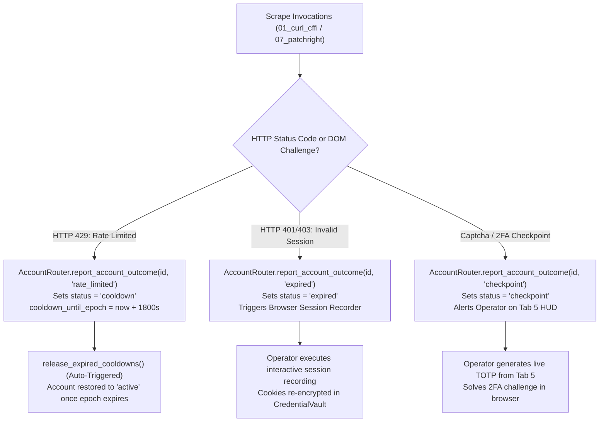

# Troubleshooting, Concurrency Resilience & Disaster Recovery Guide
**Project:** `Crawlers_testing` | **Status:** Formal Engineering Troubleshooting Specification | **Stage:** Completed (Full 6-Stage Web Scraping Testbed & Benchmarking Engine)

---

## 1. Windows File Locking & Concurrency Solutions

Windows filesystem semantics differ fundamentally from POSIX systems. File descriptors opened by one process lock the underlying filesystem inode (`ERROR_SHARING_VIOLATION`), preventing other threads from modifying or deleting the file. `Crawlers_testing` implements defensive measures across all subsystems to prevent lock contention.

### 1.1 Resolving `sqlite3.OperationalError: database is locked`

#### Root Cause
Occurs when a thread attempts to write to a SQLite database while another thread holds an exclusive write lock, or when readers on standard rollback journal mode block writers.

#### Permanent Mitigations
1. **Enforce WAL Mode:** All database initializers across `core/base_indexer.py`, `core/global_indexer.py`, and `core/credential_vault.py` mandate:
   ```sql
   PRAGMA journal_mode = WAL;
   PRAGMA synchronous = NORMAL;
   PRAGMA busy_timeout = 5000;
   ```
2. **Short Transaction Windows:** Wrap all write operations in context managers (`with conn:`) rather than holding long-lived transaction objects:
   ```python
   # Correct Pattern
   with self._get_connection() as conn:
       conn.execute("UPDATE vault_accounts SET status = ? WHERE account_id = ?", ("active", acc_id))
   ```
3. **Closing Hanging Locks:** If a crashed script left uncheckpointed WAL locks on Windows:
   ```powershell
   # Force checkpoint WAL journal files into the main database
   .\.venv\Scripts\python.exe -c "
   import sqlite3
   for db in ['vault_store/credentials_vault.sqlite', 'index_store/global_master_index.sqlite']:
       conn = sqlite3.connect(db)
       conn.execute('PRAGMA wal_checkpoint(TRUNCATE);')
       conn.close()
       print('WAL checkpointed:', db)
   "
   ```

### 1.2 Preventing Uvicorn / Watchdog File Watcher Storms

#### Root Cause
FastAPI's default development runner (`uvicorn --reload`) monitors all filesystem modifications under the root directory. When scrapers write 10,000 files to `data/` or append logs, Uvicorn reloads continuously.

#### Permanent Solution
Always scope Uvicorn reload to `backend/`:
```powershell
.\.venv\Scripts\python.exe -m uvicorn backend.app:app --host 127.0.0.1 --port 8000 --reload --reload-dir backend
```
In `backend/app.py`, the `watchdog` file handler explicitly filters events, only processing `.jsonl` modifications inside `logs/`.

---

## 2. Browser Automation & Anti-Bot Evasion Troubleshooting

Headless browsers require native binary engines and anti-fingerprinting assets.

### 2.1 Resolving Missing Browser Binaries

If Playwright or Patchright raises `Executable doesn't exist`:

```powershell
# Install Playwright Chromium, Firefox, WebKit binaries
.\.venv\Scripts\playwright.exe install chromium

# Install Patchright stealth browser binaries
.\.venv\Scripts\patchright.exe install chromium

# Fetch Camoufox anti-detect Firefox assets
.\.venv\Scripts\python.exe -m camoufox fetch
```

### 2.2 Cloudflare Turnstile, DataDome & Rate Limit Recovery

When scraping heavily protected platforms (LeetCode, Instagram, Cloudflare Turnstile pages), anti-bot systems periodically trigger challenges.



#### Manual Cooldown Release
To immediately clear all quarantined accounts for testing:
```powershell
.\.venv\Scripts\python.exe -c "
from core.account_router import get_account_router
router = get_account_router()
released = router.release_expired_cooldowns()
print(f'Released {released} accounts from cooldown quarantine.')
"
```

---

## 3. Credential & Encryption Recovery

### 3.1 What to Do if `.env` Is Missing or Corrupted

The `.env` file holds `VAULT_MASTER_KEY` and `VAULT_KDF_SALT`.

1. **Automatic Initialization:** If `.env` is accidentally deleted, `core/crypto_engine.py:ensure_master_key()` automatically provisions a new 256-bit URL-safe Base64 key and 128-bit salt upon first startup.
2. **Master Key Backup Recommendation:**
   ```powershell
   # Back up .env securely outside the Git repository
   Copy-Item .env C:\SecureBackups\Crawlers_testing_env_backup.env
   ```
3. **If Master Key is Lost:** Because AES-256-GCM is mathematically unbreakable, encrypted records in `vault_store/credentials_vault.sqlite` cannot be decrypted without the original master key. In this event, delete `vault_store/credentials_vault.sqlite` and re-import account credentials using `VaultImporter`.

### 3.2 Diagnosing `ValueError: Vault integrity check failed or tampered ciphertext`

#### Diagnostic Scenarios:
1. **Associated Data Mismatch:** You attempted to decrypt a credential using a different `account_id` than the one used during encryption. This is the **Row-Binding Security Mechanism** working correctly to block ciphertext swapping.
2. **Key Mismatch:** The `.env` file was regenerated or altered, but the database still contains tokens encrypted with the previous key.
3. **Data Truncation:** The token string was corrupted in transit (e.g., trailing Base64 characters stripped).

To verify cryptographic health across all vault records:
```powershell
.\.venv\Scripts\python.exe -c "
from core.credential_vault import get_credential_vault
vault = get_credential_vault()
accounts = vault.list_accounts_masked()['accounts']
print(f'Checking {len(accounts)} accounts...')
for a in accounts:
    try:
        dec = vault.get_account_decrypted(a['account_id'])
        print(f'  [OK] {a[\"account_id\"]}')
    except Exception as e:
        print(f'  [FAIL] {a[\"account_id\"]}: {e}')
"
```

---

## 4. Network & MITM Proxy Troubleshooting

Tool `15_mitmproxy_interceptor` requires local network permissions and TLS trust.

### 4.1 Resolving Port Conflicts (`mitmdump: Address already in use`)
If port `8080` (mitmproxy default) is occupied:
```powershell
# Identify process using port 8080 on Windows
Get-NetTCPConnection -LocalPort 8080 | Select-Object OwningProcess

# Terminate offending process (replace PID)
Stop-Process -Id <PID> -Force
```

### 4.2 Installing MITMProxy CA Certificate for HTTPS Decryption
When capturing encrypted HTTPS flows, the target client must trust the mitmproxy CA:
1. Run mitmproxy once: `mitmdump --listen-port 8080`
2. Certificate is generated at: `~/.mitmproxy/mitmproxy-ca-cert.cer`
3. On Windows: Double-click `mitmproxy-ca-cert.cer` -> Click **Install Certificate** -> Place in **Trusted Root Certification Authorities**.

---

## 5. Anti-Bot Chaos & Pydantic Contract Resilience Troubleshooting

### 5.1 Diagnosing Rate-Limit Backoffs (HTTP 429) & Cooldown Recovery
- **Symptom:** Scraper aborts with `HTTP 429 Too Many Requests` or target platform returns `Retry-After: N` header.
- **Automated Defensive Flow:**
  1. `core/human_timing.py` computes exponential backoff with full jitter:
     $$\text{delay} = \min(\text{max\_delay}, \text{base} \times 2^{\text{attempt}}) \times \text{Uniform}(1 - \text{jitter}, 1 + \text{jitter})$$
  2. `core/account_router.py` automatically flags the leased account as `cooldown_quarantined` and timestamps `cooldown_until_epoch = now + cooldown_sec`.
  3. Subsequent scraper runs bypass the quarantined account, selecting the next healthy account with lowest LRU lease count.
- **Manual Verification:** Inspect `vault_store/vault_stats_public.json` or frontend Tab 5 to confirm `cooldown_quarantined` accounts count. Trigger auto-release via `python -c "from core.account_router import get_account_router; print(get_account_router().release_expired_cooldowns())"`.

### 5.2 Handling Scrambled DOM Mutations via Semantic Fallback Selectors
- **Symptom:** Web scraper throws `IndexError: list index out of range` or CSS selector matches 0 elements following an upstream website redesign.
- **Heuristic Recovery Strategy:**
  1. **Semantic Relocation (`10_scrapling`):** Instead of fragile class names (`.css-1a2b3c`), configure anchors on immutable semantic attributes:
     - Form labels (`label[for="..."]`)
     - ARIA roles (`[role="main"]`, `[aria-label="..."]`)
     - Stable data attributes (`[data-cy="..."]`, `[data-testid="..."]`)
  2. **Multi-Tier Fallback Hierarchy:** In `core/cleaning_pipeline.py`, normalizers define cascading selector chains:
     ```python
     title = (
         tree.css("h1.problem-title::text").get()
         or tree.css("div[data-cy='question-title']::text").get()
         or tree.xpath("//h1/text()").get()
         or "Untitled"
     )
     ```
  3. Run the chaos mutation drill to test selector resilience:
     ```powershell
     python core/resilience_tester.py --scenario dom_mutation
     ```

### 5.3 Recovering from Socket Disconnects & Network Timeouts
- **Symptom:** `urllib.error.URLError: <urlopen error timed out>` or `ConnectionResetError: [WinError 10054] An existing connection was forcibly closed by the remote host`.
- **Mitigation Protocol:**
  1. **Strict Socket Timeout Guards:** Scrapers must explicitly configure connection and read timeouts ($< 15\text{s}$) to avoid indefinite process hangs:
     ```python
     response = client.get(url, timeout=httpx.Timeout(15.0, connect=5.0))
     ```
  2. **TCP Session Re-establishment:** When a TCP reset is caught, `HumanTimingEngine` applies a short randomized backoff before recycling the client session and rotating TLS JA4 cipher suites.
  3. Validate timeout recovery using the Chaos Stress Lab:
     ```powershell
     python core/resilience_tester.py --scenario network_chaos
     ```

### 5.4 Debugging Pydantic Contract Validation Rejections
- **Symptom:** Scraper execution fails with `pydantic_core.ValidationError: N validation errors for Cleaned...Contract`.
- **Root Cause & Diagnosis:**
  1. Inspect the missing or invalid field in the terminal traceback. Common mismatches include:
     - `CleanedMultimodalContract`: missing `source_image_or_pdf` or invalid `content_type` literal.
     - `CleanedCodeProblemContract`: `difficulty` must strictly be `"Easy"`, `"Medium"`, or `"Hard"`.
     - `CleanedSocialMediaContract`: `media_type` must be `"reel"`, `"post"`, or `"carousel"`.
  2. **Safe Fallback Normalizer:** `CleaningPipeline` provides normalization methods (`normalize_code_problem`, `normalize_social_post`) that automatically inject sensible default values for corrupted or incomplete raw responses, ensuring data lake Silver-tier integrity without unhandled crashes.
  3. Run the contract fuzzing drill to verify schema safety:
     ```powershell
     python core/resilience_tester.py --scenario contract_fuzzing
     ```
