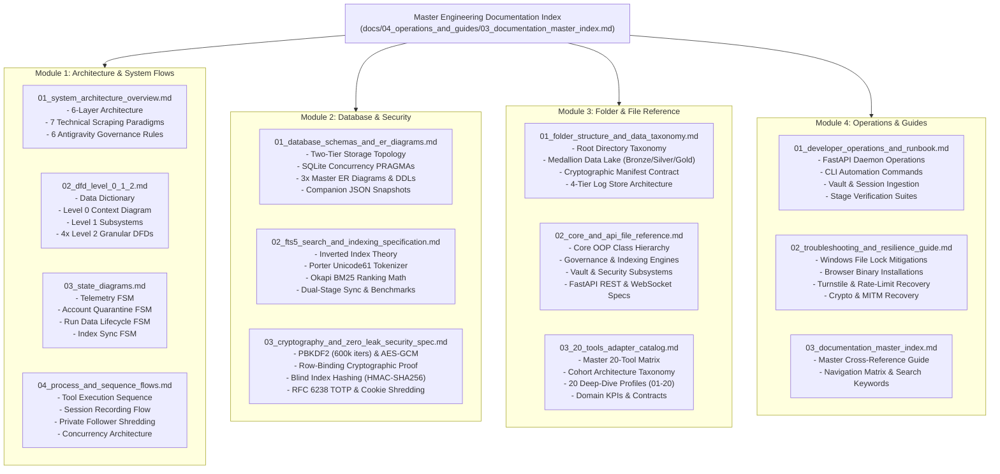

# Master Engineering Documentation Index & Knowledge Map
**Project:** `Crawlers_testing` | **Status:** Master Knowledge Index | **Stage:** Stage 3 Active

---

## 1. Documentation Ecosystem Overview

The `Crawlers_testing` engineering specification is organized into four interconnected modules comprising 13 exhaustive technical references, complete data flow diagrams, relational database schemas, cryptographic proofs, and operational runbooks.

### 1.1 Documentation Graph (Mermaid)



---

## 2. Complete Cross-Referenced Directory Catalog

### 2.1 Module 1: Architecture & System Flows (`docs/01_architecture_and_flows/`)

```
+======================================================================================================================================+
| DOCUMENT                                | PRIMARY TOPICS COVERED                                    | KEY MERMAID VISUALS            |
+-----------------------------------------+-----------------------------------------------------------+--------------------------------+
| 01_system_architecture_overview.md      | 6-Layer Architecture, 7 Scraping Paradigms, Governance    | flowchart TB (6 Layers)        |
| 02_dfd_level_0_1_2.md                   | Data Dictionary, Level 0 Context, Level 1, 4x Level 2 DFDs| flowchart LR/TB (DFD 0, 1, 2)  |
| 03_state_diagrams.md                    | Telemetry HUD, Account Quarantine, Run Lifecycle, Sync    | stateDiagram-v2 (4 Machines)   |
| 04_process_and_sequence_flows.md        | Tool Run Lifecycle, Session Recording, Cookie Shredding   | sequenceDiagram (4 Flows)      |
+======================================================================================================================================+
```

1. **[01_system_architecture_overview.md](file:///d:/Project_Files/Crawlers_testing/docs/01_architecture_and_flows/01_system_architecture_overview.md):**
   The foundational system design document. Explains the decoupled multi-layer blueprint, the theoretical mechanics of all 7 scraping paradigms (TLS/JA4 impersonation, C-engine parsing, stealth Chromium/Firefox, adaptive AI DOM healing, stream demuxing, wire MITM, and multimodal AI), and the 6 Antigravity Governance rules.
2. **[02_dfd_level_0_1_2.md](file:///d:/Project_Files/Crawlers_testing/docs/01_architecture_and_flows/02_dfd_level_0_1_2.md):**
   Full data flow specification modeling how data transitions between human users, AI agents, external websites, processes (P1–P6), and storage tiers (D1–D6).
3. **[03_state_diagrams.md](file:///d:/Project_Files/Crawlers_testing/docs/01_architecture_and_flows/03_state_diagrams.md):**
   Mathematical state machine specifications ($M = (S, \Sigma, \delta, s_0, F)$) governing task progress in `live_state.json`, account statuses in `vault_accounts`, run manifest transitions, and FTS5 search index synchronization.
4. **[04_process_and_sequence_flows.md](file:///d:/Project_Files/Crawlers_testing/docs/01_architecture_and_flows/04_process_and_sequence_flows.md):**
   Chronological sequence diagrams detailing tool execution, interactive browser session recording, private target follower routing, and background Windows concurrency safety.

---

### 2.2 Module 2: Database & Security (`docs/02_database_and_security/`)

```
+======================================================================================================================================+
| DOCUMENT                                | PRIMARY TOPICS COVERED                                    | KEY MERMAID VISUALS            |
+-----------------------------------------+-----------------------------------------------------------+--------------------------------+
| 01_database_schemas_and_er_diagrams.md  | Two-Tier Topology, PRAGMAs, Master/Tool/Vault Schemas     | erDiagram (3 Databases)        |
| 02_fts5_search_and_indexing_specification.md| Inverted Index, Unicode61 Tokenizer, BM25 Math, Benchmarks| flowchart TD (Dual-Stage Sync) |
| 03_cryptography_and_zero_leak_security_spec.md| PBKDF2 (600k), AES-GCM Row-Binding Proof, TOTP, Shredding| flowchart TD (GCM Architecture)|
+======================================================================================================================================+
```

1. **[01_database_schemas_and_er_diagrams.md](file:///d:/Project_Files/Crawlers_testing/docs/02_database_and_security/01_database_schemas_and_er_diagrams.md):**
   Complete schema definitions and ERDs for `global_master_index.sqlite`, the 20 isolated `<tool_id>.sqlite` databases, and `vault_store/credentials_vault.sqlite`. Includes concurrency pragmas (WAL mode, `busy_timeout = 5000`) and companion JSON specifications.
2. **[02_fts5_search_and_indexing_specification.md](file:///d:/Project_Files/Crawlers_testing/docs/02_database_and_security/02_fts5_search_and_indexing_specification.md):**
   Detailed specification of the SQLite FTS5 search engine, Porter stemming, Unicode 6.1 code-point tokenization, Okapi BM25 relevance ranking math, column weights, and UI highlight snippets.
3. **[03_cryptography_and_zero_leak_security_spec.md](file:///d:/Project_Files/Crawlers_testing/docs/02_database_and_security/03_cryptography_and_zero_leak_security_spec.md):**
   Rigorous security treatise containing the mathematical formulation of PBKDF2 (600,000 iterations), AES-256-GCM token serialization, formal cryptographic proof of row-binding via Associated Data (AD), blind index hashing, RFC 6238 TOTP computation, and the Git Pre-Commit Secret Guard scanner.

---

### 2.3 Module 3: Folder & File Reference (`docs/03_folder_and_file_reference/`)

```
+======================================================================================================================================+
| DOCUMENT                                | PRIMARY TOPICS COVERED                                    | KEY MERMAID VISUALS            |
+-----------------------------------------+-----------------------------------------------------------+--------------------------------+
| 01_folder_structure_and_data_taxonomy.md| Root Tree, Medallion Data Lake, Manifests, Log Store      | flowchart TD (Medallion Flow)  |
| 02_core_and_api_file_reference.md       | Code Reference: Core Modules, FastAPI Endpoints, Frontend | classDiagram (OOP Hierarchy)   |
| 03_20_tools_adapter_catalog.md          | 20-Row Matrix, Cohort Diagram, 20 Deep-Dive Profiles      | flowchart TB (20 Tool Cohorts) |
+======================================================================================================================================+
```

1. **[01_folder_structure_and_data_taxonomy.md](file:///d:/Project_Files/Crawlers_testing/docs/03_folder_and_file_reference/01_folder_structure_and_data_taxonomy.md):**
   Filesystem blueprint defining the Medallion Data Lake tiers (Bronze raw captures, Silver normalized outputs, Gold search indexes), the `run_manifest.json` contract, and 4-tier log store paths.
2. **[02_core_and_api_file_reference.md](file:///d:/Project_Files/Crawlers_testing/docs/03_folder_and_file_reference/02_core_and_api_file_reference.md):**
   Exhaustive technical reference covering every class and method in `core/` (`FolderManager`, `StateTracker`, `LogEngine`, `GitManager`, `BaseToolIndexer`, `GlobalMasterIndexer`, `CryptoEngine`, `CredentialVault`, `TOTPHelper`, `VaultImporter`, `AccountRouter`, `BrowserSessionRecorder`, `AuthInjector`), FastAPI REST endpoints, and frontend controllers.
3. **[03_20_tools_adapter_catalog.md](file:///d:/Project_Files/Crawlers_testing/docs/03_folder_and_file_reference/03_20_tools_adapter_catalog.md):**
   Comprehensive catalog profiling all 20 crawling tools across Batches 1 to 4, covering theoretical mechanisms, adapter implementations, artifact contracts, domain KPIs, and auth bundle compatibility.

---

### 2.4 Module 4: Operations & Guides (`docs/04_operations_and_guides/`)

```
+======================================================================================================================================+
| DOCUMENT                                | PRIMARY TOPICS COVERED                                    | KEY MERMAID VISUALS            |
+-----------------------------------------+-----------------------------------------------------------+--------------------------------+
| 01_developer_operations_and_runbook.md  | Uvicorn Startup, CLI Adapters, Vault Ingestion, Test Suites| None (Code Blocks & Tables)   |
| 02_troubleshooting_and_resilience_guide.md| Windows File Locks, Browser Binaries, Turnstile Recovery| flowchart TD (Recovery Flow)   |
| 03_documentation_master_index.md        | Complete Cross-Referenced Index & Knowledge Graph         | flowchart TD (Doc Architecture)|
+======================================================================================================================================+
```

1. **[01_developer_operations_and_runbook.md](file:///d:/Project_Files/Crawlers_testing/docs/04_operations_and_guides/01_developer_operations_and_runbook.md):**
   Step-by-step instructions for launching servers safely, managing worker PIDs via `psutil`, executing crawler adapters from the CLI, performing bulk credential imports, generating live TOTP codes, and running regression suites.
2. **[02_troubleshooting_and_resilience_guide.md](file:///d:/Project_Files/Crawlers_testing/docs/04_operations_and_guides/02_troubleshooting_and_resilience_guide.md):**
   Diagnostic runbook detailing solutions for Windows SQLite file locks, Uvicorn file watcher storms, browser binary installations, Cloudflare Turnstile rate limits, and cryptographic key recovery.
3. **[03_documentation_master_index.md](file:///d:/Project_Files/Crawlers_testing/docs/04_operations_and_guides/03_documentation_master_index.md):**
   This master navigation hub and cross-reference catalog.
