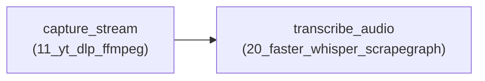

# 🔗 Precision Pipeline Chaining Report: `pipeline_run_20261018_185209_5f06fdc5`

- **Pipeline ID:** `stream_whisper_chain`
- **Label:** Stage 4 Step 4.5 Test: Media Demux to Whisper Transcription
- **Target URL:** `https://www.instagram.com/reel/C8XYZ12345/`
- **Execution Status:** **✅ COMPLETED**
- **Total Pipeline Latency:** `5.926s`
- **Execution Mode:** `human_mode=False` (`BALANCED_HUMAN`)
- **Total Stages:** 2

---

## 1. Pipeline Stage Handoff Architecture

---

## 2. Stage-by-Stage Execution Breakdown

| # | Stage ID | Tool ID | Action Name | Duration | Status | Artifacts Ingested | Deliverables |
|:---:|:---|:---|:---|:---:|:---:|:---|:---:|
| 1 | `capture_stream` | `11_yt_dlp_ffmpeg` | `stream_capture` | 2.671s | `completed` | *(Initial Input)* | 10 files |
| 2 | `transcribe_audio` | `20_faster_whisper_scrapegraph` | `audio_transcribe` | 3.244s | `completed` | `extracted_audio.wav` | 5 files |

---

## 3. Consolidated End-to-End Deliverables

| # | Artifact Name | Producing Stage | Producing Tool | Size | Workspace Relative Path |
|:---:|:---|:---|:---|:---:|:---|
| 1 | `caption_and_stats.md` | `capture_stream` | `11_yt_dlp_ffmpeg` | 1.2 KB | `data\11_yt_dlp_ffmpeg\stream_capture\2026-10-18\run_185210_644238b4\cleaned\caption_and_stats.md` |
| 2 | `combined_video.mp4` | `capture_stream` | `11_yt_dlp_ffmpeg` | 51.7 KB | `data\11_yt_dlp_ffmpeg\stream_capture\2026-10-18\run_185210_644238b4\cleaned\combined_video.mp4` |
| 3 | `extracted_audio.mp3` | `capture_stream` | `11_yt_dlp_ffmpeg` | 73.0 KB | `data\11_yt_dlp_ffmpeg\stream_capture\2026-10-18\run_185210_644238b4\cleaned\extracted_audio.mp3` |
| 4 | `extracted_audio.wav` | `capture_stream` | `11_yt_dlp_ffmpeg` | 95.1 KB | `data\11_yt_dlp_ffmpeg\stream_capture\2026-10-18\run_185210_644238b4\cleaned\extracted_audio.wav` |
| 5 | `media_analysis.json` | `capture_stream` | `11_yt_dlp_ffmpeg` | 1.7 KB | `data\11_yt_dlp_ffmpeg\stream_capture\2026-10-18\run_185210_644238b4\cleaned\media_analysis.json` |
| 6 | `knowledge_graph.json` | `transcribe_audio` | `20_faster_whisper_scrapegraph` | 2.4 KB | `data\20_faster_whisper_scrapegraph\audio_transcribe\2026-10-18\run_185214_ed24522d\cleaned\knowledge_graph.json` |
| 7 | `multimodal_summary.md` | `transcribe_audio` | `20_faster_whisper_scrapegraph` | 2.0 KB | `data\20_faster_whisper_scrapegraph\audio_transcribe\2026-10-18\run_185214_ed24522d\cleaned\multimodal_summary.md` |
| 8 | `transcript.srt` | `transcribe_audio` | `20_faster_whisper_scrapegraph` | 0.2 KB | `data\20_faster_whisper_scrapegraph\audio_transcribe\2026-10-18\run_185214_ed24522d\cleaned\transcript.srt` |
| 9 | `transcript_segments.json` | `transcribe_audio` | `20_faster_whisper_scrapegraph` | 0.6 KB | `data\20_faster_whisper_scrapegraph\audio_transcribe\2026-10-18\run_185214_ed24522d\cleaned\transcript_segments.json` |

---

*Report automatically generated by Antigravity PrecisionTaskRouter (Stage 4 / Step 4.5). Auto-indexed into GlobalMasterIndexer.*
