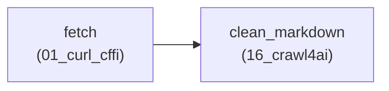

# 🔗 Precision Pipeline Chaining Report: `pipeline_run_20261019_061227_f6a3b016`

- **Pipeline ID:** `graphql_markdown_chain`
- **Label:** Two-Stage GraphQL Fetch to LLM-Ready Markdown Chunker
- **Target URL:** `https://quotes.toscrape.com`
- **Execution Status:** **✅ COMPLETED**
- **Total Pipeline Latency:** `2.608s`
- **Execution Mode:** `human_mode=True` (`FAST_AUTOMATED`)
- **Total Stages:** 2

---

## 1. Pipeline Stage Handoff Architecture

---

## 2. Stage-by-Stage Execution Breakdown

| # | Stage ID | Tool ID | Action Name | Duration | Status | Artifacts Ingested | Deliverables |
|:---:|:---|:---|:---|:---:|:---:|:---|:---:|
| 1 | `fetch` | `01_curl_cffi` | `scrape_for_leetcode` | 1.419s | `completed` | *(Initial Input)* | 5 files |
| 2 | `clean_markdown` | `16_crawl4ai` | `markdown_harvest` | 1.18s | `completed` | `graphql_payload.json`, `two_sum.md` | 5 files |

---

## 3. Consolidated End-to-End Deliverables

| # | Artifact Name | Producing Stage | Producing Tool | Size | Workspace Relative Path |
|:---:|:---|:---|:---|:---:|:---|
| 1 | `catalog_index.json` | `fetch` | `01_curl_cffi` | 1.4 KB | `data\01_curl_cffi\scrape_for_leetcode\2026-10-19\run_061227_9d27871e\cleaned\catalog_index.json` |
| 2 | `two_sum.md` | `fetch` | `01_curl_cffi` | 1.0 KB | `data\01_curl_cffi\scrape_for_leetcode\2026-10-19\run_061227_9d27871e\cleaned\two_sum.md` |
| 3 | `llm_ready.md` | `clean_markdown` | `16_crawl4ai` | 4.7 KB | `data\16_crawl4ai\markdown_harvest\2026-10-19\run_061229_39df4e35\cleaned\llm_ready.md` |
| 4 | `media_and_links.json` | `clean_markdown` | `16_crawl4ai` | 0.1 KB | `data\16_crawl4ai\markdown_harvest\2026-10-19\run_061229_39df4e35\cleaned\media_and_links.json` |
| 5 | `semantic_chunks.json` | `clean_markdown` | `16_crawl4ai` | 5.5 KB | `data\16_crawl4ai\markdown_harvest\2026-10-19\run_061229_39df4e35\cleaned\semantic_chunks.json` |

---

*Report automatically generated by Antigravity PrecisionTaskRouter (Stage 4 / Step 4.5). Auto-indexed into GlobalMasterIndexer.*
